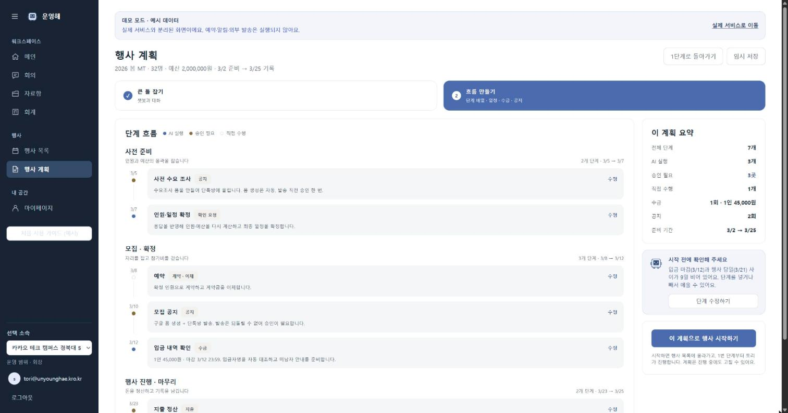
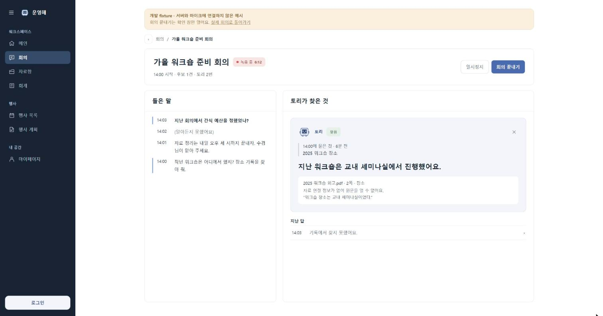
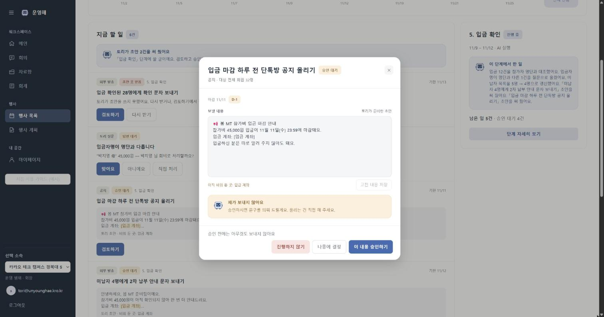
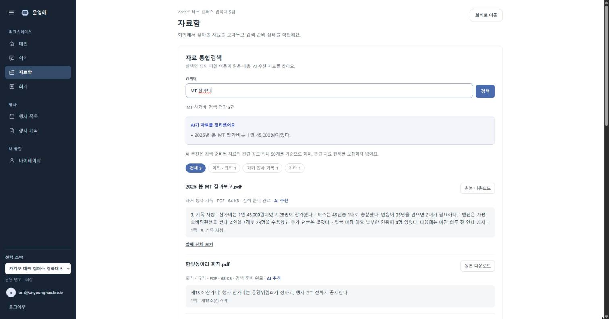
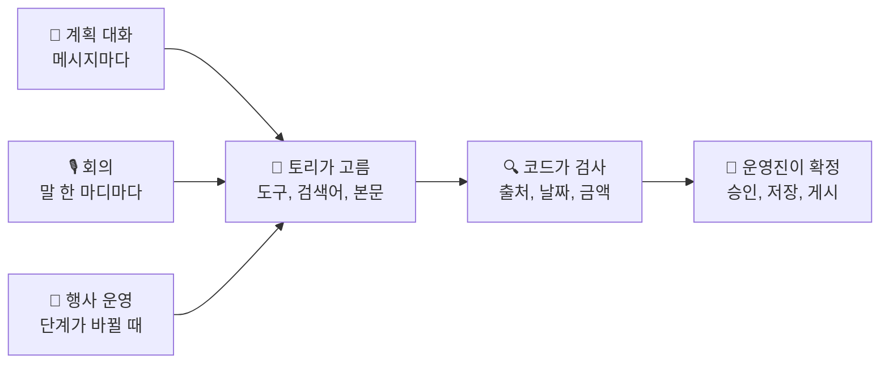
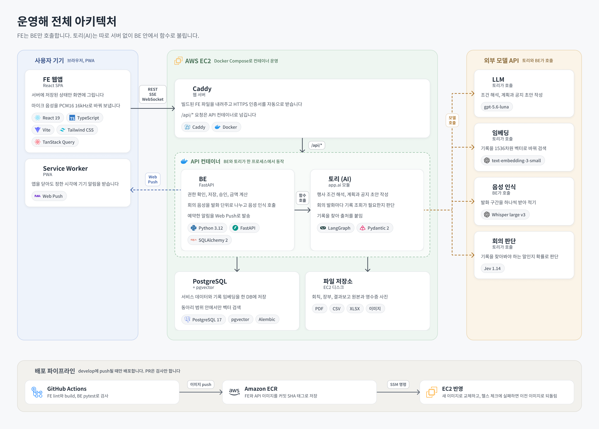
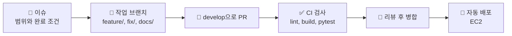

<div align="center">


# 운영해

### 🎓 동아리 운영진의 행사 계획과 운영을 돕는 AI 서비스

> **"토리는 제안하고, 운영진이 확정합니다."**<br/>
> 계획 초안, 회의 중 기록 찾기, 공지 초안까지 AI 도우미 토리가 먼저 준비하고<br/>
> 확인과 결정은 운영진이 합니다.

[](https://unyounghae.kro.kr)
[](https://unyounghae.kro.kr)
[](#토리가-하는-일)

카카오 테크 캠퍼스 4기 경북대 5팀, 2026.08 ~ 2026.11

</div>

<!--
🎬 소개 영상 자리
GitHub에서 README를 편집할 때 영상 파일(mp4, 100MB 이하)을 이 주석 아래 빈 줄에 끌어다 놓으면
https://github.com/user-attachments/assets/... 주소가 생깁니다. 그 주소만 한 줄로 두면 플레이어로 보입니다.
영상을 넣은 뒤에는 이 주석을 지워도 됩니다.
-->

---

### 💡 왜 운영해인가?

동아리 운영진은 행사 하나를 치르면서 계획을 짜고, 회의를 하고, 공지를 쓰고, 영수증을 모읍니다.
그러다 보면 "작년엔 어떻게 했더라?"를 확인하려고 지난 장부와 결과보고를 뒤지는 일이 자주 생깁니다.

운영해에서는 회의 중에 이런 말이 나오면 토리가 기록을 찾아 출처와 함께 보여 줍니다.

> 🙋 "작년 MT 때 숙소비 얼마 나왔지?"<br/>
> 🤖 **550,000원** (2025 봄 MT 결과보고, 2쪽, 2. 예산)

| 핵심 가치 | 어떻게 지키나 |
| --- | --- |
| **제안과 확정을 나눔** | 토리는 초안까지만 씁니다. 승인, 저장, 게시, 이체는 운영진이 하고 금액 계산은 코드가 합니다 |
| **근거 없는 말을 하지 않음** | 기록에서 찾은 답에는 파일과 원문 위치를 붙입니다. 기록에 없으면 없다고 말합니다 |
| **실패를 덮지 않음** | 처리에 실패하면 빈 결과나 예시 데이터로 대신하지 않고, 못 한 일과 다시 시도할 방법을 보여 줍니다 |

---

## 목차

<table>
<tr>
<td width="50%" valign="top">

### 📋 서비스 소개

- [주요 기능](#주요-기능)
- [토리가 하는 일](#토리가-하는-일)
- [전체 아키텍처](#전체-아키텍처)
- [기술 스택](#기술-스택)

</td>
<td width="50%" valign="top">

### 🤝 개발 안내

- [파트별 문서](#파트별-문서)
- [시작하기](#시작하기)
- [저장소 구조](#저장소-구조)
- [협업 방식](#협업-방식)
- [팀원](#팀원)

</td>
</tr>
</table>

---

## 주요 기능

행사는 **계획 → 운영 → 종료** 순서로 진행됩니다. 단계마다 토리가 먼저 준비하고 운영진이 확인합니다.

<table>
<tr>
<td width="50%" valign="top">

#### 💬 1. 행사 계획



토리와 대화하면 행사 이름, 인원, 참가비, 일정 같은 조건이 채워집니다.
조건이 모이면 13개 단계 중에서 골라 일정과 할 일까지 담은 계획 초안을 만듭니다.

</td>
<td width="50%" valign="top">

#### 🎙️ 2. 회의



회의 음성을 받아 적다가 기록을 찾아봐야 하는 말이 나올 때만 근거 카드를 띄웁니다.
회의가 끝나면 회의록과 일정, 할 일 후보를 정리합니다.

</td>
</tr>
<tr>
<td width="50%" valign="top">

#### 📌 3. 행사 운영



다음 단계가 시작되면 공지와 발송 문구 초안을 미리 써 둡니다.
승인해도 앱이 대신 보내지 않고, 운영진이 직접 게시한 뒤 완료를 표시합니다.

</td>
<td width="50%" valign="top">

#### 📚 4. 자료함과 회계



회칙, 장부, 결과보고를 올리면 검색할 수 있게 정리되어 토리 답의 근거가 됩니다.
영수증 사진은 지출 초안이 되고, 확인한 뒤에만 장부에 들어갑니다.

</td>
</tr>
</table>

이 밖에 메인 화면에서 확인할 일을 모아 보여 주고, 확정한 시각에 기기 알림(Web Push)을 보냅니다.

> 화면별 구현은 [FE README](fe/README.md#주요-기능), 토리의 판단 방식은 [AI README](be/app/ai/README.md#주요-기능)에 있습니다.

---

## 토리가 하는 일

토리는 정해진 순서대로 움직이는 챗봇이 아니라, 상황에 맞춰 필요한 도구와 검색어를 스스로 고르는 Agent입니다.
다만 토리가 낸 결과는 코드가 한 번 더 검사하고, 마지막 확정은 운영진이 합니다.



| 언제 | 토리가 하는 일 | 확정 전에 거치는 것 |
| --- | --- | --- |
| **계획 대화** | 조건을 해석하고, 필요하면 과거 기록을 찾고, 계획 초안을 씁니다 | 코드가 근거와 계획을 검사하고, 운영진이 고친 뒤 확정합니다 |
| **회의** | 기록을 찾아봐야 하는 말인지 판단하고 근거 카드를 만듭니다 | 코드가 출처와 숫자를 검사하고, 운영진이 카드를 쓸지 정합니다 |
| **행사 운영** | 단계가 바뀌면 공지와 발송 문구 초안을 씁니다 | 코드가 날짜와 금액을 대조하고, 운영진이 승인한 뒤 직접 게시합니다 |

> 판단마다 실제로 오간 값과 측정해서 내린 결정은 [AI 기술 문서](be/app/ai/docs/technical-overview.md)에 있습니다.

---

## 전체 아키텍처

FE는 BE만 호출합니다. 토리(AI)는 따로 서버를 두지 않고 BE 프로세스 안에서 함수로 불립니다.
서비스 전체는 EC2 한 대에서 Docker Compose로 돌아가고, 모델은 외부 API로 호출합니다.

<p align="center">
  
</p>

기능마다 통신 방식을 다르게 골랐습니다. 계획 대화는 처리 과정을 보여 주려고 **SSE**로, 회의 음성은 끊김 없이 보내려고 **WebSocket**으로, 나머지는 **REST**로 주고받습니다.

`develop`에 push하면 GitHub Actions가 FE와 BE를 검사하고, 이미지를 ECR에 올린 뒤 SSM으로 EC2에 반영합니다. 자세한 절차는 [배포 문서](deploy/README.md)에 있습니다.

---

## 기술 스택

| 파트 | 기술 |
| --- | --- |
| **FE** |        |
| **BE** |        |
| **AI** |        |
| **인프라** |      |

> 기술마다 고른 이유는 [FE README](fe/README.md#기술-스택), [AI README](be/app/ai/README.md#기술-스택)에 있습니다.

---

## 파트별 문서

파트마다 README와 문서를 따로 둡니다. 처음이라면 README로 전체를 보고, 구현이 궁금하면 기술 문서를 읽으면 됩니다.

<table>
<tr>
<td width="33%" valign="top">

### 🖥️ FE

화면, 음성 전송, 알림

**[📘 FE README](fe/README.md)**<br/>
주요 기능과 화면, 실행 방법

**[🧩 FE 기술 문서](fe/docs/technical-overview.md)**<br/>
구조, 기능별 구현, 기술 결정

[🔗 자료함 연동](fe/docs/records-integration.md)<br/>
[🔔 회의 알림 계약](fe/docs/meeting-push-contract.md)

</td>
<td width="33%" valign="top">

### ⚙️ BE

API, 저장, 권한, 음성 처리

**[📗 BE README](be/README.md)**<br/>
폴더 구조, 데이터 모델, 실행 방법

**[📑 API Reference](be/docs/api-reference.md)**<br/>
도메인별 엔드포인트와 권한

[🎙️ 회의 음성 WS 계약](be/docs/meeting-audio.md)<br/>
[📌 행사 운영 API](be/docs/event-operations.md)<br/>
[🔎 자료함 검색](be/docs/record-search.md)

</td>
<td width="33%" valign="top">

### 🤖 AI

토리의 판단, 검색, 초안 작성

**[📙 AI README](be/app/ai/README.md)**<br/>
토리가 하는 일과 숫자로 내린 결정

**[🧠 AI 기술 문서](be/app/ai/docs/technical-overview.md)**<br/>
판단 과정, 기능별 구현, 측정 근거

[📄 요구사항](be/app/ai/docs/requirements.md)<br/>
[🏗 구조와 책임 경계](be/app/ai/docs/architecture.md)<br/>
[🔗 BE와 AI 데이터 계약](be/app/ai/docs/contracts.md)

</td>
</tr>
</table>

| 공통 문서 | 내용 |
| --- | --- |
| 🚀 [배포 절차](deploy/README.md) | EC2 배포 준비, 첫 배포, 디스크 정리, 운영자 확인 사항 |
| ✅ [베타 운영 체크리스트](docs/beta/OPERATIONS.md) | 자료 업로드부터 회의, 할 일 저장까지 직접 확인하는 순서 |

---

## 시작하기

Docker만 있으면 저장소 루트에서 FE, BE, PostgreSQL을 한 번에 띄울 수 있습니다.

### 1. 환경변수 준비

```bash
cp be/.env.example be/.env
```

DB 주소는 `compose.yml`이 넣어 주므로 따로 적지 않아도 됩니다. 아래 값은 쓰려는 기능에 맞춰 채웁니다.
비워 두어도 서버는 뜨고, 그 값을 쓰는 기능만 동작하지 않습니다.

| 기능 | 채울 값 |
| --- | --- |
| 토리 대화, 계획, 공지 초안 | `AI_API_BASE_URL`, `AI_API_KEY`, `AI_MODEL` |
| 자료 검색 | `AI_EMBEDDING_BASE_URL`, `AI_EMBEDDING_API_KEY`, `AI_EMBEDDING_MODEL` |
| 회의 음성 인식 | `STT_URL`, `STT_API_KEY` |
| 회의 중 판단 | `JEV_BASE_URL`, `JEV_API_KEY` |
| 카카오 로그인 | `KAKAO_REST_API_KEY`, `KAKAO_REDIRECT_URI` |
| 기기 알림 | `WEB_PUSH_VAPID_PUBLIC_KEY`, `WEB_PUSH_VAPID_PRIVATE_KEY`, `WEB_PUSH_VAPID_SUBJECT` |

> 값마다 자세한 설명은 [`be/.env.example`](be/.env.example)에 있습니다. 실제 값이 든 `.env`는 커밋하지 않습니다.

### 2. 실행

```bash
docker compose up

# 처음 한 번, 다른 터미널에서 DB 테이블 만들기
docker compose exec api uv run --no-sync alembic upgrade head
```

| 주소 | 내용 |
| --- | --- |
| http://localhost:5173 | FE (Vite 개발 서버) |
| http://localhost:8000/docs | BE Swagger |
| `localhost:5432` | PostgreSQL + pgvector (계정과 DB 이름 모두 `unyounghae`) |

`/signup`에서 가입하고 동아리를 만들면 바로 쓸 수 있습니다.

> [!NOTE]
> - 첫 실행은 이미지 빌드와 `npm ci` 때문에 몇 분 걸립니다.
> - `be/app`, `fe/src`를 고치면 다시 빌드하지 않아도 바로 반영됩니다. 의존성(`be/pyproject.toml`, `fe/package.json`)을 바꿨을 때만 `docker compose up --build`로 다시 빌드합니다.
> - 마이크와 기기 알림은 `localhost`나 HTTPS에서만 동작합니다.
> - 서버 없이 화면만 보려면 `?demo`나 `/onboarding`을 씁니다. 방법은 [FE README](fe/README.md#서버-없이-화면만-보기)에 있습니다.

<details>
<summary><b>Docker 없이 각각 띄우기, 테스트</b></summary>

<br/>

Python 3.12와 uv, Node 22가 필요합니다. DB는 `docker compose up -d db`로 PostgreSQL만 띄워서 씁니다.

```bash
# BE (http://localhost:8000)
cd be
uv sync --locked
uv run alembic upgrade head
uv run uvicorn app.main:app --reload

# FE (http://localhost:5173)
cd fe
npm ci
cp .env.example .env
npm run dev
```

```bash
# BE와 AI 테스트. 테스트 DB(unyounghae_test)가 없으면 DB 테스트만 건너뜀
cd be && uv run pytest

# FE 검사와 빌드
cd fe && npm run lint && npm run build
```

자세한 내용은 [BE README](be/README.md#개발-환경-설치)와 [FE README](fe/README.md#시작하기)를 봅니다.

</details>

---

## 저장소 구조

```text
.
├── fe/                  # FE: React SPA
│   ├── src/             # app, pages, features, shared, styles
│   ├── public/          # PWA 설정, Service Worker, 음성 처리 worklet
│   └── docs/            # FE 기술 문서와 연동 문서
├── be/                  # BE: FastAPI
│   ├── app/
│   │   ├── routers/     # API 엔드포인트
│   │   ├── services/    # 업무 규칙과 금액 계산
│   │   ├── models/      # DB 모델
│   │   └── ai/          # 토리(AI) 모듈. README와 기술 문서가 따로 있음
│   ├── alembic/         # DB 마이그레이션
│   ├── tests/           # BE 테스트
│   └── docs/            # API Reference와 기능별 문서
├── deploy/              # EC2 배포용 compose와 스크립트
├── docs/                # 공통 문서, README 그림, 주차별 산출물
├── prototype/           # 초기 화면 프로토타입
├── .github/             # CI와 배포 워크플로, 이슈와 PR 템플릿
├── compose.yml          # 로컬 개발용 (FE, BE, PostgreSQL)
└── PRODUCT.md           # 제품 정의: 사용자, 목적, 지키는 원칙
```

---

## 협업 방식



| 항목 | 규칙 |
| --- | --- |
| **브랜치** | 기본 브랜치는 `develop`입니다. 작업은 `feature/<이슈 번호>-설명`처럼 따로 만든 브랜치에서 하고, `main`은 멘토 리뷰용입니다 |
| **이슈** | 이슈 1개가 PR 1개가 되도록 나눕니다. 템플릿에 무엇을, 작업 범위, 완료 조건을 적고 `area:`, `type:` 라벨을 붙입니다 |
| **커밋** | `접두어: 한국어 설명` 형식입니다. 예: `Feat: 행사 조건 변경을 대화에 반영` |
| **PR** | 템플릿에 이번에 한 일, 리뷰에서 봐 줬으면 하는 곳, 고민한 선택지를 적습니다 |
| **CI와 배포** | `develop`을 향한 PR마다 FE lint와 build, BE pytest를 돌립니다. `develop`에 병합되면 이미지를 만들어 EC2에 배포합니다 |

<details>
<summary><b>커밋 접두어</b></summary>

<br/>

| 접두어 | 용도 |
| --- | --- |
| `Feat:` | 새로운 기능 |
| `Fix:` | 버그 수정 |
| `Docs:` | 문서 수정 |
| `Style:` | 동작과 상관없는 화면, 코드 모양 수정 |
| `Refactor:` | 동작을 유지하는 코드 개선 |
| `Test:` | 테스트 추가와 수정 |
| `Chore:` | 빌드, 패키지, 설정 |
| `Remove:` | 코드와 파일 제거 |

</details>

> 파트별 규칙은 [FE 개발 규칙](fe/README.md#개발-규칙)과 [AI 작업 규칙](be/app/ai/AGENTS.md)에 있습니다.

---

## 팀원

<table align="center">
<tr>
<td align="center" width="33%">
<a href="https://github.com/junhyung-dev">
<br/>
<sub><b>junhyung-dev</b></sub>
</a><br/>
<sub>🤖 AI</sub>
</td>
<td align="center" width="33%">
<a href="https://github.com/yoon-0409">
<br/>
<sub><b>yoon-0409</b></sub>
</a><br/>
<sub>🤖 AI</sub>
</td>
<td align="center" width="33%">
<a href="https://github.com/Kimtaekhyun">
<br/>
<sub><b>Kimtaekhyun</b></sub>
</a><br/>
<sub>⚙️ BE, 🤖 AI</sub>
</td>
</tr>
<tr>
<td align="center" width="33%">
<a href="https://github.com/Widadada">
<br/>
<sub><b>Widadada</b></sub>
</a><br/>
<sub>⚙️ BE</sub>
</td>
<td align="center" width="33%">
<a href="https://github.com/kixmeo">
<br/>
<sub><b>kixmeo</b></sub>
</a><br/>
<sub>🖥️ FE</sub>
</td>
<td align="center" width="33%">
<a href="https://github.com/suder0213">
<br/>
<sub><b>suder0213</b></sub>
</a><br/>
<sub>🖥️ FE</sub>
</td>
</tr>
</table>
