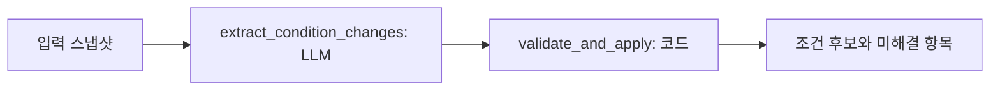
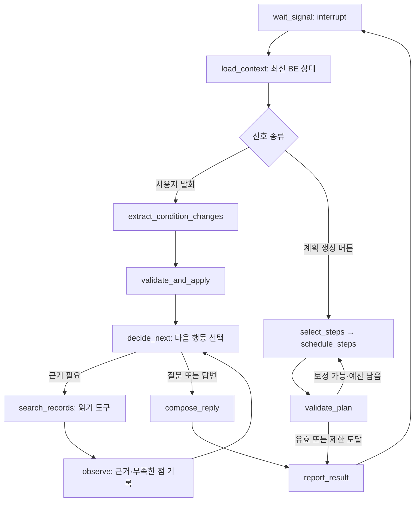

# 행사계획 설계 초안

> 상태: 설계 초안 / 작업 1 내부 구현, 2026-10-22. 작업 순서는 합의한 출발점이며 세부 명칭·스키마·노드 분리는 구현과 측정 과정에서 바뀔 수 있다. BE·FE 공동 계약은 아직 합의되지 않았다. 이 문서의 타입은 현재 공개 API가 아니다.

작업 1의 내부 조건 타입과 값 검증을 구현했다. 아래 작업 2 이후 명세와 실행 흐름은 구현 예정인 설계 초안이다.

## 범위와 문서 관계

흐름을 먼저 이해하려면 [행사계획 코드 따라가기](planning-walkthrough.md)의 입력 → 코드 → 출력 예시를 읽는다. 이 문서는 세부 설계와 제약을 다룬다.

P1 큰 틀 잡기 → P2 흐름 만들기 → 단계 편집 → 저장·복원 → 행사 시작까지 설계한다. Discord, 회의 어시스턴트, 행사 시작 이후 operations 구현은 제외한다.

- 사용자 경험과 요구사항 ID: [requirements.md](requirements.md)의 AI-PLAN-01~09.
- 행사별 Agent 수명과 BE 책임: [architecture.md](architecture.md). 이 문서는 planning 내부 설계를 구체화한다.
- 현재 구현된 타입: [contracts.py](../contracts.py), 공개 경계 설명: [contracts.md](contracts.md).
- 화면 기준: [Figma v12](https://www.figma.com/design/DAIeI2ETmdQ5vjrPSZJ196?node-id=1130-2). P1 `1130:1933`, P2 `1130:2393`, 단계 수정 `1130:4315`, 행사 상세 `1130:3766`.
- 축소 범위: [#112](https://github.com/kakaotechcampus-4/ktc4-kyungpook-5/issues/112). 예산안 자동 작성·수납 대조·미납자 판정·송금·환급은 생성 대상에서 제외한다.

현재 requirements와 단계 카탈로그에는 축소 전 회계 기능이 남아 있다. 이 문서가 전체 계약을 이미 교체했다는 뜻은 아니다. 작업 6 착수 때 관련 요구사항 ID를 보존하며 함께 정리한다. 화면의 자동 발송·수금, 임시 대화 미저장, 6개 중 4개 필수 문구도 확정 계약으로 채택하지 않는다.

## 작은 작업 단위와 완료 조건

| 작업 | 구현 단위 | 확인할 결과 | 선행 |
| --- | --- | --- | --- |
| 1 | 행사 조건 형식 | 미정·0원·참고값을 구분하고 행사 이름을 표현 | 없음 |
| 2 | 발화의 조건 변경 추출·검증·적용 | SET/CLEAR/유지 구분, 무관한 값 보존 | 1 |
| 3 | 조건 질문 | 모호함을 묻고 미정 답변을 반복 강요하지 않음 | 2 |
| 4 | 과거 기록 연결 | 출처 카드, 검색 실패/기록 없음 구분 | 1, 기존 retrieval |
| 5 | P1 응답 조립 | 채팅과 조건 카드가 같은 상태를 설명 | 2, 3; 검색은 4 이후 |
| 6 | 생성 가능한 단계 목록 | 축소 범위와 고정 단계·허용 기능 정리 | 제품·BE·FE 범위 조율 |
| 7 | 포함 단계 선택 | 제외 이유와 사용자 제외 상태 보존 | 6 |
| 8 | 순서·일정 제안 | 미정 날짜 허용, 고정한 일정 보존 | 7 |
| 9 | 계획 검증·요약 | 순서·날짜·중복 검증, 요약 수치 코드 계산 | 8 |
| 10 | P2 직접 편집 | 제외·복원·순서·날짜 수정/취소/저장 | 9, BE 연결 |
| 11 | 자연어 부분 수정 | 기준 버전과 변경 전후, 거절 시 원본 유지 | 10 |
| 12 | 저장·이어하기 | 대화·조건·계획·사용자 편집 복원 | BE 저장 계약, 5/10 |
| 13 | 행사 시작 | 최신 계획 검증, 중복 생성 방지, L2 이동 | 9, 12 |

P1은 식별할 수 있는 행사 의도가 있으면 미정 조건과 함께 초안 생성을 허용하는 방향이다. 구체적인 생성 가능 판정은 작업 5에서 정한다. AI는 생성을 권하고 사용자가 버튼으로 요청한다. 시작일과 단계 1개 이상을 요구하는 행사 시작 검증과 구분한다. P2 직접 편집은 LLM 없이 처리한다.

## 작업 1 — 행사 조건 계약

관련 요구사항: AI-PLAN-01, 02, 03. 목표는 BE가 전달한 조건 스냅샷과 사용자 발화의 변경을 구분하는 것이다. 이번에는 DB 마이그레이션, 공개 facade, 채팅 답변, 검색, 계획 생성까지 구현하지 않는다.

### 조건 스냅샷 제안

작업 1 구현 명세: `features/planning/schemas.py`의 내부 `PlanningConditions`로 분리한다. 기존 EventConditions는 retrieval에서도 사용하므로 수정·상속하지 않는다. 필드는 같은 의미를 유지하며 공개 계약 승격 때 통합한다. BE 모델은 title 100자·NOT NULL, location 200자, expected_headcount를 사용한다. AI의 title 미정(null)과 BE 기본 제목의 구분·저장 매핑은 아직 미합의이며 자동 변환 함수를 만들지 않는다.

이름은 100자, 장소는 200자까지 받고 공백만 있는 문자열은 거부한다. 입력 문자열은 임의로 잘라내지 않는다. 인원·금액은 엄격한 정수로 검증해 bool·숫자 문자열·실수를 거부한다. 날짜는 date 객체 또는 정확한 YYYY-MM-DD 문자열만 받으며 datetime·timestamp는 거부한다. 날짜 양쪽이 있으면 종료일이 시작일보다 빠를 수 없다. 같은 날 행사는 허용한다.

참고값·후보·과거 기록은 스냅샷 필드로 받지 않는다. 이 타입은 이미 확인된 값의 형식을 검증하며, 값이 사용자에게 확인됐는지 의미적으로 판정하지는 않는다. 그 판정과 근거 연결은 작업 2, 참고 카드 타입은 작업 4의 범위다.

| 필드 | 타입·의미 | 규칙 |
| --- | --- | --- |
| `title` | 문자열 또는 null | 사용자 지정/명시적 수락한 행사 이름. 유형·연도로 임의 확정하지 않음 |
| `event_type` | 기존 EventType 또는 null | 기존 enum 사용. 행사 유형 불명확과 OTHER를 구분 |
| `headcount` | 양의 정수 또는 null | 0·음수·소수 불가. 범위 표현은 질문 대상으로 보존 |
| `fee_per_person` | 정수 원 또는 null | 0은 무료, null은 미정. 수납·환급 처리 없음 |
| `start_date` | ISO 날짜 또는 null | 연도까지 특정할 수 있을 때만 설정 |
| `end_date` | ISO 날짜 또는 null | 미정 허용. 양쪽 값이 있으면 시작일 이상 |
| `location` | 문자열 또는 null | 확정한 장소만 저장. 복수 후보는 미정 사항에 보존 |
| `budget_total` | 정수 원 또는 null | 기존 호환 필드로 유지 제안. 명시한 예산 상한만 반영, 자동 산정 없음 |

P1의 6개 표시 항목과 내부 필드 수는 같지 않다. 일정은 두 필드이며 예산 상한은 기존 계약 호환 항목이다. 화면 표시 개수로 유효성을 판정하지 않는다. 문자열은 공백만 허용하지 않고 길이 제한은 실제 BE 스키마와 맞춘다. `location`은 현재 200자 제한을 유지한다. `title`의 저장 시 미정 값·기본 제목 구분은 BE와 합의할 항목이다.

`null`은 현재 확정값이 없다는 뜻이다. 사용자가 미뤘는지 아직 묻지 않았는지는 `deferred_fields` 같은 대화 메타데이터에서 구분한다. 이 메타데이터를 BE에 저장하는 계약은 작업 3/12에서 확정한다. 과거 기록과 AI 제안은 별도 참고 정보이며 조건 스냅샷에 자동 병합하지 않는다.

### 현재 코드와의 차이

- 현재 EventConditions에는 `title`이 없다. 추가 시 BE의 Event 이름 매핑을 확인한다.
- 기존 `budget_total`을 이번 문서 작업에서 삭제하지 않는다.
- 기존 PlanChatResult.collected(조건 전체 반환)는 유지 가능하다. 내부에서 변경 목록을 적용해 전체 스냅샷을 만들면 된다.
- 내부 추출 결과를 현재 PlanChatResult로 가장하지 않는다. 작업 5 이전에는 reply와 ready_to_generate를 가짜로 채우지 않는다.

### 작업 1 인수 기준

- 행사 이름 포함 스냅샷을 직렬화·복원할 수 있다.
- 참가비 null/0/양수 구분, 잘못된 타입·음수·공백을 검증한다. bool을 정수로 수용하지 않는다.
- 과거 기록·후보 장소·추정 인원을 확정 조건과 분리한다.
- 현재 호출부와 호환성 영향을 확인하고, 공동 계약 변경은 합의 전 공개하지 않는다.

## 작업 2~3 — 후속 설계

작업 2는 이번 발화에서 SET/CLEAR 변경과 미해결 항목을 구조화 추출하고 근거·타입·날짜를 검증한 후보 조건을 반환한다. 작업 3은 이 결과와 질문 이력을 받아 다음 질문을 선택한다. 두 작업의 상세 계약·실제 모델 호환성·반복 질문 정책은 각 구현 PR에서 구체화한다.

## LangGraph 노드 설계

### 작업 1~2에서 구현할 경계

입력 검증은 함수 경계에서 한다. 모든 함수를 LangGraph 노드로 쪼개지 않는다. 작업 1~2는 독립적으로 평가 가능한 schemas/추출 노드/순수 적용 함수를 만든다. 영속 그래프나 BE 연결 완료로 보고하지 않는다. 향후 행사 Agent에서 동일 함수를 노드로 사용하며, 공개 facade의 별도 대화 상태를 만들지 않는다.

### 확장할 planning 흐름 (작업 3 이후)

노드별 책임:

| 노드 | 방식 | 하는 일 |
| --- | --- | --- |
| load_context | BE port/검증된 입력 | 최신 조건·계획 버전·명시적 수락 대상을 읽음 |
| extract_condition_changes | 구조화 LLM | 이번 발화가 요구한 변경만 추출 |
| validate_and_apply | 코드 | 후보 변경 검증·원본 보존 |
| decide_next | 구조화 LLM + 코드 제한 | 검색/질문/답변 중 필요 행동 선택 |
| search_records | 기존 retrieval 호출 | 권한이 적용된 검색과 출처 반환 |
| observe | 코드 중심 | 도구 결과·검색 없음·오류를 정규화, 원문으로 정책 변경 금지 |
| compose_reply | LLM + 출력 검사 | 후보 조건과 일치하는 답변·칩·참고 카드 |
| select_steps / schedule_steps | 작업 7/8 | 버튼 요청에 따라 계획 초안 구성 |
| validate_plan | 코드 | 작업 9의 제약 검사 |
| report_result | BE 연동 | 버전이 붙은 결과 전달, 실패/저장 결과 분리 |

화면의 생성 버튼은 신호 종류로 분기한다. 생성 요청이 없는데 모델이 마음대로 계획 생성 경로로 이동하지 않는다. 입력 검증 실패·모델/도구 오류·버전 충돌은 정상 응답과 구분해 보고하며 이 그림의 정상 경로를 억지로 완주하지 않는다. 운영 시작 뒤에는 기존 행사 Agent의 operations 경계로 넘기며 구현은 별도 범위다.

### ReAct에 대한 선택

권장안은 고정 검증 흐름 안에 제한된 ReAct 구간을 두는 것이다. Agent의 자율성은 노드 수나 반복 횟수가 아니라, 관찰 결과에 따라 다음 행동을 바꿀 수 있는지에 있다.

예: “작년과 비슷하게 하되 장소는 바꾸고 싶어” → 과거 기록 검색 → 장소 후보만 있고 확정값은 없음을 관찰 → 후보를 확정하지 않고 사용자에게 질문. 반대로 “인원만 40명으로”는 검색 없이 변경 확인으로 끝낸다.

- `decide_next → tool → observe → decide_next`에서 검색 여부·검색어·종료/질문을 선택한다.
- SET/CLEAR 적용·권한·버전 검사·영속 저장은 모델이 선택적으로 건너뛸 수 없다.
- 초기 제안은 한 턴 외부 검색 최대 2회, 동일 입력 재검색 금지, 한도 도달 시 추가 검색 없이 질문/부분 결과로 종료다. 총 모델 호출·시간 제한도 설정하고, retrieval 내부 호출과 네트워크 재시도까지 예산에 산입한다. 수치는 성능 보장이 아니며 구현 시 측정으로 조정한다.
- 계획 검증 보정은 1회 제안이다. 한도 뒤에도 유효하지 않으면 성공 계획으로 반환하지 않는다. 순환이 있다는 이유만으로 모든 검증 보정 흐름을 ReAct라고 부르지 않는다.
- 사람의 답변은 결과로 질문을 내보낸 뒤 대기 노드에서 다음 신호로 받는다. 질문마다 별도 interrupt를 중첩하거나 planning 질문을 운영 Action으로 저장하지 않는다.
- 내부 추론 전문을 로그나 UI에 노출하지 않는다. 선택한 행동·짧은 업무상 이유·도구 결과·검증 오류·출처를 기록한다.
- 조건 추출만 하는 첫 구현에는 ReAct 도구 루프를 넣지 않는다. 검색이 필요한 작업 4/5에서 고정 흐름과 비교해 품질·지연·불필요 호출 수로 도입 효과를 검증한다.

### 상태·재개·저장

- 행사마다 하나의 thread를 유지한다. event ID가 전역 유일하면 `event:<id>`, 그렇지 않으면 club ID도 포함한다. 체크포인트 키 자체가 권한 검사는 아니다.
- BE가 소유하는 사실: 조건, 대화, 저장된 계획, 사용자 편집, 버전, 행사 상태.
- 실행 중 상태: 기준 버전, 이번 신호, candidate_conditions, operations, unresolved, 도구 관찰, 호출 예산, 결과 ID. 턴 시작 시 임시 필드를 초기화한다.
- 최신 스냅샷과 후보 스냅샷을 분리한다. BE 저장 성공 전에는 후보를 다음 턴의 사실로 승격하지 않는다. 버전 충돌이면 재조회/재처리하고 조용히 덮어쓰지 않는다.
- 같은 행사 신호의 병렬 resume는 직렬화한다. BE에서 request_id와 기준 버전을 이용해 중복 처리·동시 수정 충돌을 막는다. LLM 호출 동안 DB 쓰기 트랜잭션을 오래 유지하지 않는다.
- `wait_signal`에 저장·LLM 호출을 두지 않는다. 재개 시 노드가 다시 실행될 수 있으므로 보고/저장은 결과 ID 기준으로 멱등하게 처리한다. 응답 저장 실패를 성공으로 안내하지 않는다.
- 체크포인터 백엔드·수명·report 전달 방식·장애 후 재처리는 실제 graph/BE 연동 작업에서 합의한다. 지금 DB를 추가하거나 별도 worker를 전제하지 않는다.

## 구현 위치와 합의가 필요한 변경

| 위치 | 작업 1~2에서의 역할 |
| --- | --- |
| features/planning/schemas.py | 미합의 조건 후보·operation·unresolved 내부 타입 |
| features/planning/nodes.py | 추출 노드, 순수 검증·적용 함수(필요 시 모듈 분리) |
| features/planning/prompts/extract_conditions.md | 추출 프롬프트 원문 |
| tests/ | 불변성·계약 검증, 사람이 검수한 모델 평가 사례 |
| contracts.py, facade.py, __init__.py | BE 합의 후 공개. 지금은 변경하지 않음 |
| workflow/ | 작업 3 이후 통합 시 graph/state/checkpointer 구성 |

BE 확인 항목: title 매핑과 null 정책, message/request ID·기준 날짜·버전 공급, 후보 저장 시 버전 검사와 응답 저장 순서. FE 확인 항목: 미정과 무료 표시, 후보/확정 표시, P1 다음 버튼 기준, 대화 저장 문구. 기존 [#52](https://github.com/kakaotechcampus-4/ktc4-kyungpook-5/issues/52)의 공개 함수 논의와 연결하되 새 API가 합의됐다고 간주하지 않는다.

구현 전에는 관련 Issue의 범위·완료 조건을 이 문서와 맞춘다. 이 문서 작성만으로 Issue 발행·push·구현 완료 처리하지 않는다.

## 참고한 LangGraph 공식 문서

2026-10-22 확인. 개념을 참고했으며 코드 작성 시 저장소에 설치된 버전과 API 호환성을 다시 확인한다.

- [Workflows and agents](https://docs.langchain.com/oss/python/langgraph/workflows-agents): 고정 workflow와 동적 도구 선택 구분.
- [Interrupts](https://docs.langchain.com/oss/python/langgraph/interrupts): thread/checkpointer 기반 재개와 중단 노드 재실행.
