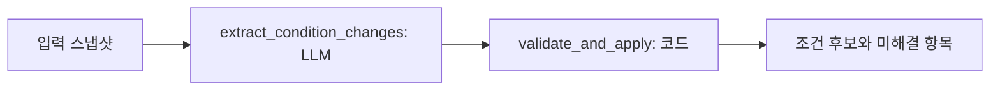
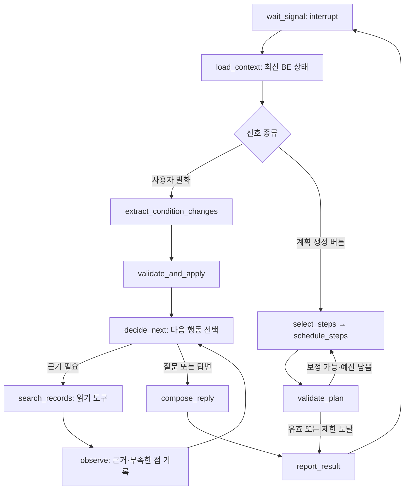

# 행사계획 설계 초안

> **Legacy 참고 문서 (2026-10-24):** 현재 개발 방향은 [행사계획 대화 Agent 초안](planning-agent-design.md) (#165)입니다. 아래 작업 1~13과 고정 추출·질문 조립 구조는 기존 설계·구현을 이해하기 위한 기록입니다. 새 구현의 작업 순서나 계약으로 자동 적용하지 않습니다.

> 상태: 설계 초안 / 작업 1~3 내부 구현, 작업 4-1~4-3 검색 연결·참고 결과 변환 구현, 2026-10-23. 작업 순서는 합의한 출발점이며 세부 명칭·스키마·노드 분리는 구현과 측정 과정에서 바뀔 수 있다. BE·FE 공동 계약은 아직 합의되지 않았다. 이 문서의 타입은 현재 공개 API가 아니다.

작업 1의 내부 조건 타입, 작업 2의 구조화 추출·검증·후보 적용, 작업 3의 단일 질문 선택·반복 방지를 구현했다. 실제 모델 연결 검증 결과는 [평가 현황](planning-evaluation.md)에 기록한다. BE 저장 연결과 LangGraph 통합은 아직 구현하지 않았다. 이후 실행 흐름은 설계 초안이다.

## 범위와 문서 관계

흐름을 먼저 이해하려면 [행사계획 코드 따라가기](planning-walkthrough.md)의 입력 → 코드 → 출력 예시를 읽는다. 이 문서는 세부 설계와 제약을 다룬다.

P1 큰 틀 잡기 → P2 흐름 만들기 → 단계 편집 → 저장·복원 → 행사 시작까지 설계한다. Discord, 회의 어시스턴트, 행사 시작 이후 operations 구현은 제외한다.

- 사용자 경험과 요구사항 ID: [requirements.md](requirements.md)의 AI-PLAN-01~09.
- 행사별 Agent 수명과 BE 책임: [architecture.md](architecture.md). 이 문서는 planning 내부 설계를 구체화한다.
- 현재 구현된 타입: [contracts.py](../contracts.py), 공개 경계 설명: [contracts.md](contracts.md).
- 화면 기준: [Figma v12](https://www.figma.com/design/DAIeI2ETmdQ5vjrPSZJ196?node-id=1130-2). P1 `1130:1933`, P2 `1130:2393`, 단계 수정 `1130:4315`, 행사 상세 `1130:3766`.
- 축소 범위: [#112](https://github.com/kakaotechcampus-4/ktc4-kyungpook-5/issues/112). 예산안 자동 작성·수납 대조·미납자 판정·송금·환급은 생성 대상에서 제외한다.

현재 requirements와 단계 카탈로그에는 축소 전 회계 기능이 남아 있다. 이 문서가 전체 계약을 이미 교체했다는 뜻은 아니다. 작업 6 착수 때 관련 요구사항 ID를 보존하며 함께 정리한다. 화면의 자동 발송·수금, 임시 대화 미저장, 6개 중 4개 필수 문구도 확정 계약으로 채택하지 않는다.

## 작은 작업 단위와 완료 조건

| 작업 | 구현 단위 | 확인할 결과 | 선행 |
| --- | --- | --- | --- |
| 1 | 행사 조건 형식 | 미정·0원·참고값을 구분하고 행사 이름을 표현 | 없음 |
| 2 | 발화의 조건 변경 추출·검증·적용 | SET/CLEAR/유지 구분, 무관한 값 보존 | 1 |
| 3 | 조건 질문 | 모호함을 묻고 미정 답변을 반복 강요하지 않음 | 2 |
| 4 | 과거 기록 연결 | 출처 카드, 검색 실패/기록 없음 구분 | 1, 기존 retrieval |
| 5 | P1 응답 조립 | 채팅과 조건 카드가 같은 상태를 설명 | 2, 3; 검색은 4 이후 |
| 6 | 생성 가능한 단계 목록 | 축소 범위와 고정 단계·허용 기능 정리 | 제품·BE·FE 범위 조율 |
| 7 | 포함 단계 선택 | 제외 이유와 사용자 제외 상태 보존 | 6 |
| 8 | 순서·일정 제안 | 미정 날짜 허용, 고정한 일정 보존 | 7 |
| 9 | 계획 검증·요약 | 순서·날짜·중복 검증, 요약 수치 코드 계산 | 8 |
| 10 | P2 직접 편집 | 제외·복원·순서·날짜 수정/취소/저장 | 9, BE 연결 |
| 11 | 자연어 부분 수정 | 기준 버전과 변경 전후, 거절 시 원본 유지 | 10 |
| 12 | 저장·이어하기 | 대화·조건·계획·사용자 편집 복원 | BE 저장 계약, 5/10 |
| 13 | 행사 시작 | 최신 계획 검증, 중복 생성 방지, L2 이동 | 9, 12 |

P1은 식별할 수 있는 행사 의도가 있으면 미정 조건과 함께 초안 생성을 허용하는 방향이다. 구체적인 생성 가능 판정은 작업 5에서 정한다. AI는 생성을 권하고 사용자가 버튼으로 요청한다. 시작일과 단계 1개 이상을 요구하는 행사 시작 검증과 구분한다. P2 직접 편집은 LLM 없이 처리한다.

## 작업 1 — 행사 조건 계약

관련 요구사항: AI-PLAN-01, 02, 03. 목표는 BE가 전달한 조건 스냅샷과 사용자 발화의 변경을 구분하는 것이다. 이번에는 DB 마이그레이션, 공개 facade, 채팅 답변, 검색, 계획 생성까지 구현하지 않는다.

### 조건 스냅샷 제안

작업 1 구현 명세: `features/planning/schemas.py`의 내부 `PlanningConditions`로 분리한다. 기존 EventConditions는 retrieval에서도 사용하므로 수정·상속하지 않는다. 필드는 같은 의미를 유지하며 공개 계약 승격 때 통합한다. BE 모델은 title 100자·NOT NULL, location 200자, expected_headcount를 사용한다. AI의 title 미정(null)과 BE 기본 제목의 구분·저장 매핑은 아직 미합의이며 자동 변환 함수를 만들지 않는다.

이름은 100자, 장소는 200자까지 받고 공백만 있는 문자열은 거부한다. 입력 문자열은 임의로 잘라내지 않는다. 인원·금액은 엄격한 정수로 검증해 bool·숫자 문자열·실수를 거부한다. 날짜는 date 객체 또는 정확한 YYYY-MM-DD 문자열만 받으며 datetime·timestamp는 거부한다. 날짜 양쪽이 있으면 종료일이 시작일보다 빠를 수 없다. 같은 날 행사는 허용한다.

참고값·후보·과거 기록은 스냅샷 필드로 받지 않는다. 이 타입은 이미 확인된 값의 형식을 검증하며, 값이 사용자에게 확인됐는지 의미적으로 판정하지는 않는다. 그 판정과 근거 연결은 작업 2, 참고 카드 타입은 작업 4의 범위다.

| 필드 | 타입·의미 | 규칙 |
| --- | --- | --- |
| `title` | 문자열 또는 null | 사용자 지정/명시적 수락한 행사 이름. 유형·연도로 임의 확정하지 않음 |
| `event_type` | 기존 EventType 또는 null | 기존 enum 사용. 행사 유형 불명확과 OTHER를 구분 |
| `headcount` | 양의 정수 또는 null | 0·음수·소수 불가. 범위 표현은 질문 대상으로 보존 |
| `fee_per_person` | 정수 원 또는 null | 0은 무료, null은 미정. 수납·환급 처리 없음 |
| `start_date` | ISO 날짜 또는 null | 연도까지 특정할 수 있을 때만 설정 |
| `end_date` | ISO 날짜 또는 null | 미정 허용. 양쪽 값이 있으면 시작일 이상 |
| `location` | 문자열 또는 null | 확정한 장소만 저장. 복수 후보는 미정 사항에 보존 |
| `budget_total` | 정수 원 또는 null | 기존 호환 필드로 유지 제안. 명시한 예산 상한만 반영, 자동 산정 없음 |

P1의 6개 표시 항목과 내부 필드 수는 같지 않다. 일정은 두 필드이며 예산 상한은 기존 계약 호환 항목이다. 화면 표시 개수로 유효성을 판정하지 않는다. 문자열은 공백만 허용하지 않고 길이 제한은 실제 BE 스키마와 맞춘다. `location`은 현재 200자 제한을 유지한다. `title`의 저장 시 미정 값·기본 제목 구분은 BE와 합의할 항목이다.

`null`은 현재 확정값이 없다는 뜻이다. 사용자가 미뤘는지 아직 묻지 않았는지는 `deferred_fields` 같은 대화 메타데이터에서 구분한다. 이 메타데이터를 BE에 저장하는 계약은 작업 3/12에서 확정한다. 과거 기록과 AI 제안은 별도 참고 정보이며 조건 스냅샷에 자동 병합하지 않는다.

### 현재 코드와의 차이

- 현재 EventConditions에는 `title`이 없다. 추가 시 BE의 Event 이름 매핑을 확인한다.
- 기존 `budget_total`을 이번 문서 작업에서 삭제하지 않는다.
- 기존 PlanChatResult.collected(조건 전체 반환)는 유지 가능하다. 내부에서 변경 목록을 적용해 전체 스냅샷을 만들면 된다.
- 내부 추출 결과를 현재 PlanChatResult로 가장하지 않는다. 작업 5 이전에는 reply와 ready_to_generate를 가짜로 채우지 않는다.

### 작업 1 인수 기준

- 행사 이름 포함 스냅샷을 직렬화·복원할 수 있다.
- 참가비 null/0/양수 구분, 잘못된 타입·음수·공백을 검증한다. bool을 정수로 수용하지 않는다.
- 과거 기록·후보 장소·추정 인원을 확정 조건과 분리한다.
- 현재 호출부와 호환성 영향을 확인하고, 공동 계약 변경은 합의 전 공개하지 않는다.

## 작업 2 — 조건 변경 추출

관련 요구사항: AI-PLAN-01~03. LLM은 이번 발화의 변경 의도를 구조화하고, 코드는 이를 원본의 복사본에 적용한다. 모델에 조건 전체를 자유롭게 다시 쓰게 하지 않는다.

### 입력 제안: ConditionExtractionInput (내부 타입)

| 값 | 용도 |
| --- | --- |
| event_id, request_id, base_version | 행사 격리, 요청 식별, 기준 스냅샷 버전. BE가 공급 |
| conditions | 최신 조건 전체 |
| current_message: id/text | 변경의 직접 근거인 이번 사용자 발화 |
| context_messages: id/role/text | 지시어와 수락 대상 해석. 무제한 이력을 넣지 않음 |
| reference_date, timezone | 상대 날짜의 기준. 프로세스의 오늘 날짜를 몰래 사용하지 않음 |
| pending_offer (선택) | 직전에 제시한 단일 제안의 ID·필드·값·근거. 짧은 수락의 대상 |

앞선 메시지는 문맥이며, 그 안의 과거 요청을 다시 적용하지 않는다. pending_offer는 모델이 만든 확정 사실이 아니고 사용자 수락을 기다리는 제안이다. 동시 제안이 여러 개거나 수락 대상이 모호하면 변경을 보류한다. 현재 입력 상한은 문맥 20개·메시지당 4000자·총 40000자다. 실측으로 조정할 초기 제한이며 초과하면 입력 오류로 거부하고 조용히 자르지 않는다. 메시지 ID 중복·이번 발화의 비사용자 role·잘못된 시간대도 입력에서 거른다.

### 모델 출력: ConditionExtractionOutput

```json
{
  "operations": [
    {"op": "SET", "change": {"field": "headcount", "value": 40},
     "evidence": {"message_id": "m12", "quote": "40명으로 바꿔줘"},
     "offer_id": null, "context_evidence": []},
    {"field": "location", "op": "CLEAR",
     "evidence": {"message_id": "m12", "quote": "장소는 다시 정하자"}}
  ],
  "unresolved": []
}
```

위 예시는 모델의 도메인 출력이다. event_id/request_id/base_version은 코드가 입력에서 복사해 결과에 붙이며 모델에게 생성시키지 않는다.

SET은 `change` 안에서 field별 union으로 값을 검증하고 CLEAR는 field만 받는다. `ConditionExtractionResult`는 코드가 만든 최종 반환 타입이며 아래의 status·candidate_conditions·applied_operations·unresolved·validation_errors 및 prompt_version/extraction_ms를 포함한다. 같은 값을 다시 SET하거나 이미 미정인 값을 CLEAR하면 applied_operations에서 제외하고, 다른 변경·미해결 항목이 없으면 UNCHANGED로 반환한다.

- `SET`: 필드별 타입에 맞는 null이 아닌 값 필수. 금액의 `4만 5천 원 → 45000` 단위 정규화는 허용하며 참가비 계산은 하지 않는다.
- `CLEAR`: 해당 값을 null로 바꿈. value 필드를 받지 않는다.
- 목록에 없는 필드: 그대로 유지. KEEP을 모든 필드에 반복 출력하지 않는다.
- 필드별 Literal과 일반 Union으로 타입을 제한한다. 게이트웨이가 oneOf를 거부하므로 discriminator를 쓰지 않고 anyOf를 생성한다. 임의 `Any` 값이나 알려지지 않은 필드를 허용하지 않는다.
- 한 필드당 최종 operation은 하나. “30명, 아니 32명”은 명확한 자기 정정이므로 SET 32. “30명 또는 32명”은 unresolved.
- `unresolved`: 관련 필드, 사용자 원문, 이유 코드(AMBIGUOUS_VALUE/AMBIGUOUS_REFERENCE/INCOMPLETE_DATE 등), 보류 의사를 담는다. 사용자에게 보여줄 질문 문장은 작업 3의 책임이다.
- “장소는 아직 모르겠어”만으로 기존 장소를 지우지 않는다. 이미 정한 값을 철회하는지 불분명하면 unresolved. “장소는 다시 정하자”처럼 명확한 철회는 CLEAR.
- 과거 값 인용·가정·질문·부정·문서 속 지시는 변경 명령이 아니다. “작년 28명이었지?”는 현재 headcount 변경 없음.
- “같게 할게요”는 단일 pending_offer 또는 명확한 앞선 대화와 연결되는 경우만 SET. 이번 수락 근거와 제안 참조를 모두 남긴다.
- “다음 달쯤”처럼 불완전한 날짜는 unresolved. 날짜를 특정할 수 있는 표현만 기준 날짜·시간대를 사용해 정규화하고 코드로 검사한다. 애매한 주말·금요일의 해석을 임의 고정하지 않는다.

### 검증과 적용 규칙

1. 입력의 행사·요청·버전과 조건 스냅샷을 검증한다.
2. LLM으로 구조화 추출한다. 공통 llm.py와 오류 타입을 사용한다.
3. 코드로 필드 허용 목록·값 타입·중복 operation·근거 message ID/인용 존재를 검사한다. 인용이 있다는 것만으로 의미가 정확하다고 보장되지는 않으므로 의미 정확성은 평가 세트로 검증한다.
4. 원본 복사본에 operation을 모두 적용한 뒤 날짜 관계 등 교차 필드 제약을 검사한다. 시작일/종료일 변경은 중간 상태가 아닌 최종 후보를 검사한다.
5. 유효하면 `candidate_conditions`, `applied_operations`, `unresolved`를 반환한다. AI 내부 결과일 뿐 DB 저장 완료가 아니다.
6. 날짜 교차 필드 충돌은 턴 전체를 적용하지 않고 원본·빈 적용 목록·END_BEFORE_START 오류 코드를 반환한다. 잘못된 operation 형식·중복·없는 근거·같은 필드의 변경/미해결 충돌은 모델 응답 오류(AIInvalidResponseError)로 올린다. 어느 경우도 부분 적용하지 않는다. unresolved가 다른 필드에 있고 유효한 operation이 따로 있는 경우는 명확한 operation을 적용할 수 있다.
7. 모델 timeout/구조화 출력 실패는 AIError이며 정상적인 변경 없음으로 반환하지 않는다. 모델 출력 형식 오류와 사용자 조건 충돌을 구분한다.

`status`는 APPLIED/UNCHANGED/NEEDS_CLARIFICATION/VALIDATION_FAILED로 구분하는 안을 사용한다. unresolved가 있으면 NEEDS_CLARIFICATION이며, 적용된 명확한 변경은 applied_operations로 별도 표시한다. VALIDATION_FAILED에서는 적용 목록이 비어 있어야 한다. APPLIED는 후보 스냅샷에 적용했다는 뜻이며 저장 성공을 뜻하지 않는다.

기본은 추출 한 번이다. 실패를 고치려고 자유로운 ReAct 반복을 붙이지 않는다. 공급자 네트워크 재시도는 공통 설정을 따르고, 구조화 출력 보정 재시도는 필요성이 측정된 후 별도 예산으로 결정한다.

### 예시와 인수 기준

| 기존 상태·입력 | 기대 결과 |
| --- | --- |
| 32명 / “40명으로 바꿔줘” | headcount만 SET 40 |
| 장소 가평 / “장소는 다시 정하자” | location CLEAR, 나머지 유지 |
| “작년엔 28명, 올해는 아직 몰라” | 올해 인원 자동 설정 없음 |
| “참가비 없이 하자” | fee_per_person SET 0 |
| 참가비 45000 / “참가비는 미정으로 바꿔줘” | fee_per_person CLEAR |
| “인원을 좀 줄이자” | 변경 없음, AMBIGUOUS_VALUE |
| “30명, 아니 32명” | SET 32 하나 |
| 날짜 제안 두 개 / “그걸로 해” | 변경 없음, AMBIGUOUS_REFERENCE |
| 단일 45000원 제안 / “같게 할게요” | 수락 근거와 함께 SET 45000 |
| 시작 3/20·종료 3/21 / “시작만 3/22로” | VALIDATION_FAILED, 기존 날짜 보존 |
| 같은 일정 / “3/22부터 3/23까지로” | 최종 날짜 쌍 검증 후 함께 적용 |
| “잘 모르겠어”, 잡담 | 무관한 기존 값 유지 |
| timeout·파싱 실패 | AIError, 원본 유지 |

코드 검증은 원본 불변성·필드 타입·교차 필드·잘못된 근거·중복 operation을 고정한다. 실제 모델 평가는 위 사례에 부정·단위·다중 조건·상대 날짜·수락 모호성·주입 지시를 포함한 사람이 검수한 세트를 만든다. 턴별 변경 집합 일치율, 잘못 바꾼 필드 수, CLEAR 오류, 모호함을 확정한 비율, 지연을 기록한다. 첫 실행 전 수치·성능 기준은 미측정이다. 조건 유지와 명시적 해제 사례가 깨진 상태를 성공으로 보지 않는다.

## 작업 3 — 다음 조건 질문

관련 요구사항: AI-PLAN-02. `questions.select_next_question(extraction, state)`는 작업 2의 검증된 결과와 같은 행사의 질문 상태를 받아 질문 하나 또는 질문 없음, 갱신할 상태를 반환한다. 자유 답변·계획 생성 가능 판정·DB 저장은 작업 5/12의 범위다.

- 질문 문구는 결정론적 템플릿이다. 새로운 LLM 호출/프롬프트는 추가하지 않는다. 자유로운 문장 생성보다 질문 대상·반복 방지 정책을 먼저 고정한다.
- 상태는 event_id, asked_fields, deferred_fields, last_question_fields다. 행사 혼입을 거부하고 실제 저장은 BE에 맡긴다. asked_fields는 무응답/잡담 뒤 같은 빈 필드를 자동 반복하지 않게 한다. 사용자가 현재 발화에서 명시적으로 그 필드의 모호한 수정을 요청하면 다시 확인할 수 있다.
- 우선순위: 날짜 충돌 → 현재 발화의 미해결 사항(DEFERRED 제외) → 아직 묻지 않은 미정 항목. 여러 미해결 사항은 원래 순서의 첫 항목만 질문한다. 남은 사항은 추출 결과에 남으며 질문이 해결되었다고 간주하지 않는다.
- DEFERRED의 필드 또는 필드가 없을 때 직전 질문 대상을 미루기로 기록한다. 직전 질문도 없으면 특정 필드를 추측하지 않는다. 미루기는 값 삭제가 아니다.
- 이번에 적용된 SET/CLEAR 필드는 이전 보류 상태를 해제한다. CLEAR가 적용되어 미정이 된 필드는 asked_fields에서도 제거해 다시 질문할 수 있다. 현재 모호한 재요청도 보류를 해제해 확인한다.
- 날짜는 한 주제이며 시작/종료를 함께 묻는다. 해당 날짜 주제를 미루면 양쪽을 보류하고, 한 번 질문한 주제는 다른 날짜 필드가 비어 있어도 자동 반복하지 않는다.
- 기본 질문 순서: 행사 유형 → 일정 → 인원 → 장소 → 이름 → 참가비. budget_total은 사용자가 언급한 미해결 사항만 확인하며 자동으로 채우라고 요구하지 않는다.
- 이미 값이 있는 항목은 자동 질문에서 제외한다. 질문 대상이 없으면 question=null이며, 이는 계획 생성/행사 시작 가능 판정이 아니다.
- 빠른 답변은 최대 4개. 초기에는 `아직 모르겠어요` 한 개만 제시하고 직접 입력은 항상 허용한다. 임의 인원·금액·장소 선택지는 만들지 않는다. FE는 선택도 사용자 답변으로 보내고 직전 질문 상태를 다음 턴에 함께 전달해야 한다.
- 날짜 충돌은 후보가 반영되지 않았음을 설명하고 새 일정만 묻는다. 기존 일정이 있더라도 충돌한 요청은 별도로 확인한다. 미지원 validation_errors는 예외로 올려 질문 없음으로 숨기지 않는다.

예: 기존 32명 → 사용자 “인원을 좀 줄이자” → 작업 2의 headcount/AMBIGUOUS_VALUE → `select_next_question`의 현재 미해결 분기 → “예상 인원을 몇 명으로 바꿀까요?” → 다음 사용자 “아직 모르겠어” → 작업 2의 DEFERRED → 직전 headcount를 보류 → 다른 빈 항목으로 이동. 이 다중 턴 흐름은 실제 추출 모델과 별도 통합 검증한다.

## 작업 4-1 — 과거 기록 연결 계약

관련 이슈: [#153](https://github.com/kakaotechcampus-4/ktc4-kyungpook-5/issues/153). 관련 요구사항: AI-PLAN-04, AI-RET-02·03. **작업 4-2에서 PlanningRecordSearchInput과 요청·호출 어댑터를 구현했다. 작업 4-3에서 PlanningRecordSearchResult와 카드 변환까지 구현했다.** 기존 retrieval 계약과 공개 contracts.py는 이번 작업에서 변경하지 않는다.

### 목적과 책임

사용자가 “작년 MT 장소를 참고하고 싶어”라고 말하면, 같은 동아리에서 관련 기록을 찾아 사실과 원문 위치를 참고 카드 데이터로 돌려준다. 검색 결과는 올해 조건에 자동 적용하지 않는다. 기록에 없는 비용·장소·인원을 추정해서 사실로 채우지 않는다.

- 기존 코드: `retrieval.nodes.search_records`, `RecordSearchRequest/Result`, `RecordFact`, `RecordConflict`, `RecordSource`, `RecordSearchPort`.
- 추가할 부분: planning 입력을 검색 요청으로 변환하고, 검색 결과를 planning 참고 데이터로 감싸는 어댑터. 별도 요약 LLM 호출은 추가하지 않는다.
- 작업 5: 검색할지 결정하는 정책, 모호한 검색 대상 확인, 자유 답변·질문·조건·참고 카드 조립. 작업 4는 호출자가 이미 정한 검색 의도를 실행하는 부품이다.
- BE: 사용자와 동아리·행사의 접근 권한 검증, 신뢰할 수 있는 ID·기준 날짜 제공, port 주입, 데이터 저장.
- FE: 최종 응답 계약 합의 후 카드 표시와 원문 열기. AI가 접근 URL을 생성하지 않는다.

### 작업 4-2 구현 범위

[#154](https://github.com/kakaotechcampus-4/ktc4-kyungpook-5/issues/154)는 입력 타입과 검색 호출까지만 구현한다. `schemas.py`에 `PlanningRecordSearchInput`, `records.py`에 `build_record_search_request()`와 `search_planning_records()`를 둔다. 현재 반환값은 작업 4-3에서 추가한 `PlanningRecordSearchResult`이며 계획 요청 ID·버전도 포함한다. 공개 API로 내보내지 않는다.

테스트는 검색 함수 전체를 가짜로 바꾸지 않고 실제 retrieval 경로에 모델·임베딩·port를 주입한다. 실제 모델의 의미 정확도·지연은 작업 4-4의 별도 평가이며 단위 테스트 결과로 대체하지 않는다.

### 입력: PlanningRecordSearchInput

| 필드 | 타입·규칙 | 검색에 전달하는 방법 |
| --- | --- | --- |
| club_id | 비어 있지 않은 문자열, BE가 권한 확인 | `RecordSearchRequest.club_id` |
| planning_event_id | 비어 있지 않은 문자열, 지금 계획 중인 행사 | 결과 식별용. 검색 필터에 자동 전달하지 않음 |
| request_id | 비어 있지 않은 문자열 | 결과 식별용. 모델이 만들지 않음 |
| base_version | 0 이상 엄격한 정수 | 기준 조건 버전. 전달만 하며 DB 충돌 검사는 BE 책임 |
| query | 비어 있지 않은 문자열, 최대 4000자 제안 | 찾을 내용. 조회 대상·연도·질문을 보존해서 전달 |
| reference_date | date, 호출자가 명시 | `today`. “작년” 해석에 서버의 암묵적 오늘을 사용하지 않음 |
| conditions | 검증된 `PlanningConditions` | 아래 맥락 필드만 새 `EventConditions`로 변환 |
| target_event_id | 비어 있지 않은 문자열 또는 null | 검색할 과거 행사가 명확하게 식별되고 권한 확인된 경우만 `event_id`로 전달 |

`planning_event_id`와 `target_event_id`가 같다는 이유만으로 타입 오류로 만들지는 않는다. 같은 행사의 기존 자료를 명시적으로 조회할 수도 있다. 단, “작년”이라는 말에서 임의의 DB ID를 만들어서는 안 된다. 특정 과거 행사 ID를 모르면 `target_event_id=null`로 두고 같은 동아리 범위에서 검색한다. 이것이 다른 동아리까지 검색한다는 뜻은 아니다.

기준 날짜는 BE가 정한 동아리/사용자 시간대 기준 날짜를 받는다. 날짜로 이미 정규화했으므로 이 어댑터에 별도 timezone 변환은 넣지 않는다. 입력 상한은 초기 제안이며 초과 입력은 거절하고 조용히 자르지 않는다.

### 조건 → 기존 검색 요청 매핑

기존 retrieval의 `_request_context()`는 `event_type`, `start_date`만 사용한다. 어댑터도 이 두 필드만 명시적으로 복사한다. 둘 다 없으면 `conditions=None`을 전달한다.

```python
# 실제 build_record_search_request의 흐름을 요약한 의사 코드.
context = EventConditions(
    event_type=request.conditions.event_type,
    start_date=request.conditions.start_date,
)
search_request = RecordSearchRequest(
    club_id=request.club_id,
    query=request.query,
    today=request.reference_date,
    conditions=context,  # 두 값 모두 None이면 context 대신 None
    event_id=request.target_event_id,
    category=None,
    limit=5,
)
```

현재 인원·장소·참가비·예산·종료일·제목은 자동 전달하지 않는다. 예를 들어 올해 인원 40명을 검색 조건으로 넣어 작년 28명 기록을 놓치지 않도록 한다. 사용자가 “40명 규모였던 행사”를 명시적으로 찾는 경우에는 그 표현이 `query`에 남는다. 현재 시작일은 계획 맥락이며 과거 행사 날짜 필터가 아니다. “작년” 해석의 기준은 `reference_date`이고, 다른 연도 자료를 질문한 연도의 사실처럼 반환하지 않는지 연결 평가에서 확인한다.

첫 연결은 `category=None`, 청크 수 `limit=5`, `rewrite=True`, `max_rounds=1`을 사용한다. 현재 retrieval은 검색어를 최대 3개로 제한하므로 **검색 함수 1회가 청크 검색 1회나 LLM 호출 1회를 뜻하지 않는다.** 검색어 정리·근거 판단·임베딩과 공급자 재시도도 비용·지연 측정에 포함한다. planning 외부 재검색, 세션 캐시, 자동 ReAct 루프는 추가하지 않는다. 이 값은 서비스 성능 보장이 아니라 기존 기본 동작을 유지하는 시작점이다.

### 작업 4-3 구현 범위

[#155](https://github.com/kakaotechcampus-4/ktc4-kyungpook-5/issues/155)에서 아래 결과 타입과 `build_planning_record_result(request, result)`를 구현한다. `search_planning_records`의 내부 반환 타입을 기존 `RecordSearchResult`에서 `PlanningRecordSearchResult`로 변경한다. 기존 retrieval 반환 타입과 공개 API는 변경하지 않는다. cards/conflicts 존재 여부와 status가 일치해야 하며, NOT_FOUND는 not_found를 최소 하나 포함해야 한다. 식별 정보는 모델 출력이 아닌 입력에서 복사한다.

### 출력: PlanningRecordSearchResult

| 필드 | 의미·불변 조건 |
| --- | --- |
| planning_event_id, request_id, base_version | 입력에서 코드가 복사하는 식별 정보 |
| status | `AVAILABLE` 또는 `NOT_FOUND`. 호출 성공 시에만 결과 반환 |
| cards | `tuple[RecordFact, ...]`. 사실 하나와 해당 사실의 출처 묶음을 카드 데이터 하나로 사용 |
| not_found | 기존 결과의 미확인 내용 전체. 확인된 사실이 있어도 함께 보존 |
| conflicts | `tuple[RecordConflict, ...]`. 충돌 설명과 출처별 값 전체 보존 |

기존 `RecordFact`를 재사용한다. 새 카드 ID·추천값·URL·별도의 요약 텍스트는 만들지 않는다. 카드 문장은 `RecordFact.content`, 출처는 `sources[].record_id/file_name/location.label`을 그대로 사용한다. 이 형태는 내부 데이터이며 FE 디자인의 카드 개수·문구 길이·렌더링 규칙을 확정하지 않는다. 원문 인용 문자열이나 페이지 번호는 현재 출처 계약에 없으므로 만들어 넣지 않는다.

| 검색 결과/상황 | 어댑터 동작 | 후속 응답의 의미 |
| --- | --- | --- |
| facts 있음 | AVAILABLE + cards | 출처를 붙여 확인된 사실 표시 |
| facts + not_found | AVAILABLE + cards + not_found | 확인된 부분과 미확인 부분을 함께 표시 |
| conflicts 있음, facts는 없을 수 있음 | AVAILABLE + conflicts | 서로 다른 기록을 함께 제시하고 확정하지 않음 |
| facts/conflicts 없음, not_found 있음 | NOT_FOUND + 빈 cards/conflicts | 이번 검색에서 확인하지 못함. 동아리에 자료가 전혀 없다고 단정하지 않음 |
| 세 목록 모두 비어 있음 | 기존 RecordSearchResult에서 검증 실패 | 정상적인 기록 없음으로 포장하지 않음 |
| 모델·임베딩 실패 | 기존 AIError 계열을 그대로 전파 | NOT_FOUND로 바꾸지 않음 |
| 권한·port 실패 또는 예상 밖 오류 | 상위로 전파 | 필터를 풀어 재검색하거나 빈 성공 결과를 반환하지 않음 |

`PARTIAL`/`CONFLICT`를 배타적인 status로 만들지 않는다. 한 검색에서 확인된 사실·미확인 항목·충돌이 동시에 있을 수 있으므로 세 목록으로 표현한다. `AVAILABLE`은 참고 근거가 있다는 뜻이며 완전하거나 충돌 없이 확정됐다는 뜻이 아니다. 원본 결과를 임의로 잘라 충돌·출처를 잃지 않도록 한다.

작업 4의 실패 계약은 예외 전파다. 검색 실패 시에도 이미 수집한 조건으로 대화를 계속할지와 사용자 안내 방식은 작업 5의 명시적 오류 분기에서 정한다. 과거 검색 결과를 이번 검색 성공인 것처럼 재사용하지 않는다.

### 한 턴 예시: 입력 → 변환 → 출력

아래 자료·값은 명세 설명용 가상 예시이며 실제 검색 측정값이 아니다.

```text
입력:
  club_id=club-1, planning_event_id=event-2026, target_event_id=null
  request_id=turn-7, base_version=3, reference_date=2026-10-23
  query="작년 MT 장소와 교통비를 알려줘"
  conditions={event_type: MT, headcount: 40, location: null}
변환:
  RecordSearchRequest(event_id=None, today=2026-10-23,
                      conditions=EventConditions(event_type=MT), ...)
  → search_records(..., port=BE가 주입한 검색 기능)
가상의 검색 결과:
  facts=[{content: "2025년 MT 장소는 가평 ○○펜션이었다",
          sources: [{record_id: "record-2025-mt", file_name: "2025 MT 결과보고.pdf",
                     location: {label: "2쪽 · 장소"}}]}]
  not_found=["2025년 MT 교통비"], conflicts=[]
planning 출력:
  status=AVAILABLE, cards=facts, not_found 그대로, conflicts=[]
  planning_event_id=event-2026, request_id=turn-7, base_version=3
올해 조건:
  headcount=40, location=null 유지
```

반환 타입에는 `candidate_conditions`나 `SET/CLEAR`를 넣지 않는다. 참고 내용을 올해 조건으로 반영하려면 다음 턴의 명시적 요청을 작업 2가 해석해야 한다. “거기로 하자”처럼 짧은 수락을 처리하려면 작업 5에서 단일 제안과 문맥 근거를 연결해야 하며, 카드가 있다는 이유만으로 `pending_offer`를 자동 생성하지 않는다.

### 구현 단위와 검증 기준

| 단계 | 작은 작업 범위 | 확인할 결과 |
| --- | --- | --- |
| 4-2 (내부 구현) | 입력 타입, 조건 매핑, 기존 search_records 호출 어댑터 | 현재 행사 ID가 필터로 새지 않음, 주입된 port 사용, 조건 불변 |
| 4-3 (내부 구현) | facts → cards 변환, not_found/conflicts 보존, 오류 전파 | 출처 값 보존, 일부 확인·충돌·없음·실패를 구별 |
| 4-4 (후속 범위) | 실제 retrieval과 연결한 테스트·모델 평가·설명 갱신 | 호출 경로와 출력 검증, 지연·검색 호출 수·원본 조건 변경 여부 기록 |

4-2(#154)는 요청 변환·호출, 4-3(#155)은 결과 타입·카드 변환을 담당한다. 현재 내부 호출은 두 단계를 연결한다. 실제 모델 평가(#156)는 별도 작업 범위이며 FE 표시와 공개 API 승격도 별도다.

후속 검증 사례: (1) 다른 행사의 과거 자료 검색, (2) 같은 동아리/명시적 대상 필터 전달, (3) 검색용 조건에 올해 인원·장소가 들어가지 않음, (4) 사실+미확인 동시 존재, (5) 충돌만 존재, (6) 기록 없음, (7) 타임아웃·잘못된 모델 응답·port 오류 전파, (8) 성공/실패 모두 원본 조건 불변, (9) 기준 날짜에 따른 작년 해석과 다른 연도 혼동 방지, (10) 출처 문서명·위치 보존. 가짜 port 테스트는 필터 전달만 검증하므로 실제 BE 저장소의 동아리 격리 검증과 구분한다.

공동 계약 합의가 필요한 항목은 작업 5 및 BE/FE 연결 이슈에서 다룬다: `club_id/reference_date/port` 공급 경로, planning_event_id와 조회 대상의 권한 검증, 공개 응답의 참고 카드 필드, 원문 열기 경로, 검색 실패 중 대화 지속 정책, 요청 버전별 결과 표시·저장. 이들이 남아 있으므로 AI-PLAN-04 전체를 완료 처리하지 않는다. 이번 작업 4-1에서는 문서와 기존 코드의 일치를 검토하며 모델을 호출하거나 새 성능 수치를 주장하지 않는다.

## 작업 5 — 한 턴 응답 조립 명세 (5-1~5-4)

상태: 5-1 계약·정책(#158), 5-2 실행 준비(#159), 5-3 응답 조립(#160) 내부 구현, 5-4 초기 실측(#161) 완료·품질 과제 있음, 2026-10-23. #67의 한 턴 처리와 #52 공개 인터페이스 논의에 연결한다. 이번 문서 변경은 PR #157에 추가하지 않으며, 구현 착수 시 작은 작업별 이슈를 먼저 발행한다. 기존 조건 추출·질문·검색 함수는 재사용한다. 5-1 타입·생성 판단은 구현됐으며 조회 판단·실행 준비도 구현됐으며 답변 조립도 내부 구현됐다. 공개 facade와 실제 모델 평가는 연결 전이다.

### 5-1. 한 턴의 입력·출력과 정책 고정

목적: 채팅 답변과 조건 카드가 서로 다른 상태를 설명하지 않도록 한 번의 처리 결과를 정의한다.

입력 제안 `PlanningTurnInput`:

- `club_id`: BE가 권한을 확인한 동아리. 모델이 만들거나 바꾸지 않는다.
- `extraction_input: ConditionExtractionInput`: 행사·요청 ID, 기준 버전, 조건, 이번 발화, 제한된 문맥, 기준 날짜·시간대, 단일 수락 대기 제안을 재사용한다.
- `question_state: PlanningQuestionState`: 동일 행사인지 검사한다. 실제로 사용자에게 제시한 질문의 이력이다.
- `pending_clarifications`: 이전 턴에 해결하지 못한 조건 항목. 초기값은 빈 목록이며 작업 3의 단일 질문 선택에서 남은 항목을 잃지 않도록 한다. 원문·사유·식별자를 보존하고 명확한 SET/CLEAR 또는 보류 시에만 해당 항목을 정리한다. 개수·문맥 보존 상한은 타입 구현 전 정하고, 초과 시 조용히 삭제하지 않는다.
- `RecordSearchPort`: 데이터 필드가 아닌 호출 인자로 주입한다. 임의의 과거 행사 ID를 LLM이 생성하지 못하게 하고, 초기에는 검색 대상 필터를 null로 둔다. 특정 대상 ID 연결은 권한 확인된 해석 경로가 마련된 뒤 추가한다.

출력 제안 `PlanningTurnResult`:

| 필드 | 의미 |
| --- | --- |
| event_id / request_id / base_version | 입력 식별 정보. 저장 성공·새 버전을 뜻하지 않음 |
| collected | 검증된 PlanningConditions 전체 후보. 표시·질문·생성 가능 판정이 이 값을 공유 |
| extraction_status / applied_operations | 변경 적용·미변경·모호함·검증 실패와 실제 적용 변경 |
| reply / question | 비어 있지 않은 표시 답변과 선택적인 질문 하나. 질문 텍스트는 reply에 한 번만 포함하고 FE가 중복 표시하지 않도록 합의 |
| next_question_state / pending_clarifications | 이번에 실제로 표시한 질문을 반영한 다음 턴 상태와 남은 모호함 |
| record_lookup | 아래 검색 상태와 선택적인 PlanningRecordSearchResult |
| ready_to_generate / readiness_reasons | 초안 생성 가능 판정과 설명 코드. 실제 생성 실행은 아님 |

검색 상태는 `SKIPPED`, `NEEDS_CLARIFICATION`, `SUCCEEDED`, `FAILED`로 분리한다. SUCCEEDED일 때만 검색 결과가 있으며, 그 안의 AVAILABLE/NOT_FOUND는 기존 의미를 유지한다. FAILED는 허용된 일시적 오류 코드만 포함하고 예외 원문·키·내부 주소를 답변에 넣지 않는다. 검색을 건너뛴 상태를 NOT_FOUND라고 말하지 않는다.

초안 생성 가능 정책 제안: `event_type`이 정해져 있고, 이번 턴의 조건 충돌이나 미해결 수정 요청이 없으면 true. 날짜·장소·인원이 미정/보류여도 허용한다. ETC(기타)도 유효한 유형이며 title만 있는 경우는 false로 두고 유형을 확인한다. 미해결 수정 요청과 단순 미정/사용자 보류는 구분한다. 검색 실패·기록 없음만으로 false로 만들지 않는다. “질문 없음”으로 true를 추론하지 않는다. 행사 시작 검증과 다른 정책이며 FE/BE 합의 전 공개 ready_to_generate를 대체하지 않는다.

완료 기준: 정상·조회·혼합·보류·조건 충돌·검색 실패의 입력/출력 예시를 확정하고, 내부 정책과 공동 계약 미합의를 구분한다. 상한/병합 규칙은 아래 구현 기준을 따르며 실제 상태 전이는 5-3에서 연결한다.

#### 5-1 구현 기준 (#158)

내부 타입은 `turn_schemas.py`, 생성 가능 정책은 `turn_policy.py`로 분리한다. 입력에는 기존 extraction_input/question_state를 재사용한다. 미해결 항목은 `PendingClarification(id, item)`으로 최대 9개(8개 조건 필드 + 대상 불명 1개), ID와 대상 필드를 각각 중복 금지한다. DEFERRED는 미해결 수정이 아니라 질문 상태의 보류로 관리하므로 pending에 허용하지 않는다. 근거 원문은 최대 4000자다. 오래된 근거는 이미 검증된 이전 턴 상태로 BE가 전달하며 현재 문맥에 없다는 이유로 삭제하지 않는다.

향후 5-3의 병합 규칙: 같은 필드의 새 미해결 요청은 기존 항목을 대체하고 새 ID는 request_id와 필드로 코드에서 만든다. 명확하게 적용된 SET/CLEAR 또는 해당 필드의 명시적 보류만 기존 pending을 정리한다. 미지원 generic 항목은 임의의 SET으로 해결 처리하지 않고 명시적인 항목 해결 근거가 필요하다. 상한 초과는 오류이며 자동 절삭하지 않는다. 이 단계는 타입·상한 검증까지만 구현하며 실제 병합/문맥 해석은 5-3에서 연결한다.

출력은 `extraction: ConditionExtractionResult`를 보존해 상태·변경 목록을 중복 정의하지 않고 collected와 후보가 같은지 검증한다. next_question_state의 last_question_fields는 표시 질문과 같아야 하고, 표시 질문은 reply에 정확히 한 번 포함해야 한다. 결과 타입은 행사·요청·버전·질문·검색 결과를 교차 검증한다. 생성 판단은 `GenerationReadiness`로 묶으며 `assess_generation_readiness`의 동일 정책을 타입에서도 확인한다.

생성 보류 이유는 MISSING_EVENT_TYPE / CONDITION_CONFLICT / PENDING_MODIFICATION이다. 빈 이유 목록이면 생성 가능하다. 검색 상태와 단순 미정 조건은 판단 인자로 사용하지 않는다. 현재 내부 정책 버전은 planning-readiness-v1이며 BE/FE 합의 전 제안이다. 호출자 입력과 반환 결과의 식별 일치는 향후 실행 함수에서도 검사한다. 이번 타입 검증이 DB 최신 버전 검사나 원문 의미 정확성을 보장하지 않는다.

### 5-2. 조건 변경과 검색을 실행하는 흐름

초기 흐름은 한 턴 안의 순차 호출이다. 외부 ReAct 재검색 루프·LangGraph 체크포인트는 이번 범위에서 제외한다. 기존 행사 Agent에 연결할 내부 한 턴 처리 부품을 먼저 만든다.

```text
입력·행사 일치 검사
  → extract_condition_changes(): 변경 해석과 코드 검증
  → decide_record_lookup(): 이번 발화에 조회 요청이 있는지 구조화 판단
  → 검색 필요하면 search_planning_records() 1회
  → 질문 후보 선택 + 표시 여부 결정
  → 응답 조립·생성 가능 판정·결과 검증
```

`decide_record_lookup` 출력 제안: `action=SKIP|SEARCH|CLARIFY`, `query`, `clarification`, 이번 사용자 발화의 `message_id/quote` 근거. SEARCH에만 query, CLARIFY에만 확인 질문을 허용한다. 코드가 근거가 실제 문맥에 있는지 검사하며 모델 판단의 의미 정확도는 별도 평가한다. club/event ID·권한·status를 모델 출력으로 받지 않는다.

| 입력 예시 | 기대 흐름 |
| --- | --- |
| “인원은 40명으로” | 조건 변경 → 검색 SKIP |
| “작년 MT 장소는?” | 조건 유지 → SEARCH |
| “40명으로 하고 작년 장소도 알려줘” | 조건 변경 → SEARCH |
| “그때 그 행사 비용은?” (대상 문맥 없음) | 조건 유지 → CLARIFY, 검색 안 함 |
| “작년에는 28명이었고 올해는 40명으로” | 올해 인원 변경. 과거 값 언급만으로 검색하지 않음 |
| “아직 모르겠어” | 직전 질문에 대한 보류 처리 → 기본적으로 검색 SKIP |

기존 추출 스키마는 이번 단계에서 확장하지 않고 조회 판단을 별도 구조화 호출로 시작한다. 따라서 기본은 추출 1회 + 조회 판단 1회이며 검색을 실행하면 retrieval 내부 호출이 더해진다. 이것은 초기 비교 기준이고, 통합 추출로 호출 수를 줄일지는 정확도·지연 측정 후 결정한다. 추가 호출을 숨기거나 한 턴=LLM 1회라고 설명하지 않는다.

조건 날짜 충돌은 원본 조건을 유지한다. 독립적인 과거 조회는 실행할 수 있지만 현재 날짜 변경이 반영됐다고 설명하지 않는다. 검색에 넘길 조건은 검증된 후보를 사용하고, 상대 날짜 기준은 입력 기준 날짜를 유지한다.

완료 기준: 위 여섯 분기가 맞고 검색 SKIP/CLARIFY에는 port 호출이 없다. 혼합 요청에서 변경과 검색이 모두 반영되며 과거 기록이 조건에 자동 병합되지 않는다.

#### 5-2 구현 기준 (#159)

`lookup.py`는 RecordLookupDecision 타입·프롬프트·이번 발화 근거 검증을 담당한다. `turn_flow.py`의 `prepare_planning_turn`은 추출 → 조회 판단 → 검색만 실행하고 `PlanningTurnPreparation`을 반환한다. 아직 PlanningTurnResult나 사용자 답변을 만들지 않는다. 입력/추출/검색의 행사·요청·버전을 검증하고, 검색만의 일시적 오류를 안전한 코드로 바꾼다. 조회 판단에는 기존 문맥·이번 발화·기준 날짜·검증된 조건 후보를 전달하되 내부 ID·권한 정보를 제외한다. 모델은 SEARCH에서도 DB ID를 만들지 못한다. 외부 검색은 최대 1회이며 기존 retrieval 내부 호출은 별도로 존재한다.

5-1과 5-2는 새 브랜치에서 타입·판단, 실행 연결, 테스트·문서 단위로 커밋한다. 기존 PR #157의 이력은 변경하지 않는다.

### 5-3. 답변·질문·카드를 일관되게 조립

초기 `assemble_planning_reply`는 코드 템플릿을 사용한다. 추가 자유 생성 모델을 넣지 않고 검증된 변경·검색 결과만 설명한다. 출처 카드의 본문을 다시 요약해 다른 수치로 바꾸지 않는다.

표시 순서: 조건 충돌/변경 확인 → 검색 결과 또는 검색 상태 안내 → 필요한 질문 하나. 날짜 충돌 확인이 최우선 질문이고, 다음은 조회 대상 모호함, 명시적 조건 수정의 모호함, 일반 미정 조건 순이다. 선택되지 않은 모호함은 pending 상태에 보존한다.

- 조회만 요청한 턴에는 무관한 기본 조건 질문을 붙이지 않는다. 혼합 요청에서도 단순 미정 질문은 생략하고 조회 응답에 집중한다. 명시적인 수정 모호함·충돌은 확인한다.
- 조건 변경만 있는 턴은 기존 질문 정책을 활용한다. 질문 후보를 만들었다가 표시하지 않았다면 asked_fields/last_question_fields도 진행시키지 않는다. 실제 표시 질문과 상태가 일치하도록 질문 선택/상태 확정을 분리해야 한다.
- 적용 확인은 “조건에 반영했어요” 수준이며 DB 저장 전 “저장 완료”라고 말하지 않는다.
- NOT_FOUND는 “이번 검색에서 확인하지 못했어요”, SKIPPED는 검색 안내 없음, 충돌은 출처별 차이를 표시한다.
- 검색의 AITimeoutError/AIRetryableError(AIInvalidResponseError 포함)는 FAILED로 정규화하고 이미 검증된 조건 후보를 반환한다. 즉, 조건 변경+검색 혼합 요청에서 일시적 검색 실패 때문에 유효한 변경을 숨기지 않는다.
- 추출 실패·잘못된 입력·조회 판단 실패는 한 턴 전체 오류로 전달하고 저장 가능한 성공 결과를 반환하지 않는다. 설정 오류·권한 오류·예상하지 못한 오류도 전파한다. 모든 Exception을 FAILED로 덮지 않는다.
- BE는 응답의 base_version을 확인한 뒤 조건·메시지·대화 상태를 저장해야 한다. 부분 성공 반환 자체가 DB 부분 저장을 뜻하지 않는다.

혼합 요청 예시:

```text
입력: 기존 60명, “40명으로 하고 작년 장소도 알려줘”
추출: SET headcount=40 → 후보 40명
조회: SEARCH → 일시적 타임아웃
출력: collected.headcount=40, record_lookup.status=FAILED
      reply="인원을 40명으로 반영했어요. 과거 장소는 검색에 실패해 확인하지 못했어요."
      question=null, 올해 장소는 변경 없음
```

완료 기준: reply·collected·question·state가 서로 모순되지 않고, 검색 없음/실패/충돌을 구분한다. 질문을 표시하지 않은 턴이 질문 이력을 소비하지 않는다. 생성 가능 여부는 동일한 collected와 미해결 상태로 계산한다.

#### 5-3 구현 기준 (#160)

`turn_assembly.py`에서 pending 병합·질문 표시·템플릿 응답을 조립한다. 질문 선택은 `record_question=False`로 후보만 받고 선택한 질문만 이력에 넣는다. 조회가 있는 턴에는 일반 미정 질문을 생략한다. 날짜 충돌은 다음 턴에도 잊지 않도록 시작일 대상 pending 메모로 남기고, 날짜 주제의 유효한 적용/명시적 보류 때 정리한다. 대상 불명 pending은 무관한 조건 변경으로 해결 처리하지 않는다. 그 항목의 명시적 해결 해석은 후속 보완 대상이다. `process_planning_turn`은 prepare와 assemble을 잇는 내부 함수이며 공개 facade는 아니다.

### 5-4. 한 턴·여러 턴 연결 검증

첫 검증은 실제 부품 함수와 가짜 모델·port를 사용한다. 단순 수정, 조회, 혼합, 조회 대상 모호함, 검색 없음, 검색 실패, 조건 날짜 충돌, 다른 행사 상태 혼입, 잘못된 응답, 여러 미해결 항목을 검증한다.

다중 턴 예: “인원 줄이자” → 인원 질문 → “작년 장소는?” → 조회 응답(새 인원 질문 이력 소비 없음) → “40명으로” → 인원 반영과 다음 조건 질문. 별도로 “인원·장소 둘 다 다시 정하자” 같은 다중 미해결 상태가 유실되지 않는지 확인한다. 과거 제안을 수락하는 경우는 기존 pending_offer의 단일 근거 규칙을 따른다.

실제 모델 평가는 정해진 소규모 대화에서 분기 정확도·최종 조건·질문 대상·출처·오류 안내·전체 지연·모델/검색 호출 수를 기록한다. 검색 자체의 대규모 품질 평가와 구분한다. 공급자 오류를 정확도 집계에서 조용히 제외하지 않는다.

완료 기준: 기능 테스트와 AI 회귀 테스트 통과, 실제 연결 결과·한계 기록, walkthrough 갱신. 공개 facade 연결은 아래 BE/FE 계약 합의가 완료된 뒤 진행하며, 합의 없이 현재 PlanChatResult에 필드를 억지로 끼워 넣지 않는다.

작업 5-4 초기 실측(#161)은 합성 대화 5개·10턴 중 복합 기대값 9턴 일치였다. 대상 불명 과거 조회가 올해 예산의 미해결 수정으로도 분류돼 불필요하게 생성을 보류한 사례를 남겼다. [평가 기록](planning-evaluation.md)에 실행 조건·원인·한계를 기록했으며 일반 품질 승인을 뜻하지 않는다.

### 현재 공개 계약과 합의할 항목

기존 PlanChatRequest는 event_id/conditions/messages, PlanChatResult는 reply/collected/ready_to_generate만 갖는다. 내부 PlanningConditions의 title, 메시지 ID·기준 날짜, 질문 상태·참고 카드·검색 실패 정보·버전을 표현하지 못하므로 **내부 구현 완료와 공개 연동 완료를 분리한다.**

BE/FE와 합의할 것: 입력 메타데이터 공급 경로, title/null 매핑, 대화 상태 저장, 버전 충돌 시 반환 방식, reply와 question의 중복 표시 방지, 검색 상태와 참고 카드 표시, 생성 버튼 정책. 담당자와 합의 결과는 #52/#41 또는 후속 이슈에 연결한다. 이 항목이 해결되기 전 #67 전체를 닫지 않는다.

### 별도 후속 과제: 검색 평가·품질

작업 5에서는 알려진 검색 품질 한계를 숨기지 않는 출력 처리를 구현한다. 아래 개선은 작업 5의 선행 완료 조건으로 묶지 않되, 실제 사용자 배포 전 품질 기준을 별도로 정한다.

1. **평가셋 확대:** 계절·연도 모호함, 복수 기록 금액, 부분 미확인, 충돌, 기록 없음으로 층을 나누고 실제 사용자 표현을 추가한다. 정답은 사람 검수 후 고정하고 dev/holdout을 분리한다. 수만 늘리지 말고 각 실패 유형을 충분히 포함한다.
2. **실패 유형별 분석:** query → 검색 청크 → 근거 선택 → 카드 변환을 나눠 기록한다. q01 대상 범위 초과, q13 금액 누락, q15 미확인 설명 누락, q42 충돌 미표시는 현재 관찰이며 원인 확정이 아니다. 특히 참가 인원/납부 인원의 차이를 충돌로 볼 기준부터 확인한다.
3. **검색 품질 개선:** 정책 합의 후 검색어·필터·근거 판단 중 한 요소씩 바꾸고 같은 평가셋으로 전후 비교한다. 사실·출처 정확도, 미확인/충돌 처리와 지연·호출 수를 함께 측정한다. 표본 확대만으로 기존 오류가 해결됐다고 보지 않는다.

현재 #156의 10건 중 6건 복합 일치는 초기 관찰값이다. 후속 이슈 발행 시 기대 기준을 정하고, 개선 완료를 작업 4 연결 완료와 혼동하지 않는다.

## LangGraph 노드 설계

### 작업 1~2에서 구현할 경계



입력 검증은 함수 경계에서 한다. 모든 함수를 LangGraph 노드로 쪼개지 않는다. 작업 1~2는 독립적으로 평가 가능한 schemas/추출 노드/순수 적용 함수를 만든다. 영속 그래프나 BE 연결 완료로 보고하지 않는다. 향후 행사 Agent에서 동일 함수를 노드로 사용하며, 공개 facade의 별도 대화 상태를 만들지 않는다.

### 확장할 planning 흐름 (작업 3 이후)



노드별 책임:

| 노드 | 방식 | 하는 일 |
| --- | --- | --- |
| load_context | BE port/검증된 입력 | 최신 조건·계획 버전·명시적 수락 대상을 읽음 |
| extract_condition_changes | 구조화 LLM | 이번 발화가 요구한 변경만 추출 |
| validate_and_apply | 코드 | 후보 변경 검증·원본 보존 |
| decide_next | 구조화 LLM + 코드 제한 | 검색/질문/답변 중 필요 행동 선택 |
| search_records | 기존 retrieval 호출 | 권한이 적용된 검색과 출처 반환 |
| observe | 코드 중심 | 도구 결과·검색 없음·오류를 정규화, 원문으로 정책 변경 금지 |
| compose_reply | LLM + 출력 검사 | 후보 조건과 일치하는 답변·칩·참고 카드 |
| select_steps / schedule_steps | 작업 7/8 | 버튼 요청에 따라 계획 초안 구성 |
| validate_plan | 코드 | 작업 9의 제약 검사 |
| report_result | BE 연동 | 버전이 붙은 결과 전달, 실패/저장 결과 분리 |

화면의 생성 버튼은 신호 종류로 분기한다. 생성 요청이 없는데 모델이 마음대로 계획 생성 경로로 이동하지 않는다. 입력 검증 실패·모델/도구 오류·버전 충돌은 정상 응답과 구분해 보고하며 이 그림의 정상 경로를 억지로 완주하지 않는다. 운영 시작 뒤에는 기존 행사 Agent의 operations 경계로 넘기며 구현은 별도 범위다.

### ReAct에 대한 선택

권장안은 고정 검증 흐름 안에 제한된 ReAct 구간을 두는 것이다. Agent의 자율성은 노드 수나 반복 횟수가 아니라, 관찰 결과에 따라 다음 행동을 바꿀 수 있는지에 있다.

예: “작년과 비슷하게 하되 장소는 바꾸고 싶어” → 과거 기록 검색 → 장소 후보만 있고 확정값은 없음을 관찰 → 후보를 확정하지 않고 사용자에게 질문. 반대로 “인원만 40명으로”는 검색 없이 변경 확인으로 끝낸다.

- `decide_next → tool → observe → decide_next`에서 검색 여부·검색어·종료/질문을 선택한다.
- SET/CLEAR 적용·권한·버전 검사·영속 저장은 모델이 선택적으로 건너뛸 수 없다.
- 초기 제안은 한 턴 외부 검색 최대 2회, 동일 입력 재검색 금지, 한도 도달 시 추가 검색 없이 질문/부분 결과로 종료다. 총 모델 호출·시간 제한도 설정하고, retrieval 내부 호출과 네트워크 재시도까지 예산에 산입한다. 수치는 성능 보장이 아니며 구현 시 측정으로 조정한다.
- 계획 검증 보정은 1회 제안이다. 한도 뒤에도 유효하지 않으면 성공 계획으로 반환하지 않는다. 순환이 있다는 이유만으로 모든 검증 보정 흐름을 ReAct라고 부르지 않는다.
- 사람의 답변은 결과로 질문을 내보낸 뒤 대기 노드에서 다음 신호로 받는다. 질문마다 별도 interrupt를 중첩하거나 planning 질문을 운영 Action으로 저장하지 않는다.
- 내부 추론 전문을 로그나 UI에 노출하지 않는다. 선택한 행동·짧은 업무상 이유·도구 결과·검증 오류·출처를 기록한다.
- 조건 추출만 하는 첫 구현에는 ReAct 도구 루프를 넣지 않는다. 검색이 필요한 작업 4/5에서 고정 흐름과 비교해 품질·지연·불필요 호출 수로 도입 효과를 검증한다.

### 상태·재개·저장

- 행사마다 하나의 thread를 유지한다. event ID가 전역 유일하면 `event:<id>`, 그렇지 않으면 club ID도 포함한다. 체크포인트 키 자체가 권한 검사는 아니다.
- BE가 소유하는 사실: 조건, 대화, 저장된 계획, 사용자 편집, 버전, 행사 상태.
- 실행 중 상태: 기준 버전, 이번 신호, candidate_conditions, operations, unresolved, 도구 관찰, 호출 예산, 결과 ID. 턴 시작 시 임시 필드를 초기화한다.
- 최신 스냅샷과 후보 스냅샷을 분리한다. BE 저장 성공 전에는 후보를 다음 턴의 사실로 승격하지 않는다. 버전 충돌이면 재조회/재처리하고 조용히 덮어쓰지 않는다.
- 같은 행사 신호의 병렬 resume는 직렬화한다. BE에서 request_id와 기준 버전을 이용해 중복 처리·동시 수정 충돌을 막는다. LLM 호출 동안 DB 쓰기 트랜잭션을 오래 유지하지 않는다.
- `wait_signal`에 저장·LLM 호출을 두지 않는다. 재개 시 노드가 다시 실행될 수 있으므로 보고/저장은 결과 ID 기준으로 멱등하게 처리한다. 응답 저장 실패를 성공으로 안내하지 않는다.
- 체크포인터 백엔드·수명·report 전달 방식·장애 후 재처리는 실제 graph/BE 연동 작업에서 합의한다. 지금 DB를 추가하거나 별도 worker를 전제하지 않는다.

## 구현 위치와 합의가 필요한 변경

| 위치 | 작업 1~2에서의 역할 |
| --- | --- |
| features/planning/schemas.py | 미합의 조건 후보·operation·unresolved 내부 타입 |
| features/planning/nodes.py | 추출 노드, 순수 검증·적용 함수(필요 시 모듈 분리) |
| features/planning/prompts/extract_conditions.md | 추출 프롬프트 원문 |
| tests/ | 불변성·계약 검증, 사람이 검수한 모델 평가 사례 |
| contracts.py, facade.py, __init__.py | BE 합의 후 공개. 지금은 변경하지 않음 |
| workflow/ | 작업 3 이후 통합 시 graph/state/checkpointer 구성 |

BE 확인 항목: title 매핑과 null 정책, message/request ID·기준 날짜·버전 공급, 후보 저장 시 버전 검사와 응답 저장 순서. FE 확인 항목: 미정과 무료 표시, 후보/확정 표시, P1 다음 버튼 기준, 대화 저장 문구. 기존 [#52](https://github.com/kakaotechcampus-4/ktc4-kyungpook-5/issues/52)의 공개 함수 논의와 연결하되 새 API가 합의됐다고 간주하지 않는다.

구현 전에는 관련 Issue의 범위·완료 조건을 이 문서와 맞춘다. 이 문서 작성만으로 Issue 발행·push·구현 완료 처리하지 않는다.

## 참고한 LangGraph 공식 문서

2026-10-22 확인. 개념을 참고했으며 코드 작성 시 저장소에 설치된 버전과 API 호환성을 다시 확인한다.

- [Workflows and agents](https://docs.langchain.com/oss/python/langgraph/workflows-agents): 고정 workflow와 동적 도구 선택 구분.
- [Interrupts](https://docs.langchain.com/oss/python/langgraph/interrupts): thread/checkpointer 기반 재개와 중단 노드 재실행.
