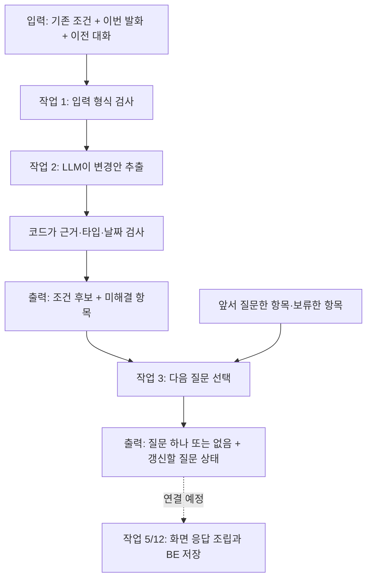

# 행사계획 코드 따라가기 — 한 문장이 조건과 질문이 되기까지

> 현재 범위: 작업 1~3 내부 구현. 작업 4 이후는 연결 예정이다. 단계가 진행될 때 이 문서도 갱신한다.

오랜만에 돌아왔다면 **1절의 그림 → 3절의 한 턴 예시 → 7절의 다음 단계** 순서로 읽는다. 상세 제약·설계 결정은 [plan_architecture.md](plan_architecture.md), 실제 측정은 [planning-evaluation.md](planning-evaluation.md)를 참고한다.

## 1. 지금 어디까지 만들어졌나?

우리가 만드는 것은 운영진의 대화를 받아 행사 조건을 정리하고 계획을 만드는 기능이다. 현재는 말을 읽어 조건 후보를 만들고, 다음에 무엇을 물을지 정하는 부분까지 구현했다.



그림의 작업 2에서만 현재 LLM을 호출한다. 질문 선택은 코드로 처리한다. 이 함수들이 LangGraph 전체에 연결된 것은 아직 아니다. DB 저장과 FE 화면까지 완성됐다는 뜻도 아니다.

| 작업 | 쉬운 설명 | 대표 코드 | 현재 상태 |
| --- | --- | --- | --- |
| 1 | 조건을 담을 그릇과 입력 규칙 | `PlanningConditions` | 내부 구현 |
| 2 | 말에서 변경할 부분을 찾고 검증 | `extract_condition_changes`, `validate_and_apply` | 내부 구현·실제 모델 연결 확인 |
| 3 | 다음 질문 하나를 고름 | `select_next_question` | 내부 구현·2턴 통합 확인 |
| 4 | 과거 기록을 찾아 근거 카드로 연결 | 기존 `search_records` 활용 예정 | planning 연결 미구현 |
| 5 | 채팅·조건 카드·참고 카드를 한 응답으로 조립 | 공개 응답/facade 설계 예정 | 미구현 |
| 6~13 | 계획 초안·편집·저장·행사 시작 | 설계 문서의 작업표 | 미구현 |

## 2. 먼저 알아둘 네 가지

**스냅샷(snapshot)**은 특정 시점의 조건 묶음이다. `headcount=32, location="가평"`처럼 지금 정해진 값을 담는다. `None`은 미정이고, 참가비 `0`은 무료다.

**변경안(operation)**은 전체 조건이 아니라 바꿀 항목만 담는다. `SET headcount=40`은 인원을 바꾸고, `CLEAR location`은 장소를 미정으로 되돌린다. 목록에 없는 항목은 유지한다.

**후보(candidate)**는 검증한 변경을 적용한 새 스냅샷이다. 함수가 후보를 만들었다고 DB에 저장한 것은 아니다. BE가 버전·권한을 확인하고 저장해야 한다.

**Structured Output**은 LLM의 답을 정해진 데이터 형식으로 받는 방식이다. “인원을 바꿨습니다”라는 자유 문장 대신 코드가 읽을 수 있는 변경 목록을 받는다. 형식을 지켰다고 의미까지 맞는 것은 아니므로 근거 검증과 실제 모델 평가가 따로 필요하다.

## 2-1. LLM 호출은 한 턴·두 턴에서 어떻게 반복되나?

**“작업 2에서만 LLM을 호출한다”는 사용자 발화 한 턴마다 작업 2가 구조화 추출을 한 번 요청한다는 뜻이다. 대화 전체에서 한 번만 호출하는 뜻이 아니다.** 작업 3은 그 결과를 코드로 읽어 질문을 고르므로 질문 문구 생성을 위한 추가 LLM 호출이 없다. 네트워크 실패에 따른 실제 전송 재시도는 공통 호출 설정을 따른다.

아래는 기존 조건이 MT·60명이고 일정은 미정인 대화 예시다. 질문 문구는 설명용이다.

| 사용자 턴 | 작업 2: 이번 발화를 LLM으로 해석 | 코드 검증 후 조건 | 작업 3: 질문 선택 |
| --- | --- | --- | --- |
| 1. “인원을 좀 줄이자” | headcount/AMBIGUOUS_VALUE | 60명 유지 | “몇 명으로 바꿀까요?” |
| 2. “40명으로 하자” | SET headcount=40 | 40명으로 변경 | 일정 질문 |
| 3. “일정은 나중에 정할게” | 일정 DEFERRED | 날짜 미정 유지 | 일정 보류 후 다른 미정 항목 질문 |

이 예시는 사용자 발화 3번, 추출 호출 요청 3번이다. 2턴에서 “아직 모르겠어”라고 답했다면 이전 인원 질문을 문맥으로 보고 모델이 DEFERRED로 해석한다. 질문 코드는 마지막 질문 대상인 headcount를 보류하고 다음 항목으로 넘어간다. 보류는 기존 60명을 삭제한다는 뜻이 아니다.

```text
매 사용자 턴의 호출자
  최신 조건 + 이번 발화 + 이전 대화 → extract_condition_changes()
    → LLM: 이번 발화의 변경·모호함·보류 해석
    → validate_and_apply(): 근거·타입·최종 날짜 검사
    → ConditionExtractionResult
  추출 결과 + 같은 행사의 질문 이력 → select_next_question()
    → 날짜 충돌? 현재 모호함? 아직 묻지 않은 미정 항목?
    → 질문 하나 또는 없음 + 갱신된 질문 이력
  결과를 보여주고 사용자 답을 기다림
  다음 사용자 발화가 들어오면 같은 흐름을 다시 호출
```

매 턴 전체 입력을 읽지만 이미 정해진 항목을 전부 다시 묻지는 않는다. “인원은 40명”처럼 명확하면 반영하고 다음 미정 항목으로 간다. 현재 발화가 모호하게 수정을 요청하면 이미 값이 있는 항목도 다시 확인한다. 이번 발화에 새로 생긴 모호함은 추출 결과, 앞서 질문·보류한 이력은 `PlanningQuestionState`가 담당한다.

LLM이 이전 호출을 자동 기억한다고 가정하지 않는다. 매번 최신 조건과 필요한 이전 메시지를 새 요청으로 전달해야 한다. 현재는 개별 함수와 테스트·실행 스크립트에서 이 연결을 검증했다. 실제 호출자가 BE 저장 결과를 다음 턴의 최신 조건으로 공급하고 대화·질문 이력을 저장하는 연결은 작업 5/12의 범위다. 저장 성공 전 후보를 다음 턴의 확정 사실로 삼지 않는다. 추출 호출이 실패하면 정상 질문 선택으로 진행한 것처럼 처리하지 않는다.

## 3. 한 턴 따라가기: “인원은 40명으로, 장소는 다시 정하자”

### 3-1. 입력 만들기

[schemas.py](../features/planning/schemas.py)의 `ConditionExtractionInput`으로 아래 정보를 묶는다. 예시는 읽기 쉽게 일부 필드만 표시했다.

```text
conditions       = {headcount: 32, location: "가평", fee_per_person: 45000}
current_message  = {id: "m1", role: "user", text: "인원은 40명으로, 장소는 다시 정하자"}
context_messages = []
reference_date   = 2026-10-22
timezone         = Asia/Seoul
event_id         = evt_demo
request_id       = req_demo
base_version     = 3
```

`event_id`는 어느 행사인지, `request_id`는 어느 요청인지, `base_version`은 어떤 버전의 조건을 보고 처리했는지 알려준다. 지금 함수는 이 값을 결과에 보존한다. 실제 DB의 최신 버전과 비교하는 일은 BE 연결 때 구현한다.

이 단계에서는 `headcount=True`, `headcount="32"`, 공백 이름, 잘못된 날짜 등 형식 오류를 막는다. “말한 32명이 작년 인원인가 올해 인원인가?”는 여기서 알 수 없으며 다음 추출 단계가 해석한다.

### 3-2. 모델에 보낼 메시지 만들기

[nodes.py](../features/planning/nodes.py)의 `build_extraction_messages()`는 두 메시지를 만든다.

```python
return [SystemMessage(_system_prompt()), HumanMessage(payload)]
```

- SystemMessage: [extract_conditions.md](../features/planning/prompts/extract_conditions.md)의 추출 규칙.
- HumanMessage: 조건·현재 발화·이전 대화·기준 날짜를 담은 JSON 데이터.

과거 assistant 발화도 JSON의 문맥 데이터로 넣는다. 과거 대화나 문서 속 문장을 새로운 system 지시로 바꾸지 않는다. event_id/request_id/base_version은 모델이 만들 필요가 없어 모델 입력에서 제외하고 코드가 보존한다.

### 3-3. Structured Output으로 변경 목록 받기

호출 경로는 다음과 같다.

```text
extract_condition_changes(request)
  → call_extraction_model(messages)
  → llm.ainvoke_structured(messages, ConditionExtractionOutput)
  → Responses API
  → ConditionExtractionOutput 객체
```

[llm.py](../llm.py)의 핵심 설정은 다음과 같다.

```python
model.with_structured_output(
    schema, method="json_schema", include_raw=True
)
```

Pydantic 타입에서 JSON Schema를 만들고 모델에 기대 형식을 전달한다. 공통 호출 함수는 파싱 성공 여부를 검사한 뒤 타입이 있는 객체를 반환한다. 실제로 읽는 것은 `ConditionExtractionOutput`이다.

이번 예시의 기대 출력은 다음과 같다. 실제 모델 답을 고정하는 예시가 아니라 데이터 흐름을 설명하는 예시다.

```json
{
  "operations": [
    {
      "op": "SET",
      "change": {"field": "headcount", "value": 40},
      "evidence": {"message_id": "m1", "quote": "인원은 40명으로"},
      "offer_id": null,
      "context_evidence": []
    },
    {
      "op": "CLEAR",
      "field": "location",
      "evidence": {"message_id": "m1", "quote": "장소는 다시 정하자"}
    }
  ],
  "unresolved": []
}
```

`evidence`는 이번 사용자 발화의 근거다. `offer_id`와 `context_evidence`는 “그걸로 할게요”처럼 앞선 제안을 수락할 때 쓰며, 직접 지정한 이번 예시에서는 비어 있다.

필드마다 허용하는 값 타입이 다르다. 예를 들어 인원은 양의 정수이고 장소는 문자열이다. 일반 Union과 Literal로 이를 검증한다. discriminated union은 `oneOf`를 생성해 게이트웨이가 거부했으므로 현재는 지원되는 `anyOf`를 사용한다. 타입 제한을 없앤 것은 아니다.

### 3-4. 코드로 검증하고 적용하기

모델 출력은 바로 DB로 가지 않고 `validate_and_apply(request, output)`으로 들어간다.

```python
values = request.conditions.model_dump()
```

먼저 기존 스냅샷의 복사본을 만든다. 그다음 각 변경의 근거가 이번 메시지에 있는지, 같은 필드가 중복되지 않는지 확인한다. SET은 값을 넣고 CLEAR는 `None`을 넣는다.

```text
변경 전: headcount=32, location="가평", fee_per_person=45000
SET 적용: headcount=40
CLEAR 적용: location=None
건드리지 않은 값: fee_per_person=45000
```

마지막으로 `PlanningConditions.model_validate(values)`로 전체 후보를 다시 검사한다. 날짜 두 개를 바꿀 때는 중간 상태가 아니라 최종 날짜 쌍을 검사한다.

출력 `ConditionExtractionResult`의 주요 내용:

```text
status               = APPLIED
candidate_conditions = {headcount: 40, location: None, fee_per_person: 45000, ...}
applied_operations   = [SET headcount, CLEAR location]
unresolved           = []
event_id/request_id/base_version = 입력에서 그대로 복사
```

여기서 APPLIED는 **후보에 반영했다**는 의미다. 저장 완료나 행사 시작 완료를 의미하지 않는다.

### 3-5. 다음 질문으로 넘기기

[questions.py](../features/planning/questions.py)의 `select_next_question(extraction, state)`가 위 결과와 질문 상태를 받는다.

```text
asked_fields         = 앞서 물었던 필드
deferred_fields      = 사용자가 나중에 정하겠다고 한 필드
last_question_fields = 직전 질문의 대상
```

우선순위는 날짜 충돌 → 이번 발화의 미해결 사항 → 아직 묻지 않은 빈 항목이다. 예시에서 행사 유형도 아직 비어 있다면 “어떤 종류의 행사를 준비하시나요?”가 나온다. 인원은 이미 40명이라 다시 묻지 않는다.

결과는 `PlanningQuestionResult`다. `question`에는 질문·빠른 답변·대상 필드가, `state`에는 다음 턴으로 전달할 질문 이력이 들어간다. 상태를 DB에 자동 저장하지는 않는다.

## 4. 두 턴 따라가기: 모호함 → 미루기 또는 확정

| 입력 | 작업 2 출력 | 작업 3이 거치는 분기 | 사용자에게 나오는 결과 |
| --- | --- | --- | --- |
| 기존 32명, “인원을 좀 줄이자” | headcount/AMBIGUOUS_VALUE, 기존 32명 유지 | 현재 미해결 항목 우선 | “예상 인원을 몇 명으로 바꿀까요?” |
| 이어서 “아직 모르겠어” | headcount/DEFERRED | deferred_fields에 추가 → 자동 질문 대상에서 제외 | 다른 빈 항목 질문 |
| 대신 “40명으로 하자” | SET headcount=40 | 값이 있는 필드 제외 | 다음 빈 항목 질문 |

실제 모델을 사용한 이 대화의 기록은 [질문 통합 결과](evaluation-results/planning-questions-2026-10-22.json)에 있다. 직전 질문은 다음 추출 요청의 `context_messages`로 전달해야 한다. 질문 상태만 넘겨 놓고 모델이 직전 질문을 안다고 가정하면 안 된다.

`DEFERRED`는 값을 지우지 않는다. 기존 32명이 있었다면 그대로 유지한다. 명확히 “인원은 미정으로 바꿔줘”라고 요청하면 CLEAR로 처리한다. 모델이 이 차이를 잘못 해석할 가능성은 별도 평가해야 한다.

## 5. 직접 실행해 볼 수 있는 최소 예시

아래 코드는 be/에서 실행할 수 있는 API 비용 없는 예시다. 모델 출력만 고정하고 실제 검증·질문 선택 함수를 실행한다. 실제 한국어 해석 정확도를 검증하는 테스트는 아니다.

<!-- executable-example -->
```python
import asyncio
from app.ai.features.planning.schemas import ConditionExtractionInput, ConditionExtractionOutput
from app.ai.features.planning.nodes import extract_condition_changes
from app.ai.features.planning.questions import PlanningQuestionState, select_next_question

request = ConditionExtractionInput.model_validate({
    "event_id": "evt_demo", "request_id": "req_demo", "base_version": 3,
    "conditions": {"headcount": 32, "event_type": "MT"},
    "current_message": {"id": "m1", "role": "user", "text": "40명으로 바꿔줘"},
    "reference_date": "2026-10-22", "timezone": "Asia/Seoul",
})

async def example_model(messages):
    return ConditionExtractionOutput.model_validate({
        "operations": [{
            "op": "SET", "change": {"field": "headcount", "value": 40},
            "evidence": {"message_id": "m1", "quote": "40명으로 바꿔줘"},
            "offer_id": None, "context_evidence": [],
        }],
        "unresolved": [],
    })

async def main():
    extraction = await extract_condition_changes(request, extract=example_model)
    next_step = select_next_question(extraction, PlanningQuestionState(event_id="evt_demo"))
    print(extraction.status)                          # APPLIED
    print(extraction.candidate_conditions.headcount)  # 40
    print(request.conditions.headcount)              # 32: 원본 보존
    print(next_step.question.text)                   # 일정 질문

asyncio.run(main())
```

실제 모델을 쓰려면 `.env`를 설정하고 `extract=example_model` 인자를 빼면 된다. 네트워크와 API 사용 비용이 발생한다. 여러 사례의 실행 명령과 검증 범위는 [평가 문서](planning-evaluation.md)에 있다.

## 6. 실패하거나 멈추는 지점 읽기

| 상태/예외 | 의미 | 원래 조건 |
| --- | --- | --- |
| APPLIED | 유효한 변경으로 새 후보를 만듦 | 보존 |
| UNCHANGED | 변경 없음 또는 같은 값 재지정 | 보존 |
| NEEDS_CLARIFICATION | 애매하거나 미룬 항목이 있음. 별개 필드의 명확한 변경은 적용될 수 있음 | 원본 보존, 후보 별도 |
| VALIDATION_FAILED | 날짜 관계 충돌로 턴 전체 변경을 보류 | 그대로 반환 |
| AIInvalidResponseError | 출력 형식·근거·중복 등 모델 응답 문제 | 적용 안 함 |
| AITimeoutError 등 | 모델 호출 실패 | 적용 안 함 |

질문이 `None`이어도 “모든 준비 완료”는 아니다. 더 자동으로 물을 항목이 없다는 뜻이며 계획 생성/행사 시작 조건은 다른 작업에서 판정한다. 오류를 변경 없음이나 성공으로 바꾸지 않는다.

## 7. 다음 작업 4: 과거 기록은 어디에 연결되나?

작업 4는 기존 검색 기능을 **계획 대화의 참고 정보**로 연결하는 작업이다. 아래는 아직 구현 전인 흐름이다.

```text
사용자: “작년 MT는 몇 명이었어?”
  → 조건 추출: 올해 인원을 바꾸라는 말은 아니므로 변경 없음
  → 검색 필요 판단: 작년 참가 인원 조회가 필요
  → RecordSearchRequest(club_id, query, today, conditions)
  → 기존 search_records(..., port=허용된 기록 검색 기능)
  → RecordSearchResult(facts, not_found, conflicts)
  → planning의 참고 정보로 변환
  → 작업 5에서 답변/참고 카드에 함께 표시
```

가상의 검색 결과가 “작년 28명”이면 참고 카드에 문서명·위치와 함께 보여준다. 올해 `headcount`는 바꾸지 않는다. 이후 “올해도 28명으로 하자”라는 명시적 요청/수락이 들어와야 작업 2가 조건 변경으로 처리한다.

이미 있는 코드:

- [retrieval/schemas.py](../features/retrieval/schemas.py): `RecordSearchRequest`, `RecordFact`, `RecordSearchResult`.
- [retrieval/nodes.py](../features/retrieval/nodes.py): `search_records`의 검색어 정리 → 검색 → 근거 확인.
- [ports.py](../ports.py): AI가 BE의 검색 기능을 호출하는 약속. 동아리 접근 범위는 BE 구현체가 보장한다.

작업 4에서 새로 정할 작은 단위:

1. 계획 대화에서 검색할 내용과 검색하지 않을 요청을 구분한다.
2. `PlanningConditions`와 기존 검색용 `EventConditions` 사이의 필요한 필드만 변환한다. 현재 행사 ID를 과거 기록 검색 필터에 무조건 넣으면 과거 자료가 제외되므로 구분한다.
3. facts/출처를 참고 카드용 결과로 변환하고, 기록 없음·서로 다른 기록·검색 실패를 나눈다.
4. 같은 문맥에서 반복 검색하지 않는 범위와 갱신 조건을 정한다. 캐시/상태의 실제 저장은 BE와 합의한다.
5. 검색해도 올해 조건이 자동으로 바뀌지 않는지 검증한다.

질문과 검색을 최종 화면에서 어떤 순서로 보여줄지는 작업 5의 책임이다. 단순 조회 질문에 무관한 조건 질문이 먼저 튀어나오지 않도록 조립 순서를 정해야 한다.

## 8. LangGraph와 ReAct는 언제 등장하나?

현재는 부품 함수가 있다. LangGraph는 이 부품을 어떤 순서로 실행하고 상태를 어떻게 이어갈지 연결할 예정인 실행 구조다. 지금 별도 그래프가 이미 돌고 있는 것은 아니다.

ReAct를 적용할 후보 구간은 **검색 필요 판단 → 도구 실행 → 결과 관찰 → 다음 행동 선택**이다. 검색 자료가 충분하면 답하고 부족하면 다시 검색하거나 질문하는 선택을 한다. 조건 타입·발화 근거·날짜 검증은 모델의 선택과 상관없이 코드로 지킨다. 제한 횟수와 중단 조건은 [설계 문서](plan_architecture.md)의 노드 설계를 따른다.

## 9. 다음 작업 때 이 문서를 갱신하는 방법

새 기능을 구현하면 아래를 같은 작업에서 맞춘다.

1. 1절 상태표에서 구현됨/연결 예정 상태를 갱신한다.
2. 새 입력이 어느 타입으로 들어와 어떤 함수를 거쳐 어디로 나가는지 설명한다.
3. 사용자 발화 하나의 입력 → 코드 분기 → 실제 출력 예시를 추가한다.
4. 모델이 판단하는 부분과 코드가 검증하는 부분을 구분한다.
5. 실행 가능한 예시는 실행하고, 측정값은 평가 문서에 기록한 뒤 링크한다.

이 문서는 이해를 돕는 안내서다. 타입의 정확한 정의는 코드, 세부 정책은 설계 문서, 검증 결과는 평가 문서가 기준이다. 안내서가 오래된 구현을 설명하지 않도록 연결되는 부분을 함께 수정한다.
