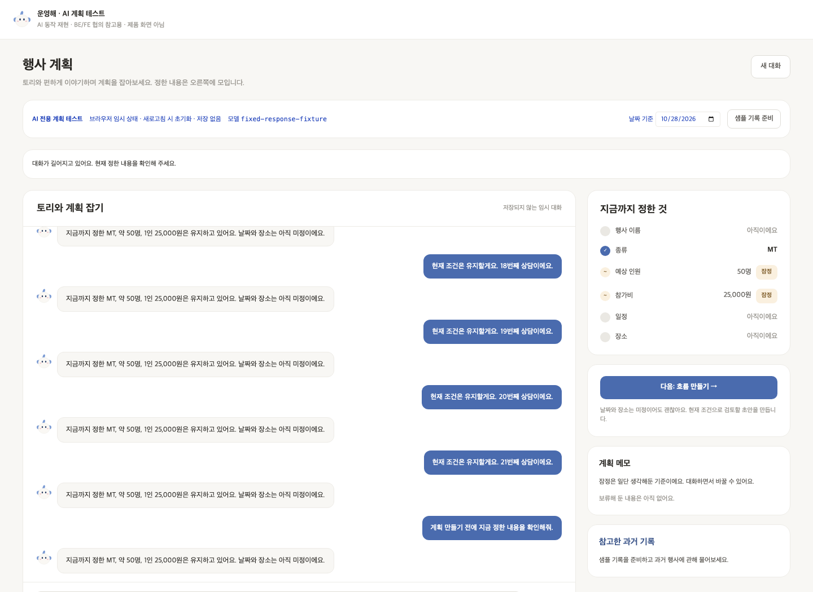

# 행사계획 대화 Agent 검증 기록

## 생성 보류와 조건 질문 보류의 경계 (#205, 2026-10-29)

사용자가 “예상 참가 인원을 60명으로 바꿔줘. 계획 초안은 만들지 마.”라고 말했을 때, 인원과 답변은 정상인데 날짜 질문 보류까지 추가되는 문제를 확인했다. 기존 #196 원본의 날짜 보류 추가는 19/30건이었다. 모델이 생성 금지 문장을 날짜 보류의 근거로 사용했고, 처리기는 원문 포함 검사만으로 수용했다. 두 보류의 지침 경계와 이전 날짜 문맥은 원인 후보이며 모델 내부의 판단 이유는 확정하지 않는다.

수정은 planning-agent-v6 시스템 지침에 두 보류의 차이와 혼합 요청, 미정과 보류의 구분을 명시한 것이다. 모델, Tool 스키마, 처리기와 Node 연결은 그대로다. 평가에서는 사용자 판단에 따라 tentative/specified 차이를 진단값으로만 남겼고, 기존 #196의 8/30 점수와 원본은 유지했다.

실행 코드 be82944(dirty=false), gpt-5.6-luna, 기존 timeout/retry 옵션으로 공개 함수를 실행했다. 같은 실행 코드에서 a60e818의 기존 시스템 지침과 수정 지침만 번갈아 주입했다. 핵심 각 30회와 대조 5종 각 3회로 총 90요청을 수행했다. 다음 표는 인원과 다른 조건, 주제 보류, 생성 보류와 실제 생성 없음, 이력/상태 보존 등을 함께 검사한 결과다.

| 사례 | 기존 지침 | 수정 지침 |
| --- | --- | --- |
| 핵심 입력: 인원 변경 + 생성하지 않기 | 13/30 | 30/30 |
| 생성 보류 표현 변형 | 0/3 | 3/3 |
| 날짜 직접 보류 | 3/3 | 3/3 |
| 날짜와 장소 함께 보류 | 3/3 | 3/3 |
| 직전 날짜 질문에 “그건 나중에” | 3/3 | 3/3 |
| 기존 날짜 보류에서 “날짜는 다시 얘기하자” | 0/3 | 2/3 |

**핵심 입력의 불필요한 날짜 보류는 17/30건에서 0/30건으로 줄었다.** 인원 변경과 다른 조건값 유지, 실제 생성 없음은 두 지침 모두 30/30건이었다. 이전 #196의 19/30과 이번 17/30은 별도 배치다.

모호한 재개 표현의 실패 1건은 그대로 보존했다. 이후 “날짜 보류를 해제하고 지금부터 일정을 정하자”라는 명확한 재개와 새 생성 보류 표현을 각 지침에서 각 3회, 총 12요청으로 별도 확인했다. 수정 지침은 각 3/3건을 통과했다. 기존 지침은 새 표현 0/3건, 명확한 재개 2/3건이었다(날짜 재개는 3/3건이지만 생성 보류 기록 누락 1건). 후속 성공을 원래 실패의 대체 표본으로 쓰지 않았다.

검증: 신규 오프라인 평가 기준 테스트 10개, AI 전체 회귀 877개 통과. 102요청의 204이벤트와 원본 복사/지침 해시를 확인하고, 공개 반환값을 다시 검사해 판정과 집계가 일치했다. API 키와 설정 주소를 보존하지 않았다. [원본, 상세 분석과 재실행](evaluation-results/planning-deferrals-2026-10-29/README.md), [입력 → 코드 → 결과](walkthrough.md#생성-보류가-날짜-질문-보류로-번지지-않게-하기-205).

두 보류의 범위를 명시하는 것이 이 입력군의 오류를 줄이는 데 도움이 됐다는 근거다. 지침 설명/예시와 문맥 영향 각각의 기여는 분리하지 않았다. 의미가 잘못 연결된 Tool 요청을 코드가 항상 차단하도록 바꾼 것은 아니며, 실제 표현의 확대와 모호한 재개 기준, 제품 연결은 남았다. 이미 보관된 보류 상태도 무조건 초기화하지 않는다.

## 반복 응답 시간 기준 측정 (#196, 2026-10-28)

[측정 기준](latency-baseline.md)을 정리했다. 일반 상담, 조건 변경, 채팅 생성, 버튼 생성을 구분하고 사례별 30회, 세션 3개의 단일 동시 요청 측정으로 시작한다. 성공 요청의 p50/p95와 성공률을 함께 보고 실패 결과와 시간도 보존한다. 이 표본 수는 프로젝트의 초기 측정 규모이며 통계적 충분성을 보장하지 않는다.

고정 입력과 반복 실행기, 전체/세부 구간 관측과 오프라인 집계를 구현하고 실제 모델 기준값을 수집했다. 기존 단발 검증은 반환 후 JSON 처리까지 일부 포함하므로 새 측정과 그대로 전후 비교하지 않는다. 최적화나 모델/프롬프트/재시도 정책 변경은 수행하지 않았다.

### 실제 모델 3세션 기준값 (2026-10-28)

`be76b60bad58f93b96e30ecfa5489970df3994fb`의 깨끗한 작업 트리에서 `gpt-5.6-luna`로 실행했다. 14:57:51~15:21:33(Asia/Seoul)에 새 프로세스 3개를 순차 실행했고, 준비 실행 12건과 본측정 120건이 모두 종료됐다. 각 요청은 같은 MT 50명/참가비 25,000원/날짜 미정 상태를 새로 복원했다. 요청 사이 1초, 동시 요청 1이며 실행기가 실패 표본을 대체하지 않았다.

timeout 60초, SDK max_retries=2, 생성 max_tokens=8192/내부 streaming=true를 유지했다. temperature와 reasoning은 명시하지 않았다. [실행 조건과 원본](evaluation-results/planning-latency-real-2026-10-28/README.md), [통합 집계](evaluation-results/planning-latency-real-2026-10-28/combined-summary.json)에 코드/프롬프트/입력 해시와 환경을 보존했다.

PR 준비 시 최신 develop의 #194/#198을 통합했다. 아래 수치는 이 변경 이전 `be76b60`의 기록이다. 2026-10-29 통합 후 AI 전체 회귀 867개가 통과했고 보존한 3세션의 재집계 JSON도 기존 결과와 일치했다. 현재 코드로 실제 모델을 재측정한 결과로 취급하지 않는다.

| 사례 | 자동 검사 통과 / 본측정 | 통과율 | 성공 p50 | 성공 p95 |
| --- | --- | --- | --- | --- |
| C1 현재 조건 설명 | 30/30 | 100.0% | 2.367초 | 3.262초 |
| C2 인원 60명으로 변경, 생성하지 않기 | 8/30 | 26.7% | 6.613초 | 9.068초 |
| G1 권유 수락으로 채팅 생성 | 28/30 | 93.3% | 17.066초 | 19.754초 |
| G2 버튼 생성 | 27/30 | 90.0% | 11.828초 | 13.293초 |

성공 지연은 자동 검사를 모두 통과한 요청만의 분포다. C2는 성공 표본 8개이며, 실패를 포함한 30개 전체 완료 시간의 p50/p95는 6.910/8.319초였다. G1의 전체 최장 요청은 실패한 31.244초다. 모든 실패 시간과 세션별 결과도 원본과 분석에 남겼다.

**C2의 인원 반영은 30/30건 성공했다.** 나머지 조건값 유지와 생성하지 않기도 30/30건 통과했다. 엄격한 실패 22건은 날짜 보류를 추가한 요청 19건과 인원을 tentative로 표시한 요청 4건에서 나왔다(1건 중복). 검사는 지정한 상태인 specified와 기존 보류 목록 유지까지 요구했다. “예상 참가 인원”을 tentative로 보는 해석 여지도 있으므로 기대 상태와 허용할 부가 변경부터 확인한다. 사후에 기준을 완화해 원래 점수를 바꾸지 않는다.

**생성 최종 실패 5건은 모두 validate_plan의 invalid_plan이었다.** 모델 응답과 구조화 해석 이후 코드 검증에서 거절됐다. 어떤 세부 규칙을 위반했는지는 현재 관측 범위 밖이다. 한 G1 요청은 Agent가 생성 Tool을 두 번 선택했고 두 번 모두 실패해 31.244초가 걸렸다. 따라서 실패 요청 5건과 실패한 생성 시도 6회를 구분한다. 본측정 120건 모두 공개 함수는 예외 없이 반환했지만 자동 검사 성공은 93건이었다.

전체 완료 요청의 평균으로 보면 G1은 대화 모델 합계 5.181초와 생성 Graph 합계 12.686초, G2는 대화 모델 0초와 생성 Graph 11.672초였다. 생성 시도 61회의 코드 검증은 평균 약 0.216ms였다. 검증 실행 비용보다 모델 작성 후 계획이 거절되고 때로 다시 생성되는 경로가 우선 조사 대상이다. 부모 생성 Graph와 자식 모델/검증 시간은 중복 합산하지 않았다. 모델 구간은 SDK/통신/수신/해석을 포함하며 순수 추론 시간이 아니다.

검증: 세션별 44요청의 시작/종료 88이벤트, 총 264이벤트와 설정 일치/입력 해시/구간 완전성을 정식 집계기로 확인했다. 원본의 복사 전후 바이트 일치를 확인하고, 보존본의 재집계와 보조 진단 재계산이 원래 결과와 일치했다. API 키와 설정 주소는 결과에 포함하지 않았다. 측정 관련 테스트 `test_planning_latency*.py` 90개를 다시 실행해 모두 통과했고 문서의 로컬 링크와 diff 공백 검사도 통과했다. 이번 단계는 기능 코드를 변경하지 않았으며 아래 825개 회귀 통과는 앞선 관측기 구현 단계의 기록이다.

해석 범위와 다음 조사:

- 같은 합성 MT 상황 4종의 반복이다. 서비스 전체의 품질/성공률, 긴 이력, 검색, 동시 처리량을 대표하지 않는다. BE DB/HTTP와 FE 표시 시간은 제외한다.
- 본측정 논리 모델 진입은 대화 182회/생성 61회다. SDK HTTP 재시도 횟수, 토큰과 공급자 캐시는 미관측이며 null을 유지한다.
- 먼저 C2의 기대 상태와 부가 보류 변경을 확인하고, 계획 검증에 안전한 세부 규칙 코드를 남길 수 있게 한 뒤 원인을 좁힌다. 최적화는 그 이후 한 요소씩 비교한다.
- p95와 평균 차이를 완료 시간 보장이나 순수 Agent 오버헤드로 사용하지 않는다. 화면 안내는 “잠시 걸릴 수 있어요”를 유지한다.

실제 성공 요청 한 건과 재시도 실패 한 건의 입력 → 함수 → 반환은 [코드 따라가기](walkthrough.md#실제-모델에서는-어떤-시간이-기록됐는가)에 설명했다. 아래 기록/집계 테스트의 ms 숫자는 고정 시계로 지정한 검산값이며 이 실측과 구분한다.

### 세부 구간과 논리 모델 호출 관측 검증 (2026-10-28)

`c180e45` 기반 작업 트리에 관측기와 새 기록 형식, 집계를 연결했다. 실제 공개 함수와 Graph를 실행하되 모델 응답과 시계만 고정했다. 외부 모델 호출은 0회이며 아래 값은 실제 서비스 지연이 아니다. 코드/입력 파일 해시와 실제 관측 예시는 [검증 원본](evaluation-results/planning-latency-stages-fixed-2026-10-28.json)에 있다.

| 확인 | 결과 |
| --- | --- |
| 변경 전 AI 전체 회귀 | 799개 통과 |
| 구간 관측과 집계 신규 테스트 | 26개 통과 |
| AI 전체 회귀 | 825개 통과 |
| CLI 연결 검증 | 네 사례 정상 기록, report_version=2를 읽어 구간 집계까지 성공 |
| 가상 요청 시간 C1 / C2 / G1 / G2 | 5 / 15 / 47 / 32ms, 지정한 값과 일치 |
| 채팅 생성 G1 | 대화 모델 2회, 생성 모델 1회. 생성 32ms 안에 작성 30ms와 검증 2ms |
| 버튼 생성 G2 | 대화 모델 0회, 생성 모델 1회. 생성 Graph 32ms |
| Agent가 실패 후 다시 생성 Tool을 선택한 사례 | 생성 30ms 실패와 32ms 성공 보존. 생성 모델 시도 2회, 요청당 생성 합계 62ms |

기본 인자에 이미 묶인 생성 invoke도 관측되는지, 실패한 첫 대화 모델이 논리 시도 1회로 남는지 확인했다. 정상 반환된 생성 실패의 실제 관측 원인(timeout/출력 한도)과 계획 검증 실패(invalid_plan)를 구분했다. 예외 원문은 구간 JSON에 복사하지 않았다. 감싼 함수는 설치 범위 밖에서 원래대로 호출되고 정상/예외 종료 후 복원됐다. 같은 프로세스의 동시 설치는 거절하고 요청별 ContextVar 기록이 섞이지 않음을 확인했다.

취소는 부모 task를 실제로 cancel해 확인했다. 동기 검증 함수가 executor에서 계속 실행 중인 경우에는 요청 종료 시점을 기준으로 스냅샷을 고정하고 pending 구간의 시간을 null로 남겼다. 이미 종료된 요청에 뒤늦게 완료된 시간을 섞거나 0ms로 채우지 않았다. 구간 집계는 완료된 호출과 중단 대기를 구분했다. 잘못된 부모 ID, 호출 수, 포함 범위와 완료 표시는 집계에서 거절했다.

새 관측 기록은 report_version=2, 집계는 summary_version=2다. version=1도 읽되 구간은 null로 표시하고 새 기록과 병합하지 않는다. HTTP 재시도 횟수와 토큰은 관측하지 않았으므로 계속 null이다. 모델 메시지 text 길이는 Tool 스키마를 포함한 전체 모델 입력 길이나 토큰 수가 아니다.

재실행 (`be/`, 외부 모델 호출 없음):

```sh
.venv/bin/python -m pytest app/ai/tests/test_planning_latency_observation.py app/ai/tests/test_planning_latency_stage_summary.py -q
```

### 고정 응답으로 기록과 집계 검증 (2026-10-28)

기록기 기준 `dbc5e88`, 계산 구현 `0b416f3`와 같은 작업의 파일 검증/집계 변경으로 확인했다. 모델/공개 함수/프롬프트는 변경하지 않았고 외부 모델 호출은 0회다. 검증을 두 가지로 구분했다.

- 실제 공개 함수와 Graph에는 고정 모델 응답과 가상 시계를 넣었다. 두 세션의 준비 실행 8회와 본 측정 16회가 기록기에서 집계기로 이어졌고, 지정한 실패가 성공률에 반영되며 원본 파일도 유지됐다.
- 계산 정답 검증에는 시간을 직접 지정한 합성 이벤트 기록을 사용했다. 세 세션의 132개 요청 중 준비 실행은 12개, 본 측정은 120개였다. 각 사례에 성공 시간 1~28초와 실패 2개를 지정했고, 정답과 실제 CLI 결과를 비교했다. 서비스 성능 측정이 아니다.

| 확인 | 결과 |
| --- | --- |
| 변경 전 AI 회귀 | 764개 통과 |
| 기록/집계 신규 테스트 | 35개 통과 |
| AI 전체 회귀 | 799개 통과 |
| 계산용 기록의 사례별 시작/성공/실패 | 30 / 28 / 2 일치 |
| 계산용 성공률 | 28/30 = 93.3% 일치 |
| 계산용 성공 p50 / p95 | 14,500ms / 26,650ms 일치 |
| 준비 실행 분리 | 12개를 본 측정 분위수에서 제외 |
| 여러 세션의 분위수 | p95 평균을 내지 않고 원본 표본을 합쳐 다시 계산 |

[계산 정답과 CLI 관측 결과](evaluation-results/planning-latency-aggregation-known-2026-10-28.json)에 합성 데이터임을 표시하고 원본 파일 및 집계 코드 해시를 남겼다. 위 시간은 코드 검산을 위해 넣은 값이며 실제 모델의 속도나 성공률이 아니다.

종료가 없는 started, 명시적 취소, 미시작 요청을 구분하고 부분 결과로 표시했다. 중복 이벤트, 대응 없는 종료, 잘못된 시간과 성공 표시, 고정 입력 변경, 다른 설정의 세션 병합은 거절했다. 마지막 JSON 한 줄이 덜 쓰인 경우에는 손상을 표시하고 부분 기록을 보존했다. 완전한 기록의 manifest 건수는 원본 이벤트와 대조했다. CLI의 기존 출력 파일 보존과 API 설정 미사용도 확인했다.

재실행 (`be/`, 외부 API 호출 없음):

```sh
.venv/bin/python -m pytest app/ai/tests/test_planning_latency_summary.py app/ai/tests/test_planning_latency_aggregation.py -q
```

이 단계의 집계는 공개 함수 전체 시간에 대한 것이었다. 내부 구간과 SDK 재시도/모델 호출 수를 새로 관측하거나, 미완료 시간을 완료 시간으로 추정하지 않았다. 당시 미관측 필드는 null로 남겼다. 이후 구간 관측 구현은 위 검증 기록에서 구분한다.

### 고정 입력과 반복 실행기 검증 (2026-10-28)

기준 코드 `6058a83`, 측정 기준 `6662b4f`, 입력 구현 `2a2562e`와 같은 작업의 실행기 변경으로 확인했다. 공개 실행 코드, 프롬프트와 모델 옵션은 변경하지 않았다. 실제 공개 함수와 Graph를 실행하되 모델 응답만 고정했다. 외부 모델 호출은 0회다.

| 확인 | 결과 |
| --- | --- |
| 변경 전 AI 회귀 | 735개 통과 |
| 고정 입력과 반복 실행기 테스트 | 신규 29개 통과 |
| AI 전체 회귀 | 764개 통과 |
| CLI dry-run | API 설정 없이 네 요청 검증, 모델 호출 없음 |
| 별도 파일 기록 검증 | 준비 실행 4회와 본 측정 8회, started/finished 24개, 기대 동작 검사 모두 통과 |
| 고정 생성 모델 호출 | 채팅/버튼 합계 6회. 이전 초안을 재사용하지 않음 |

매 반복은 같은 이력 4개와 50명, 생성 전 상태에서 출발했다. 인원을 변경한 결과나 생성한 초안을 다음 반복에 전달하지 않았다. 예외 후 다음 사례 실행, 정상 반환한 생성 실패의 실패 집계, 반영 없이 답변만 하는 경우, 요청 오염, 기존 폴더 보존, 취소와 종료 기록을 확인했다. 결과 검사에 가상의 100ms를 더해도 가상의 함수 시간 5ms에는 섞이지 않는 테스트로 타이머 경계를 확인했다. 이 숫자는 검사용 시계 값이며 모델 지연이 아니다.

이 단계의 기록 범위는 공개 함수 전체 시간과 공개 반환 결과였다. 실패한 내부 모델 호출, SDK HTTP 시도와 토큰 사용량은 관측하지 않고 null로 표시했다. 정상 반환한 생성 실패는 generation_failed로 기록했으며 공개 문구에서 timeout 등 세부 원인을 추측하지 않았다. 이후 세부 구간 구현에서는 실제 관측한 원인을 연결한다. 이 기록은 반복 실행기의 동작 검증이며 서비스 응답 시간의 기준값이 아니다.

## 제외 단계 이름과 저장 호환 (#198, 2026-10-28)

기준은 develop `16a2df9`, 이름 보완 코드 `f257f3b`와 같은 작업의 테스트 UI 변경이다. 공통 이름 목록, 최종 응답과 저장 상태 복원, 실제 생성 Graph와 독립 UI를 확인했다. 모델 응답을 고정했고 외부 모델 호출은 0회다. 행사별 단계 선택의 적절성이나 실제 모델의 성공률을 측정한 결과가 아니다.

| 확인 | 결과 |
| --- | --- |
| 변경 전 관련 테스트 | 61개 통과 |
| 이름 보완과 저장 호환 회귀 추가 후 관련 테스트 | 77개 통과, 신규 16개 |
| AI 전체 테스트 | 751개 통과 |
| 변경 전후 모델용 PlanComposition JSON Schema 비교 | 동일 |
| 변경 전후 모델에 전달하는 13개 카탈로그와 생성 프롬프트 비교 | 동일 |
| 기존 실제 모델 검증 기록을 새 타입으로 읽기 | 화면 응답 6건과 초안 2건 복원, 이름 없던 제외 항목 1개 보완 |
| 독립 테스트 UI | build, lint, 변경 파일 Prettier 확인 통과 |
| 브라우저 검증 | 버튼 생성 성공, 제외 항목 2개의 이름과 이유 일치, 브라우저 오류 0건 |

고정 응답 테스트는 채팅 Tool 생성과 버튼 생성, 동일 성공 요청 재사용, 이름 없는 저장 상태의 복원, 실패한 재생성 뒤 이전 초안 보존을 확인한다. 누락된 name만 보완하고 명시된 잘못된 이름이나 알 수 없는 코드는 거절한다. 기존 포함/제외 완전성, 날짜, 행동 조합 검사는 유지한다.

기존 실제 모델 기록은 [2026-10-25 원본](evaluation-results/planning-public-2026-10-25.json)을 오프라인으로 읽었으며 새 모델 실행이 아니다. 저장 상태 보존은 별도의 고정 응답 테스트로 확인했다. 실제 제품 DB, HTTP 응답 매핑과 FE 연결은 #187에서 검증해야 한다. 경고의 생성 주체를 나타내는 source 필드는 이번 범위에 포함하지 않았다.

브라우저에서는 `MT, 50명, 참가비 25,000원, 날짜 미정` 대화 뒤 「다음: 흐름 만들기」를 눌렀다. 고정 모델 출력은 수요 조사와 예약을 제외한 초안이며, 실제 `validate_plan()`이 이름을 붙였다. UI는 자체 코드 변환 없이 응답의 name과 reason을 표시했다. 아래 화면과 [검증 원본](ui-tests/excluded-step-names-198.json)은 이 표시 경로의 증거다.


핵심 회귀 재실행 (`be/`, 모델/네트워크 호출 없음):

```sh
.venv/bin/python -m pytest app/ai/tests/test_planning_excluded_names.py app/ai/tests/test_plan_generation_graph.py app/ai/tests/test_planning_public_workflow.py app/ai/tests/test_planning_public_state.py app/ai/tests/test_planning_contract_boundary.py -q
```

## 공개 함수 실제 모델 연결 검증 (#184, 2026-10-25)

`app.ai.chat_planning` 5회와 `app.ai.generate_planning_preview` 1회를 실제 모델 `gpt-5.6-luna`로 호출했다. 내부 Graph를 직접 호출하거나 모델 응답을 대체하지 않았다. 각 채팅 결과를 JSON 문자열로 저장한 뒤 다음 입력에서 복원했다. [결과 원본](evaluation-results/planning-public-2026-10-25.json), [재현 스크립트](../../scripts/check_planning_public.py).

| 입력/경로 | 관찰 결과 | 지연 |
| --- | --- | --- |
| 날짜 미정, 대략 50명 | 날짜 보류, 인원 50명 잠정 반영 | 5.673초 |
| 3만 원 상담, 아직 변경하지 않기 | 기존 25,000원 유지 | 3.872초 |
| 저장/복원 후 “일단 그렇게 잡자” | 참가비 30,000원 잠정 반영 | 4.166초 |
| 생성하지 말고 권유만 요청 | pending 권유 저장, 생성 없음 | 4.822초 |
| 권유 후 “응, 만들어줘” | 채팅 생성 성공, 구조화 초안 13단계 | 26.287초 |
| 3번째 턴의 동일 조건에서 버튼 생성 | 생성 성공, 12단계, 새 메시지 없음 | 16.522초 |

자동 확인 기준 9개가 모두 참이었다. 조건 반영, 날짜 보류, 상담 시 값 유지, 짧은 수락, 권유와 생성 구분, 두 생성 경로, 버튼 이력 유지, JSON 왕복 일치를 확인했다. 각 턴의 전체 화면 응답과 상태 크기/이력 개수도 원본에 기록했다.

HEAD `694e11f`, 작업 트리 변경 있음. 관련 코드/프롬프트/설정 코드/검증 스크립트의 SHA-256을 기록했다. 기존 모델 및 생성 설정을 변경하지 않았고 키, 설정 주소, 공급자 예외 원문은 결과에 넣지 않았다.

해석 범위:

- 합성 MT 대화 한 건의 6개 공개 요청이다. 전체 성공률이나 지연 분포를 추정하는 평가가 아니다.
- 생성 권유는 사용자가 직접 요청했다. 자발적 권유 시점의 적절성을 검증하지 않았다.
- 검색 port를 주입하지 않았다. 실제 BE 검색, DB, HTTP, FE 연결은 미검증이다.
- 같은 조건이어도 생성 구성은 달랐다(채팅 13단계, 버튼 12단계). 두 경로가 같은 생성 기능을 사용하는 것과 출력이 항상 같다는 것은 다르다.
- 채팅 답변은 10개 항목으로 요약했지만 구조화 초안은 13단계였다. 화면의 Step 수/순서는 generation_result.preview.steps로 구성해야 한다.
- 상담에서 모델이 50명 × 30,000원 = 150만 원을 설명했지만 budget_total은 null로 유지됐다. 이 사례에서 산술은 맞았으나 계산 Tool 정확도나 금액 적정성까지 검증한 것은 아니다.
- 실패와 동시 저장 충돌은 이번 실제 모델 실행에서 발생시키지 않았다. 기존 고정 응답 테스트와 BE 연결 검증을 구분한다.

재실행은 `be/`에서 수행한다. 기존 결과 파일은 덮어쓰지 않고 새 이름을 지정한다.

```bash
.venv/bin/python -m app.ai.scripts.check_planning_public --output app/ai/docs/planning/evaluation-results/planning-public-new-run.json
```


## 생성 수락 후 반복 실패 — 출력·전송 한도 진단 (#176, 2026-10-24)

현재 UI에서 워크숍·약 40명·참가비 25,000원·10/31~11/2를 정리한 뒤 권유를 수락했으나 생성이 실패했고, 재요청도 실패했다. 화면의 처리 흐름에서 생성 Tool 실행과 모델 1회 호출을 확인했다. 수락 해석을 통과한 뒤의 실패이며, 원래 UI 두 실패의 공급자 응답은 수집하지 못했으므로 그 두 응답의 원인을 소급해 단정하지 않는다.

같은 워크숍 조건을 별도로 재현하자 **응답이 `incomplete / max_output_tokens`, 출력 2,000토큰에서 종료**됐다. JSON은 문자열 중간에서 끊겼다. 추론에 쓴 648/516토큰도 같은 출력 한도에 포함돼 단계·일정·행동 JSON을 마치지 못했다. 날짜 미정 MT·날짜 있는 소풍을 포함한 고정 4회에서 생성 1/4 성공, 출력 한도 중단 3/4이었다.

한도만 8,192로 높인 일반 응답 요청은 HTTP 400으로 거절됐다. 게이트웨이가 일반 응답의 2,000토큰 상한과 더 긴 출력의 스트리밍 필요를 명시했다. 따라서 생성 전용 모델에 `streaming=True`, `max_output_tokens=8192`를 함께 설정했다. 생성/대화 프롬프트·모델·reasoning 기본값·카탈로그·스키마·계획 검증은 유지했다. 스트림을 완성본으로 모아 기존 구조화 검증을 하므로 UI 계약이나 제품 `fe/`는 바꾸지 않았다.

| 고정 사례 | 기존 일반 응답·한도 미지정 | 생성 전용 스트리밍·한도 8,192 |
| --- | --- | --- |
| 워크숍 1 | 출력 중단, 2,000토큰 | 생성 성공, 2,148토큰 |
| 워크숍 2 (동일 조건 재실행) | 출력 중단, 2,000토큰 | 생성 성공, 2,445토큰 |
| MT·날짜 미정 | 생성 성공, 1,268토큰 | 생성 성공, 1,354토큰 |
| 소풍·날짜 있음 | 출력 중단, 2,000토큰 | 생성 성공, 2,231토큰 |

모델 gpt-5.6-luna, planning-generation-v1, 같은 프롬프트 SHA-256. [이전 원본](evaluation-results/planning-generation-limits-baseline-2026-10-24.json)·[조정 후 원본](evaluation-results/planning-generation-limits-stream8192-2026-10-24.json)·[고정 입력](../../tests/fixtures/eval/planning_generation_limits.json)을 보존했다. 당시 임시 진단 실행기를 [재실행 스크립트](../../scripts/diagnose_plan_generation.py)로 정리했다. 원본의 전체 코드 해시는 당시 미수집이며 HEAD·dirty 상태·프롬프트 해시·원래 결과를 남겼다. 진단은 생성 graph만 호출해 대화 해석과 분리했고, HTTP 응답을 버퍼링해 종료 상태를 관찰했다. 같은 입력의 순차 4회 비교이지 전체 서비스 성공률·통계적 개선율·지연 성능 비교가 아니다. 8,192는 상한이며 항상 그만큼 소비하는 값이 아니다.

추가로 다음을 확인했다.

- 기존 UI의 상태·대화를 유지하고 서버만 재시작한 뒤 “다시 시도해줘” → **13단계 P2 성공, 26.68초**. 조건·잠정 여부가 이전과 같고 source=chat, 대화 모델 2회·생성 모델 1회였다. [UI 복구 기록](ui-tests/agent-generation-recovery-2026-10-24.json).
- 새 합성 대화에서 먼저 권유를 요청 → pending 제안 기록(6.15초) → “그렇게하자” → 같은 offer ID 수락·초안 성공(25.30초), 2/2턴 기대 기준 일치. [입력과 실제 결과](evaluation-results/planning-workshop-acceptance-2026-10-24.json). 먼저 권유를 요청한 사례이므로 자발적 권유 품질의 평가가 아니다.
- API 없는 AI 회귀 **698개 통과**. 기존 미커밋 legacy 평가 1개는 제외했다. 실제 SDK의 스트림 조립·출력 한도 전송·미완성/종료 신호 누락 거절·진단 비밀정보 제외를 검증했다. 조건·기존 초안 보존 회귀도 유지했다.

출력 한도 미완성을 일반 형식 오류와 구분하는 `AIOutputLimitError`를 추가했다. 생성 실패는 `compose_plan / output_limit|invalid_output|timeout|temporarily_unavailable`, `validate_plan / invalid_plan`처럼 단계·분류만 로그에 남기고 고정된 안전한 사유를 전달한다. 공급자 원문·SDK 메타정보 전체·대화·키는 로그/UI에 넣지 않는다. JSON이 파싱돼도 공급자가 미완성이라고 알렸거나 스트림의 최종 완료 신호가 없으면 채택하지 않는다. 일반 응답에서 SDK 파싱이 먼저 실패해 종료 메타정보를 얻지 못한 경우는 출력 한도로 단정하지 않고 기존 형식 오류로 남긴다.

자동 생성 반복, JSON 덧붙이기 보정, 모델·reasoning·프롬프트 교체는 하지 않았다. 같은 낮은 한도로 반복 호출하거나, 출력 내용을 억지로 축약해 검증 요구를 바꾸는 방안보다 확인한 전송 제약을 바로잡는 쪽을 택했다. 시간 초과·8,192 초과·잘못된 날짜/단계/근거·수락 해석 오류가 모두 해소됐다는 뜻은 아니다. 실제 사례 확대와 실패 유형별 누적 관찰은 계속 필요하다.

재실행(`be/`, 실제 모델 호출·새 결과 파일 사용):

```sh
# 기존 일반 응답과 현재 생성 전용 전송을 같은 입력으로 비교
.venv/bin/python -m app.ai.scripts.diagnose_plan_generation --transport regular --max-output-tokens 0 --json /tmp/planning-limit-before-new.json
.venv/bin/python -m app.ai.scripts.diagnose_plan_generation --json /tmp/planning-limit-after-new.json
# 실제 Agent의 권유 → 짧은 수락 → 생성
.venv/bin/python -m app.ai.scripts.eval_plan_generation --dialog workshop-offer-acceptance --json /tmp/planning-acceptance-new.json
```

## 테스트 UI 소유 범위 정정 — 독립 앱 (#174, 2026-10-24)

AI 테스트 UI를 제품 `fe/`에서 `tests/ui/planning/`으로 옮겼다. 자체 package/lockfile·설정·node_modules로 설치·빌드하며 제품 FE를 import하지 않는다. 초기 화면 조각은 참고용 복사본으로 보존했다. 제품 FE의 라우트·공용 컴포넌트·타입·프록시에 넣었던 AI 테스트 변경은 제거했다. Agent·생성 프롬프트와 API 로직은 이번 정정에서 바꾸지 않았다.

- 현재 작업공간: 독립 앱 빌드·전체 lint 통과, 기존 미커밋 legacy 평가 1개를 제외한 AI 회귀 684개 통과. `020933b^`의 FE와 작업 결과의 전체 `fe/` 차이가 없음을 확인했다.
- #170: 해당 PR의 P1·검색 범위만 분리했다. `npm ci`로 독립 설치·빌드·전체 lint, AI 회귀 641개 통과. PR 기준 커밋 `7f23cce`와 전체 `fe/` 차이가 없음을 확인했다. P2 생성 코드를 추가하지 않았다.

실제 브라우저의 새 포트 5174 → 자체 프록시 → AI 8011 → 화면을 확인했다(gpt-5.6-luna, planning-agent-v5 / generation-v1). MT·40명·인당 25,000원, 날짜/장소 보류 반영은 12.40초였다. 버튼의 첫 생성은 `failed`(16.34초)였고 조건·이력은 유지됐다. 안전한 실패 메시지 이상의 상세 원인은 이번에 수집하지 않았으므로 JSON 파싱 실패로 단정하지 않는다. 새 버튼 요청은 12단계 생성 성공(12.34초), source=button·이력 6개 유지·일정 null을 확인했다. 실패를 성공 실행으로 덮어쓰지 않고 [기록](ui-tests/agent-isolated-2026-10-24.json)에 함께 남겼다. [독립 앱 화면](ui-tests/agent-isolated-p2-2026-10-24.jpg)은 제품 내비게이션 없이 AI 전용임을 표시한다.

#170의 별도 검증 포트 5175 → 해당 PR의 API 8012에서는 planning-agent-v2로 조건 반영(6.42초), 합성 기록 12종 준비 후 과거 참가비 45,000원·출처 조회(14.81초)를 확인했다. 현재 참가비 25,000원·약 50명은 유지됐다. 검증용 포트만 별도로 썼으며 기본 실행 설정은 5174/8011이다. 과거 품질 평가의 재실행·정확도 비교가 아니라 폴더 분리 후 기존 기능의 연결 확인이다.


## 5-3 — 실제 채팅·버튼 생성과 P2 연결 (2026-10-24, #173)

모델 gpt-5.6-luna, provider 기본 reasoning, 생성 프롬프트 planning-generation-v1. 검색·임베딩·DB는 호출하지 않은 합성 사례다. 실행 전 고정한 [입력](../../tests/fixtures/eval/planning_generation.json)으로 3개 대화·6턴을 실행했다. 실패 뒤에도 실제 상태를 다음 턴에 넘겼으며 기대값으로 고치지 않았다.

| 관찰 | 대화 v3 [원본](evaluation-results/planning-generation-2026-10-24.json) | 대화 v4 [원본](evaluation-results/planning-generation-v4-2026-10-24.json) |
| --- | --- | --- |
| 조건·권유·생성 상태 등의 복합 기대 기준 | 1/6 일치 | 4/6 일치 |
| 현재 조건 일치 | 2/6 | 6/6 |
| 입력 원본 보존 | 6/6 | 6/6 |
| 대화 모델 호출 | 7 | 7 |
| 생성 모델 호출 | 2 | 3 |
| 실제 채팅 HTTP | 9 | 10 |
| 성공한 생성 | 1/2 시도. 별도 버튼 1건은 생성 전 보류 | 2/3 시도 |

### 발견한 문제와 좁은 보완

v3 첫 턴은 “날짜와 장소는 나중에”를 dates/location의 근거로 각각 재작성했다. 원문에 없는 문구여서 조건 변경 묶음 전체가 거절됐고, 이 상태가 뒤의 3턴에도 이어졌다. 따라서 첫 대화의 4건 불일치를 서로 독립적인 실패로 해석하지 않는다.

검증 규칙을 완화하거나 값을 자동 반영하지 않고, **연속된 원문을 그대로 복사하고 공통 문구를 여러 항목에서 재사용하며 거절되면 원문을 다시 확인하라**는 지침만 추가했다(planning-agent-v4). 실행기의 진단 필드도 추가했다. 동시 작업의 이해용 주석 변경은 남아 있지만 생성 처리의 행동·프롬프트·평가 입력은 바꾸지 않았다. 전후 입력과 생성 프롬프트 해시는 일치한다.

v4에서는 조건 반영과 보류 후 버튼 생성이 성공했다. 남은 2건은 다음과 같다.

- 첫 턴에서 조건은 반영했지만 생성 권유를 하지 않아 `offer=pending` 기대와 달랐다. 권유 타이밍은 LLM 판단이므로 이 결과는 자동 생성이나 조건 반영 실패와 구분한다. 자발적 권유의 일관성은 남은 과제다.
- 날짜가 정해진 소풍의 버튼 생성은 `AIInvalidResponseError`였고, 하위 스키마 오류 유형은 `json_invalid`였다. 구조화 JSON 파싱 실패까지 확인했으며, 생성 내용이나 날짜 계산 자체가 원인인지는 확정하지 못했다. 같은 생성 설정의 별도 [단일 재실행](evaluation-results/planning-generation-dated-diagnostic-2026-10-24.json)은 24,005ms에 성공했다. 성공한 재실행으로 앞선 실패를 대체하지 않는다.

표본이 작고 사람의 정답 검수 전이다. 프롬프트별 각 한 번 실행이며 모델의 비결정성도 있어 개선율·일반 정확도로 주장하지 않는다. 전후에는 앞선 실패로 실제 생성이 차단된 턴도 있고 진단/UI 실행이 일부 겹쳐 전체 지연을 성능 개선율로 비교하지 않는다. v4에서 성공한 버튼 생성은 18,058ms, 직접 채팅 생성은 22,377ms였다.

### 브라우저에서 실제 확인한 흐름

[UI 입력·상태 기록](ui-tests/agent-generation-trace-2026-10-24.json)은 CLI와 별도 실행이다. SDK 이력·비텍스트 블록·응답 메타정보는 제외하고 화면 진단 데이터만 선별했다.

| UI 행동 | 실제 확인 | 표시된 시간 |
| --- | --- | --- |
| MT·약 50명·25,000원, 날짜/장소 보류 | 잠정값·보류 반영, pending 권유, P1 유지(v3) | 18.11초 |
| 다음 버튼 | 별도 버튼 API → 12단계, 날짜 미정 P2. 채팅 이력 8개 유지 | 20.21초 |
| 서버 중지 후 다시 만들기 | 연결 오류, 같은 이전 preview ID 유지, 입력 잠금·재시도 표시 | 모델 미호출 |
| 서버 복구 후 같은 요청 재시도 | 새 초안 성공, 채팅 이력 8개 유지 | 20.95초 |
| 40명 변경·생성 보류 | 현재 40명, 이전 preview는 50명으로 보존, 다른 기준 안내(v4) | 7.53초 |
| 현재 40명으로 채팅 생성 | 생성 Tool → 12단계 P2, trigger=chat, 날짜 미정·참가비 잠정 유지 | 20.04초 |

[버튼 결과](ui-tests/agent-generation-button-2026-10-24.jpg), [연결 실패 시 보존](ui-tests/agent-generation-failure-2026-10-24.jpg), [채팅 결과 전체](ui-tests/agent-generation-chat-2026-10-24.jpg), [화면 개요](ui-tests/agent-generation-chat-overview-2026-10-24.jpg)를 보존했다. 서버 로그에서 서로 다른 POST 경로의 200 응답을 확인했다. 기본 오류와 생성 실패 구분은 API 없는 테스트에서도 확인했으며, 실제 UI에서 모델 JSON 실패를 의도적으로 재현한 실험은 하지 않았다.

API 신규 3개·생성 메시지 ID 바인딩 회귀 1개를 포함해 커밋 대상 회귀 684개 통과(기존 미커밋 legacy 평가 테스트 1개 제외), FE 빌드와 변경 파일 lint 통과. 운영 번들에 테스트 API·생성 버튼 문구가 포함되지 않음을 확인했다. 본문은 일반 텍스트여서 Markdown 기호가 보일 수 있고, 실제 답변에 아직 구현하지 않은 '예산 초안'을 언급한 표현과 추가 확인 목록의 날짜 중복이 있어 문체·내용 품질 과제로 남긴다.

### 짧은 수락의 메시지 ID 복사 오류와 v5 보완

별도 브라우저 상담에서 pending 권유 후 “응, 그 초안 만들어줘.”를 입력했다. v4는 문구는 맞게 복사했지만 이번 메시지 ID의 `4d97`을 `4d98`로 잘못 복사했다. 같은 잘못된 ID로 두 번 요청해 모두 `needs_clarification`이었고 초안은 생성되지 않았다(7.66초). [전후 원본](ui-tests/agent-generation-acceptance-2026-10-24.json)에 실제 사용자 ID·모델 인자·거절 사유를 남겼다.

메시지 ID는 모델이 판단할 정보가 아니므로 생성 Tool 인자를 `evidence`에서 원문 `quote`로 줄였다. 코드가 현재 요청 ID를 붙이며 원문 일치·pending 권유 ID·기준 조건 검사는 그대로 유지한다(planning-agent-v5). 모델의 잘못된 ID를 자동 교정하거나 근거 검사를 완화하는 방안은 택하지 않았다. 조건 변경과 권유 보류 Tool의 근거 계약은 바꾸지 않았다.

같은 상담 세션의 pending 권유를 유지하고 같은 문장을 새 턴으로 입력하자 quote·직전 offer_id만 요청해 생성에 성공했다. 실제 현재 메시지 ID와 preview.trigger.request_id가 일치했고 12단계·날짜 미정·50명/25,000원 잠정 조건을 유지했다. 대화 모델 2회·생성 모델 1회, 23.74초였으며 [화면](ui-tests/agent-generation-acceptance-2026-10-24.jpg)을 보존했다. v5의 집중 회귀와 이 UI 1회 관찰이며 위 6턴 평가를 v5로 다시 실행한 수치는 아니다. 단계 수보다 자연어 답변이 단계를 합쳐 설명하는 점, 날짜 질문 중복 등 내용 품질은 별도로 남는다.

재실행은 `be/`에서 다음과 같다. 실제 모델을 호출하며 원본 결과 파일은 덮어쓰지 않는다.

```sh
.venv/bin/python -m app.ai.scripts.eval_plan_generation --json app/ai/docs/planning/evaluation-results/planning-generation-new-run.json
# 날짜가 있는 사례만 확인
.venv/bin/python -m app.ai.scripts.eval_plan_generation --dialog dated-button --json app/ai/docs/planning/evaluation-results/planning-generation-dated-new-run.json
```

## 5-2 — 생성 내부 실행 회귀 (2026-10-24, #172)

모델 응답을 주입해 실제 대화 graph와 생성 graph를 실행했다. 신규 39개(요청·권유 5, 생성·버튼 22, 대화 연결 12)와 이번 커밋 대상의 AI 회귀 680개가 통과했다. 요청 분리, 권유만으로 미생성, 수락·직접 요청, 보류·오래된 제안, 조건 변경 실패, 날짜·단계·출처 검사, 입력·이전 초안 보존을 확인했다. 대화 프롬프트는 planning-agent-v3, 생성은 planning-generation-v1이다.

전체 작업 트리 실행은 681개였다. 이 중 기존 미커밋 legacy 평가 테스트 1개는 이번 작업에 포함하지 않았고, 해당 파일을 제외한 실행에서 680개를 확인했다.

실제 LLM·임베딩 API는 호출하지 않았으며 판단 정확도·생성 품질·친근함·지연·HTTP 호출 수는 미측정이다. 4단계 실측과 비교할 품질 점수가 아니다. 실제 모델과 HTTP·P2 UI 연결 검증은 5-3에서 수행한다. [명세](step-05-generation.md)와 [입력→코드→결과](walkthrough.md)를 함께 읽는다.

## 테스트 UI 소유 범위 정정 — 독립 P1·검색 앱 (#174, 2026-10-24)

테스트 UI를 제품 `fe/`에서 `tests/ui/planning/`의 독립 앱으로 옮겼다. 자체 package/lockfile·Vite·타입검사·lint·node_modules를 사용하고 제품 FE import·설치 의존성은 없다. 초기 화면 조각은 테스트용 복사본으로 보존했다. 제품 라우트·공용 컴포넌트·타입·프록시에 추가했던 AI 테스트 변경은 제거해 PR 기준 `7f23cce`와 전체 `fe/` 차이가 없다. 실제 제품 UI 구현은 FE팀이 담당한다.

`npm ci` 독립 설치, 앱 빌드·전체 lint, AI 회귀 641개가 통과했다. 이번 정정에서 Agent 프롬프트(planning-agent-v2)·검색 정책·API는 바꾸지 않았고 P2 생성도 추가하지 않았다.

실제 브라우저 검증은 기본 5174/8011과 충돌하지 않게 검증용 포트 5175/8012로 이 PR의 UI/API를 함께 실행했다. gpt-5.6-luna와 text-embedding-3-small, 기존 합성 12종을 사용했다.

| 입력 | 코드 경로·실제 표시 | 관찰 지연 |
| --- | --- | --- |
| MT·대략 50명·25,000원·날짜 보류 | 독립 UI → 프록시 → agent/turn → 현재 조건, 50명 잠정·dates 보류 | 6.42초 |
| 2025년 봄 MT 참가비 조회 | 검색 Tool → 기존 retrieval → 45,000원과 문서명·위치. 현재 참가비 25,000원 유지 | 14.81초 |

[선별한 대화·상태](ui-tests/agent-isolated-pr-2026-10-24.json), [독립 화면](ui-tests/agent-isolated-p1-2026-10-24.jpg)을 보존했다. SDK 이력·응답 메타정보는 기록에서 제외했다. 이 2턴은 폴더 분리 후 연결 확인이며 과거 평가셋 재실행이나 일반 정확도 수치가 아니다. 실제 서비스 계약·저장·권한은 계속 합의 대상이다.


## 4단계 — 기존 검색 Tool 연결 (2026-10-24, #169)

조건: gpt-5.6-luna, text-embedding-3-small, provider 기본 reasoning, `planning-agent-v2`. 기존 합성 기록 12종·36개 청크를 메모리에 실제 임베딩했다. 기존 retrieval 프롬프트·검색 정책은 바꾸지 않았다. 코드 기준 `1eb257c` + 당시 미커밋 평가 실행기/입력·기존 주석. [원본 결과](evaluation-results/planning-agent-records-2026-10-24.json)에 실행 코드·프롬프트·기록·입력 해시와 각 턴의 Tool 인자·결과·답변을 보존했다.

| 관찰 | 결과 |
| --- | --- |
| 최종 조건·Tool 사용·검색 상태·목표 사실·기대 출처 등의 복합 자동 확인 | 합성 대화 4개·5턴, 5/5 일치 |
| 실제 조회된 출처와 구조화 결과의 출처 비교 | 근거가 있는 3턴에서 모두 일치. 나머지 2턴은 출처가 없어 비교가 비어 있음 |
| Agent 판단·답변 모델 호출 | 11회 |
| 전체 채팅 HTTP | 18회: Agent 11회 + 검색 내부 7회 |
| 임베딩 HTTP | 16회: 색인 12회 + 검색 4회 |
| 한 턴 응답 시간 | 중앙값 14,960ms, 최대 15,791ms. 색인 준비 시간 13,739ms 제외 |
| API 없는 회귀 | 신규 검색 연결 15개, AI 전체 642개 통과 |

확인한 흐름은 다음과 같다.

- 올해 참가비 25,000원 → 2025 봄 MT 45,000원 조회·출처 → 올해 값 유지 → 사용자가 적용 요청 → 45,000원 반영.
- 2024 가을 MT 장소·참가비 조회 → 양평·40,000원과 출처, 올해 희망지·인원 유지.
- 인원 40명 변경 + 과거 참가비 조회 → 인원만 변경하고 올해 참가비는 유지.
- 빈 메모리로 과거 참가비 조회 → not_found, 기존 조건 유지.

검색 실패·권한 오류·자료 차이는 API 없는 테스트로 확인했다. 실제 모델에서 실패나 충돌을 유도한 실험은 이번에 하지 않았다. 작은 합성 세트의 한 번 실행이며 사람의 정답 검수 전이다. 검색 결과의 출처 보존은 주장 자체의 정확성을 완전히 보장하지 않는다. 자연어 답변 전체를 자동 채점한 수치도 아니다.

이번에는 연결과 참고값/현재값 구분을 확인했다. 검색 포함 턴의 대기는 더 길며, 검색 품질·속도 개선과 평가셋 확대·실패 유형 분석은 후속이다. 문항이 다른 legacy 평가나 2단계 수치와 개선율을 계산하지 않는다.

재실행 (`be/`, 실제 모델·임베딩 호출):

```sh
.venv/bin/python -m app.ai.scripts.eval_planning_agent --records --cases app/ai/tests/fixtures/eval/planning_agent_records.json --json app/ai/docs/planning/evaluation-results/planning-agent-records-new-run.json
```

`--records`와 `--cases`를 생략하면 기존 조건 대화 검증 입력을 사용한다. 별도 실제 브라우저 실행에서도 설정→조회→수락 3턴을 확인했다. 조회 약 16.40초, 수락 약 4.15초였으며 위 CLI 수치와 합산하지 않는다. UI 사용법과 화면·Tool 증거는 [4단계 안내](step-04-record-tool.md)에 기록한다.

## 2단계 — 실제 LLM·LangGraph 연결 (2026-10-24, #167)

조건: gpt-5.6-luna, reasoning은 공급자 기본값, `planning-agent-v1`, langgraph 1.2.12. 실행 코드 기준 `d9e3354` + 기존 미커밋 평가/주석. [원본 결과](evaluation-results/planning-agent-2026-10-24.json)에 코드·프롬프트·입력 SHA-256, 실제 답변, Tool 인자·결과를 기록했다. 별도 저장소/임베딩/검색/UI는 호출하지 않았다.

사람 검수 전인 합성 대화 4개·10턴을 한 번 실행했다. 매 턴 실제 draft와 history를 다음 턴으로 넘겼으며 기대값으로 교정하지 않았다.

| 관찰 | 결과 |
| --- | --- |
| 최종 조건·Tool 사용 여부·선택한 메타정보·보류·입력 보존의 복합 자동 확인 | 10/10턴 일치 |
| 실행 실패 / 반복 상한 도달 | 0 / 0 |
| 모델 호출 / 실제 HTTP 요청 | 18 / 18 |
| 한 턴 응답 시간 | 중앙값 4,289ms, 최댓값 9,572ms |
| API 없는 그래프/호출 경계 테스트 | 신규 26개, AI 전체 623개 통과 |

대화 사례:

- 날짜 미정 + 약 50명·25,000원 → 잠정 반영 + dates 보류. “왜 반영이 안됐을까?”에는 값이 반영됐음을 설명. 이어서 인원 50명 명시로 변경.
- “참가비 3만 원이면 어때?” → 상담하며 25,000원 유지. “일단 그렇게 잡자” → 30,000원 잠정 반영.
- 시작일만 뒤로 변경 → 날짜 충돌 거절과 설명. 두 날짜를 함께 변경 → 최종 반영.
- 무료 → 0원, 미정 → null. 감사 인사에는 Tool 없이 답변.

### 답변·실행에서 남은 부분

설명 요청에는 반영된 상태를 답했지만, “총예산을 자동 반영하지 않아 그렇게 보였을 수 있다”는 추측을 덧붙였다. 사용자의 화면 상황이나 최초 누락 원인은 이 실행에서 알 수 없으므로 불필요한 추정이다. 자동 확인은 값과 Tool 동작 중심이며 이 문제를 잡지 못한다. 답변의 관련성·원인 단정·불필요한 질문을 별도로 검토해야 한다. 이번 검증 중 프롬프트를 바꿔 결과를 덮어쓰지는 않았다.

날짜 복구 턴에서는 첫 Tool 요청이 과거 메시지 ID를 근거로 사용해 거절됐다. agent가 거절 결과를 읽고 이번 메시지 ID로 다시 요청해 성공했다(모델 호출 3회, 9,572ms). 오류 수정 경로는 동작했지만 처음부터 올바른 근거를 생성하도록 개선할 여지가 있다. 다른 날짜 거절 1건은 의도한 날짜 충돌 검사였다.

친근함·자연스러움은 실제 문구 검토와 UI 대화가 필요하다. 합성 10턴의 1회 실행을 일반 정확도로 해석하지 않는다. legacy 평가와 문항·출력·프롬프트가 달라 전후 개선율을 계산하지 않는다. 한도 초과·잘못된 인자는 API 없는 테스트에서 확인했고 실제 모델에서 상한을 유도하는 실험은 하지 않았다.

### 재실행

`be/`에서 `.env`를 설정한 뒤 실행한다. 실제 모델을 호출한다.

```sh
.venv/bin/python -m app.ai.scripts.eval_planning_agent --json app/ai/docs/planning/evaluation-results/planning-agent-new-run.json
```

입력은 `tests/fixtures/eval/planning_agent.json`, 실행기는 `scripts/eval_planning_agent.py`다. 응답 의미 전체를 자동 채점하지 않는다. 향후 평가셋 확대·실패 유형 분석·검색 품질 개선은 별도 작업으로 유지한다. 기존 흐름의 수치는 [legacy 평가](legacy/planning-evaluation.md)에 있다.

## 이력 사용량과 안내 연결 검증 (#194, 2026-10-28)

AI 공개 결과에 `view.history_usage`를 추가했다. 현재 저장할 이력 수, 최대 60개, 48개 이상 안내 여부를 코드로 계산한다. 프롬프트와 모델 설정, Tool 선택, 저장 형식 버전 1은 바꾸지 않았다. 필드명과 안내 임계값은 AI 구현안이며 BE/FE 제품 계약은 합의 전이다.

- AI 전체 회귀 761개 통과. 이번 사용량 관련 검증 26개를 포함한다.
- 47/48개 안내 경계, 60/61개 저장 경계, 상담과 Tool 결과 포함 계산, 버튼 생성의 이력 유지, JSON 왕복과 과거 응답의 null 호환성을 확인했다.
- 한도 초과 턴은 유효한 조건 변경이 중간에 있었더라도 정상 결과로 반환하지 않았다. 입력 상태와 조건이 유지됐다.
- 독립 UI 자체 설치와 TypeScript 빌드, lint 및 변경 파일 포맷 검사를 확인했다.

실제 브라우저는 검증용 포트 8013의 빌드된 독립 UI와 테스트 API, 실제 Graph를 사용했다. 모델 응답만 고정했고 외부 모델 호출은 0회다. 46개에서 안내 없음, 48개에서 안내 표시, 버튼 생성 후 48개 유지, 의도한 호출 실패 후 안내 보존, 새 대화에서 안내 해제를 확인했다. 브라우저 오류는 없었다. 이는 계산과 화면 연결 검증이며 실제 모델의 대화 품질, 제품 DB/HTTP/FE 연결 검증은 아니다.

[브라우저 확인 원본](ui-tests/history-usage-2026-10-28.json)



API 없는 회귀는 `be/`에서 `python -m pytest app/ai/tests/test_planning_history_usage.py app/ai/tests/test_planning_agent_playground.py -q`로 재현한다. 제품 전달은 #187, 압축 설계는 #195의 후속 범위다. 안내는 다음 사용자 턴의 성공이나 남은 대화 횟수를 보장하지 않는다.

### 2026-10-30 계획 기본 질문 점검

기준 `87d8048`에서 GPT-5.6 Luna 실제 합성 1대화: 변경 전 빈 초안에 `MT`를 말하면 생성 가능이었다. 기본 질문 및 readiness 변경 후 `MT` → 일정 질문·생성 차단, `날짜는 아직 모르겠고 예상 인원은 40명이야` → 날짜 보류와 40명 보존·장소 질문, `장소는 경주로 생각 중이야` → 경주 잠정·날짜 미정 유지·생성 권유 및 가능 상태를 관찰했다. 각 1회 관찰로 반복 안정성을 뜻하지 않으며 계획 생성 모델이나 제품 브라우저 왕복은 이 점검에 포함하지 않았다. AI 테스트는 가짜 모델/단위 786개가 통과했다.
