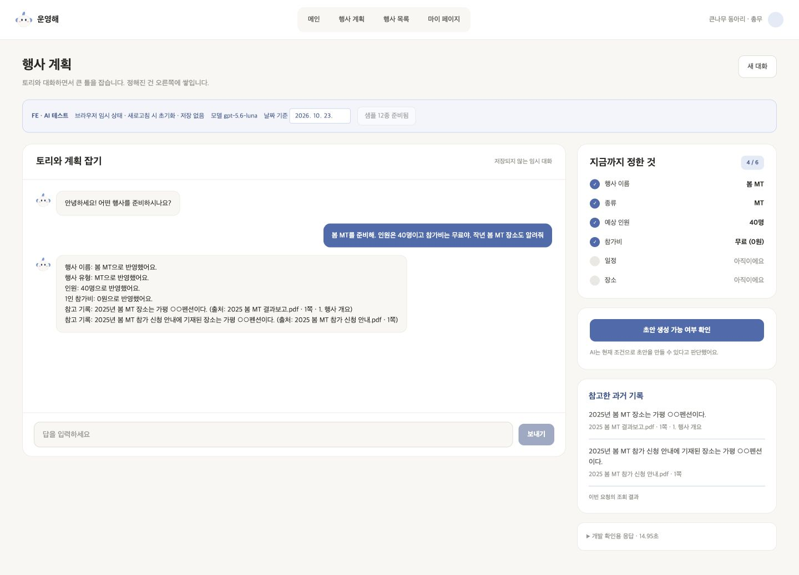

# 행사계획 P1 · FE-AI 로컬 테스트

> Legacy UI 구현 기록입니다. 현재 화면은 새 Agent를 호출합니다. 최신 실행·잠정 표시·검증 결과는 [3단계 UI 안내](../step-03-ui.md) (#168)를 읽습니다. 아래 계약과 샘플 기록 버튼은 이전 흐름의 참고 자료입니다.

2026-10-23 / [#164](https://github.com/kakaotechcampus-4/ktc4-kyungpook-5/issues/164). Figma [P1 초기 화면 1130:1938](https://www.figma.com/design/DAIeI2ETmdQ5vjrPSZJ196?node-id=1130-1938)과 기존 FE의 PlanChat/PlanFacts·공용 토리/색상 토큰을 활용했다. Figma 파일은 수정하지 않았다.

## 무엇을 테스트하나

실제 모델의 채팅 답변·현재 조건·참고 출처·생성 가능 여부를 브라우저에서 본다. 계획 생성(P2), 로그인, 실제 DB 저장, 영수증·운영 기능은 연결하지 않는다. 조건은 React 메모리에, 샘플 기록 임베딩은 서버 메모리에만 존재한다. 대화는 새로고침/새 대화로 초기화된다. 서버 재시작은 샘플 기록도 비운다. 코드 변경 중 Fast Refresh에 의해 초기화될 수도 있다.



## 실행

프로젝트 루트에서 터미널 두 개를 연다. 기존 be/.env의 AI 모델·임베딩 설정을 사용하고 FE에는 키를 넣지 않는다.

```sh
# 터미널 1
cd be
.venv/bin/python -m app.ai.scripts.planning_playground
```

```sh
# 터미널 2
cd fe
npm ci # 처음 실행할 때만
npm run dev -- --host 127.0.0.1 --port 5173 --strictPort
```

브라우저에서 [테스트 화면](http://127.0.0.1:5173/dev/planning)을 연다. 데스크톱 P1 기준으로 확인한다. `/dev/planning`은 Vite 개발 모드에서만 등록되고 운영 빌드에는 포함되지 않는다. 별도 AI 서버는 127.0.0.1:8011에만 바인딩하며 실서비스 app.main에 라우터를 등록하지 않는다. Vite의 `/__planning-test` 프록시가 중계하므로 CORS 변경이나 BE DB가 필요 없다.

1. “MT” 또는 직접 입력으로 행사 계획을 시작한다.
2. “인원은 40명이고 참가비는 무료로 할게”를 입력하고 조건 카드를 확인한다.
3. `샘플 기록 준비`를 누르면 합성 기록 12종을 실제 임베딩한다. 준비 중에는 전송을 잠근다.
4. “작년 봄 MT 장소는?”으로 출처를 확인한다. 올해 장소가 자동 확정되지 않아야 한다.
5. 날짜 역전·인원 축소·보류를 입력하고 버튼 상태와 개발용 응답을 비교한다.
6. `새 대화`로 초기화한다. 생성 확인 버튼은 상태 안내만 하며 P2로 이동하지 않는다.

날짜 기준은 기본 한국 시간의 오늘이며 대화 시작 전 변경할 수 있다. 기록의 2025년을 “작년”으로 찾으려면 기준일의 연도를 2026년으로 둔다. 20개 문맥 메시지/40000자 제한을 넘으면 자동 절삭하지 않고 새 대화를 안내한다. 실제 모델 API를 사용하므로 정적 mock 데모와 응답 시간이 다르다.

## 데이터 흐름과 테스트 전용 계약

```text
PlanningPlaygroundPage (React 임시 조건·대화·질문 이력·pending)
  → POST /__planning-test/turn
  → PlanningTurnInput 검증 → process_planning_turn
  → {result: PlanningTurnResult, elapsed_ms, fixture_count}
  → 성공 결과만 React 조건·이력·버전에 반영
```

- `GET /__planning-test/health`: 모델명·샘플 개수만 반환. 인증값은 반환하지 않는다.
- `POST /__planning-test/records`: 샘플을 메모리에 색인한다. 실패 시 기존 메모리를 유지하며 준비 성공인 것처럼 표시하지 않는다.
- `POST /__planning-test/turn`: 브라우저 상태를 받아 한 턴을 처리한다. 서버에 대화 세션을 저장하지 않는다.

서버는 fixture 동아리 clb_keunnamu만 허용한다. 이 제한은 실제 사용자 권한 검증을 대신하지 않는다. 브라우저가 만드는 event/request ID와 base_version은 UI 테스트용 식별이며 DB 버전이나 저장 완료를 뜻하지 않는다. 원문 위치는 텍스트로 표시하며 존재하지 않는 열람 URL을 만들지 않는다. wire 타입은 `fe/src/features/planning/playground.ts`에 있으며 확정된 공개 API 타입이 아니다.

입력 실패·서버 연결 실패 시 이전 조건은 유지하고 재시도 버튼을 보여준다. 이전 응답을 새 성공 응답처럼 덮지 않으며 생성 확인 버튼도 잠근다. 참고 기록은 마지막 성공 요청 기준임을 표시한다. 검색만의 일시적 실패는 AI 내부 정책에 따라 조건 후보와 함께 반환할 수 있다. API 호출 자체가 실패한 경우와 구분한다.

## 실제 브라우저에서 확인한 내용

| 입력/행동 | 관찰 |
| --- | --- |
| MT 빠른 답변 | 실제 응답·유형 카드 반영, 1/6에서도 AI 생성 가능 표시 |
| 인원 40명 + 무료 | 인원 40명·무료(0원), 미정 값과 구분 |
| 유형·40명·무료 + 작년 봄 MT 장소 혼합 요청 | 가평 ○○펜션의 문서명·원문 위치 표시. 올해 장소는 미정 유지 |
| 로컬 서버 중단 후 45명 요청 | 연결 오류·재시도 버튼 표시. 기존 40명 유지 |
| 서버 재시작 후 같은 요청 재시도 | 45명 반영·오류 해제, 샘플 메모리 0개 상태를 다시 표시 |
| 생성 가능 확인 버튼 | P1 상태 안내만 표시, P2 이동·DB 쓰기 없음 |
| 새 대화·브라우저 새로고침 | 조건 0/6·첫 인사로 초기화 |

초기 MT 응답 6.16초, 인원/무료 응답 6.32초, 혼합 요청 응답 14.95초를 화면에서 확인했다. 각 1회 관찰이며 성능 지표나 보장값이 아니다. 브라우저 UI의 실제 조작이며 정답 세트에 대한 정확도 평가와 구분한다. AI 전체 테스트 570개(테스트 API 4개 추가)·FE 빌드·변경 TS/TSX ESLint가 통과했다. 테스트용 API 경로가 운영 번들에 포함되지 않는 것도 확인했다.

## BE·FE에 전달할 합의 항목

| 항목 | 현재 차이/질문 | 합의할 내용 |
| --- | --- | --- |
| 생성 버튼 | 기존 FE는 6개 중 4개, AI는 유형+미해결 상태 | 단일 ready_to_generate 판정 주체와 설명 코드. 조건 개수는 표시용으로만 쓸지 |
| 상태 전달 | 내부 AI에 message/request ID·기준 날짜·버전·질문 이력·pending 필요 | BE가 공급/저장할 필드, 저장 단위·버전 충돌·재시도 정책 |
| 제목/필드 매핑 | 내부 PlanningConditions에 title, 기존 공개 EventConditions에는 없음 | title 미정과 BE 기본 제목, expected_headcount ↔ headcount 매핑 |
| 질문 표시 | reply에 질문이 이미 포함됨, question은 빠른 답변 데이터도 포함 | FE에서 질문 문구를 중복 출력하지 않기 |
| 재질문 | 한 번 질문한 미정 항목은 자동 반복하지 않음 | 답하지 않은 질문·보류·해결 상태의 재질문 시점. 이번 UI에서 일정 질문을 지나가고 장소 질문으로 이동한 사례 관찰 |
| 출처 카드 | AVAILABLE과 NOT_FOUND, FAILED와 SKIPPED가 다름 | 문서 열기 API/권한, 부분 미확인·충돌 표시, 마지막 조회 보존/교체 정책 |
| 긴 답변 | 출처 문장과 카드 내용이 겹쳐 읽기 길어질 수 있음 | 채팅 요약 수준·상세 카드·원문 위치 표시 역할 |
| 실패/중복 | UI는 전송 잠금·이전 상태 보존, 요청 재실행 | 서버의 멱등성·버전 정책, 늦게 온 응답 처리 |
| 생성 이후 | 테스트는 P1까지만 | 실제 P2 생성 API와 이벤트 저장 시점 |

기존 상단 내비게이션은 좁은 화면에서 줄바꿈이 많다. 이 테스트는 Figma 데스크톱 배치 기준이며 전역 내비게이션 재설계는 수행하지 않는다. 모바일 대응은 FE 후속 검토 항목이다.

추출 모델이 과거 조회를 올해 예산의 미해결 수정으로도 분류한 알려진 사례(5-4), 검색 평가셋 확대·실패 분석·품질 개선도 별도로 유지한다. 이번 UI가 해당 의미 품질 문제를 해결한 것은 아니다. #41/#52와 계약 합의 후에 공개 API로 옮긴다.
