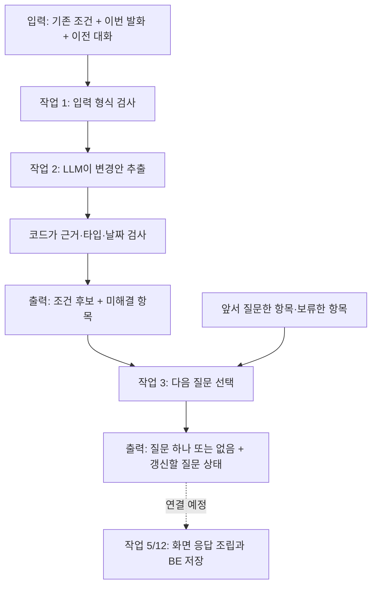

# 행사계획 코드 따라가기 — 한 문장이 조건과 질문이 되기까지

> **Legacy 코드 안내 (2026-10-24):** 이 문서는 현재 실행 중인 기존 구현을 설명합니다. 새 설계의 입력 → Node → Tool → 결과 흐름과 대화 예시는 [행사계획 대화 Agent 초안](../design.md) (#165)에서 읽습니다. 새 그래프는 아직 구현되지 않았습니다.

> 현재 범위: 작업 1~3 내부 구현. 작업 4-1 명세(#153)·4-2 검색 호출 연결(#154, 2026-10-23). 4-3 참고 결과 변환(#155)까지 구현했다. 단계가 진행될 때 이 문서도 갱신한다.

오랜만에 돌아왔다면 **1절의 그림 → 3절의 한 턴 예시 → 7절의 다음 단계** 순서로 읽는다. 상세 제약·설계 결정은 [plan_architecture.md](plan_architecture.md), 실제 측정은 [planning-evaluation.md](planning-evaluation.md)를 참고한다.

## 1. 지금 어디까지 만들어졌나?

우리가 만드는 것은 운영진의 대화를 받아 행사 조건을 정리하고 계획을 만드는 기능이다. 현재는 말을 읽어 조건 후보를 만들고, 다음에 무엇을 물을지 정하는 부분까지 구현했다.



그림의 작업 2에서만 현재 LLM을 호출한다. 질문 선택은 코드로 처리한다. 이 함수들이 LangGraph 전체에 연결된 것은 아직 아니다. DB 저장과 FE 화면까지 완성됐다는 뜻도 아니다.

| 작업 | 쉬운 설명 | 대표 코드 | 현재 상태 |
| --- | --- | --- | --- |
| 1 | 조건을 담을 그릇과 입력 규칙 | `PlanningConditions` | 내부 구현 |
| 2 | 말에서 변경할 부분을 찾고 검증 | `extract_condition_changes`, `validate_and_apply` | 내부 구현·실제 모델 연결 확인 |
| 3 | 다음 질문 하나를 고름 | `select_next_question` | 내부 구현·2턴 통합 확인 |
| 4 | 과거 기록을 찾아 근거 카드로 연결 | `build_record_search_request`, `search_planning_records` | 4-3까지 내부 구현, 실제 모델 평가는 별도 범위 |
| 5 | 채팅·조건 카드·참고 카드를 한 응답으로 조립 | 공개 응답/facade 설계 예정 | 미구현 |
| 6~13 | 계획 초안·편집·저장·행사 시작 | 설계 문서의 작업표 | 미구현 |

## 2. 먼저 알아둘 네 가지

**스냅샷(snapshot)**은 특정 시점의 조건 묶음이다. `headcount=32, location="가평"`처럼 지금 정해진 값을 담는다. `None`은 미정이고, 참가비 `0`은 무료다.

**변경안(operation)**은 전체 조건이 아니라 바꿀 항목만 담는다. `SET headcount=40`은 인원을 바꾸고, `CLEAR location`은 장소를 미정으로 되돌린다. 목록에 없는 항목은 유지한다.

**후보(candidate)**는 검증한 변경을 적용한 새 스냅샷이다. 함수가 후보를 만들었다고 DB에 저장한 것은 아니다. BE가 버전·권한을 확인하고 저장해야 한다.

**Structured Output**은 LLM의 답을 정해진 데이터 형식으로 받는 방식이다. “인원을 바꿨습니다”라는 자유 문장 대신 코드가 읽을 수 있는 변경 목록을 받는다. 형식을 지켰다고 의미까지 맞는 것은 아니므로 근거 검증과 실제 모델 평가가 따로 필요하다.

## 2-1. LLM 호출은 한 턴·두 턴에서 어떻게 반복되나?

**“작업 2에서만 LLM을 호출한다”는 사용자 발화 한 턴마다 작업 2가 구조화 추출을 한 번 요청한다는 뜻이다. 대화 전체에서 한 번만 호출하는 뜻이 아니다.** 작업 3은 그 결과를 코드로 읽어 질문을 고르므로 질문 문구 생성을 위한 추가 LLM 호출이 없다. 네트워크 실패에 따른 실제 전송 재시도는 공통 호출 설정을 따른다.

아래는 기존 조건이 MT·60명이고 일정은 미정인 대화 예시다. 질문 문구는 설명용이다.

| 사용자 턴 | 작업 2: 이번 발화를 LLM으로 해석 | 코드 검증 후 조건 | 작업 3: 질문 선택 |
| --- | --- | --- | --- |
| 1. “인원을 좀 줄이자” | headcount/AMBIGUOUS_VALUE | 60명 유지 | “몇 명으로 바꿀까요?” |
| 2. “40명으로 하자” | SET headcount=40 | 40명으로 변경 | 일정 질문 |
| 3. “일정은 나중에 정할게” | 일정 DEFERRED | 날짜 미정 유지 | 일정 보류 후 다른 미정 항목 질문 |

이 예시는 사용자 발화 3번, 추출 호출 요청 3번이다. 2턴에서 “아직 모르겠어”라고 답했다면 이전 인원 질문을 문맥으로 보고 모델이 DEFERRED로 해석한다. 질문 코드는 마지막 질문 대상인 headcount를 보류하고 다음 항목으로 넘어간다. 보류는 기존 60명을 삭제한다는 뜻이 아니다.

```text
매 사용자 턴의 호출자
  최신 조건 + 이번 발화 + 이전 대화 → extract_condition_changes()
    → LLM: 이번 발화의 변경·모호함·보류 해석
    → validate_and_apply(): 근거·타입·최종 날짜 검사
    → ConditionExtractionResult
  추출 결과 + 같은 행사의 질문 이력 → select_next_question()
    → 날짜 충돌? 현재 모호함? 아직 묻지 않은 미정 항목?
    → 질문 하나 또는 없음 + 갱신된 질문 이력
  결과를 보여주고 사용자 답을 기다림
  다음 사용자 발화가 들어오면 같은 흐름을 다시 호출
```

매 턴 전체 입력을 읽지만 이미 정해진 항목을 전부 다시 묻지는 않는다. “인원은 40명”처럼 명확하면 반영하고 다음 미정 항목으로 간다. 현재 발화가 모호하게 수정을 요청하면 이미 값이 있는 항목도 다시 확인한다. 이번 발화에 새로 생긴 모호함은 추출 결과, 앞서 질문·보류한 이력은 `PlanningQuestionState`가 담당한다.

LLM이 이전 호출을 자동 기억한다고 가정하지 않는다. 매번 최신 조건과 필요한 이전 메시지를 새 요청으로 전달해야 한다. 현재는 개별 함수와 테스트·실행 스크립트에서 이 연결을 검증했다. 실제 호출자가 BE 저장 결과를 다음 턴의 최신 조건으로 공급하고 대화·질문 이력을 저장하는 연결은 작업 5/12의 범위다. 저장 성공 전 후보를 다음 턴의 확정 사실로 삼지 않는다. 추출 호출이 실패하면 정상 질문 선택으로 진행한 것처럼 처리하지 않는다.

## 3. 한 턴 따라가기: “인원은 40명으로, 장소는 다시 정하자”

### 3-1. 입력 만들기

[schemas.py](../../../features/planning/schemas.py)의 `ConditionExtractionInput`으로 아래 정보를 묶는다. 예시는 읽기 쉽게 일부 필드만 표시했다.

```text
conditions       = {headcount: 32, location: "가평", fee_per_person: 45000}
current_message  = {id: "m1", role: "user", text: "인원은 40명으로, 장소는 다시 정하자"}
context_messages = []
reference_date   = 2026-10-22
timezone         = Asia/Seoul
event_id         = evt_demo
request_id       = req_demo
base_version     = 3
```

`event_id`는 어느 행사인지, `request_id`는 어느 요청인지, `base_version`은 어떤 버전의 조건을 보고 처리했는지 알려준다. 지금 함수는 이 값을 결과에 보존한다. 실제 DB의 최신 버전과 비교하는 일은 BE 연결 때 구현한다.

이 단계에서는 `headcount=True`, `headcount="32"`, 공백 이름, 잘못된 날짜 등 형식 오류를 막는다. “말한 32명이 작년 인원인가 올해 인원인가?”는 여기서 알 수 없으며 다음 추출 단계가 해석한다.

### 3-2. 모델에 보낼 메시지 만들기

[nodes.py](../../../features/planning/nodes.py)의 `build_extraction_messages()`는 두 메시지를 만든다.

```python
return [SystemMessage(_system_prompt()), HumanMessage(payload)]
```

- SystemMessage: [extract_conditions.md](../../../features/planning/prompts/extract_conditions.md)의 추출 규칙.
- HumanMessage: 조건·현재 발화·이전 대화·기준 날짜를 담은 JSON 데이터.

과거 assistant 발화도 JSON의 문맥 데이터로 넣는다. 과거 대화나 문서 속 문장을 새로운 system 지시로 바꾸지 않는다. event_id/request_id/base_version은 모델이 만들 필요가 없어 모델 입력에서 제외하고 코드가 보존한다.

### 3-3. Structured Output으로 변경 목록 받기

호출 경로는 다음과 같다.

```text
extract_condition_changes(request)
  → call_extraction_model(messages)
  → llm.ainvoke_structured(messages, ConditionExtractionOutput)
  → Responses API
  → ConditionExtractionOutput 객체
```

[llm.py](../../../llm.py)의 핵심 설정은 다음과 같다.

```python
model.with_structured_output(
    schema, method="json_schema", include_raw=True
)
```

Pydantic 타입에서 JSON Schema를 만들고 모델에 기대 형식을 전달한다. 공통 호출 함수는 파싱 성공 여부를 검사한 뒤 타입이 있는 객체를 반환한다. 실제로 읽는 것은 `ConditionExtractionOutput`이다.

이번 예시의 기대 출력은 다음과 같다. 실제 모델 답을 고정하는 예시가 아니라 데이터 흐름을 설명하는 예시다.

```json
{
  "operations": [
    {
      "op": "SET",
      "change": {"field": "headcount", "value": 40},
      "evidence": {"message_id": "m1", "quote": "인원은 40명으로"},
      "offer_id": null,
      "context_evidence": []
    },
    {
      "op": "CLEAR",
      "field": "location",
      "evidence": {"message_id": "m1", "quote": "장소는 다시 정하자"}
    }
  ],
  "unresolved": []
}
```

`evidence`는 이번 사용자 발화의 근거다. `offer_id`와 `context_evidence`는 “그걸로 할게요”처럼 앞선 제안을 수락할 때 쓰며, 직접 지정한 이번 예시에서는 비어 있다.

필드마다 허용하는 값 타입이 다르다. 예를 들어 인원은 양의 정수이고 장소는 문자열이다. 일반 Union과 Literal로 이를 검증한다. discriminated union은 `oneOf`를 생성해 게이트웨이가 거부했으므로 현재는 지원되는 `anyOf`를 사용한다. 타입 제한을 없앤 것은 아니다.

### 3-4. 코드로 검증하고 적용하기

모델 출력은 바로 DB로 가지 않고 `validate_and_apply(request, output)`으로 들어간다.

```python
values = request.conditions.model_dump()
```

먼저 기존 스냅샷의 복사본을 만든다. 그다음 각 변경의 근거가 이번 메시지에 있는지, 같은 필드가 중복되지 않는지 확인한다. SET은 값을 넣고 CLEAR는 `None`을 넣는다.

```text
변경 전: headcount=32, location="가평", fee_per_person=45000
SET 적용: headcount=40
CLEAR 적용: location=None
건드리지 않은 값: fee_per_person=45000
```

마지막으로 `PlanningConditions.model_validate(values)`로 전체 후보를 다시 검사한다. 날짜 두 개를 바꿀 때는 중간 상태가 아니라 최종 날짜 쌍을 검사한다.

출력 `ConditionExtractionResult`의 주요 내용:

```text
status               = APPLIED
candidate_conditions = {headcount: 40, location: None, fee_per_person: 45000, ...}
applied_operations   = [SET headcount, CLEAR location]
unresolved           = []
event_id/request_id/base_version = 입력에서 그대로 복사
```

여기서 APPLIED는 **후보에 반영했다**는 의미다. 저장 완료나 행사 시작 완료를 의미하지 않는다.

### 3-5. 다음 질문으로 넘기기

[questions.py](../../../features/planning/questions.py)의 `select_next_question(extraction, state)`가 위 결과와 질문 상태를 받는다.

```text
asked_fields         = 앞서 물었던 필드
deferred_fields      = 사용자가 나중에 정하겠다고 한 필드
last_question_fields = 직전 질문의 대상
```

우선순위는 날짜 충돌 → 이번 발화의 미해결 사항 → 아직 묻지 않은 빈 항목이다. 예시에서 행사 유형도 아직 비어 있다면 “어떤 종류의 행사를 준비하시나요?”가 나온다. 인원은 이미 40명이라 다시 묻지 않는다.

결과는 `PlanningQuestionResult`다. `question`에는 질문·빠른 답변·대상 필드가, `state`에는 다음 턴으로 전달할 질문 이력이 들어간다. 상태를 DB에 자동 저장하지는 않는다.

## 4. 두 턴 따라가기: 모호함 → 미루기 또는 확정

| 입력 | 작업 2 출력 | 작업 3이 거치는 분기 | 사용자에게 나오는 결과 |
| --- | --- | --- | --- |
| 기존 32명, “인원을 좀 줄이자” | headcount/AMBIGUOUS_VALUE, 기존 32명 유지 | 현재 미해결 항목 우선 | “예상 인원을 몇 명으로 바꿀까요?” |
| 이어서 “아직 모르겠어” | headcount/DEFERRED | deferred_fields에 추가 → 자동 질문 대상에서 제외 | 다른 빈 항목 질문 |
| 대신 “40명으로 하자” | SET headcount=40 | 값이 있는 필드 제외 | 다음 빈 항목 질문 |

실제 모델을 사용한 이 대화의 기록은 [질문 통합 결과](evaluation-results/planning-questions-2026-10-22.json)에 있다. 직전 질문은 다음 추출 요청의 `context_messages`로 전달해야 한다. 질문 상태만 넘겨 놓고 모델이 직전 질문을 안다고 가정하면 안 된다.

`DEFERRED`는 값을 지우지 않는다. 기존 32명이 있었다면 그대로 유지한다. 명확히 “인원은 미정으로 바꿔줘”라고 요청하면 CLEAR로 처리한다. 모델이 이 차이를 잘못 해석할 가능성은 별도 평가해야 한다.

## 5. 직접 실행해 볼 수 있는 최소 예시

아래 코드는 be/에서 실행할 수 있는 API 비용 없는 예시다. 모델 출력만 고정하고 실제 검증·질문 선택 함수를 실행한다. 실제 한국어 해석 정확도를 검증하는 테스트는 아니다.

<!-- executable-example -->
```python
import asyncio
from app.ai.features.planning.schemas import ConditionExtractionInput, ConditionExtractionOutput
from app.ai.features.planning.nodes import extract_condition_changes
from app.ai.features.planning.questions import PlanningQuestionState, select_next_question

request = ConditionExtractionInput.model_validate({
    "event_id": "evt_demo", "request_id": "req_demo", "base_version": 3,
    "conditions": {"headcount": 32, "event_type": "MT"},
    "current_message": {"id": "m1", "role": "user", "text": "40명으로 바꿔줘"},
    "reference_date": "2026-10-22", "timezone": "Asia/Seoul",
})

async def example_model(messages):
    return ConditionExtractionOutput.model_validate({
        "operations": [{
            "op": "SET", "change": {"field": "headcount", "value": 40},
            "evidence": {"message_id": "m1", "quote": "40명으로 바꿔줘"},
            "offer_id": None, "context_evidence": [],
        }],
        "unresolved": [],
    })

async def main():
    extraction = await extract_condition_changes(request, extract=example_model)
    next_step = select_next_question(extraction, PlanningQuestionState(event_id="evt_demo"))
    print(extraction.status)                          # APPLIED
    print(extraction.candidate_conditions.headcount)  # 40
    print(request.conditions.headcount)              # 32: 원본 보존
    print(next_step.question.text)                   # 일정 질문

asyncio.run(main())
```

실제 모델을 쓰려면 `.env`를 설정하고 `extract=example_model` 인자를 빼면 된다. 네트워크와 API 사용 비용이 발생한다. 여러 사례의 실행 명령과 검증 범위는 [평가 문서](planning-evaluation.md)에 있다.

## 6. 실패하거나 멈추는 지점 읽기

| 상태/예외 | 의미 | 원래 조건 |
| --- | --- | --- |
| APPLIED | 유효한 변경으로 새 후보를 만듦 | 보존 |
| UNCHANGED | 변경 없음 또는 같은 값 재지정 | 보존 |
| NEEDS_CLARIFICATION | 애매하거나 미룬 항목이 있음. 별개 필드의 명확한 변경은 적용될 수 있음 | 원본 보존, 후보 별도 |
| VALIDATION_FAILED | 날짜 관계 충돌로 턴 전체 변경을 보류 | 그대로 반환 |
| AIInvalidResponseError | 출력 형식·근거·중복 등 모델 응답 문제 | 적용 안 함 |
| AITimeoutError 등 | 모델 호출 실패 | 적용 안 함 |

질문이 `None`이어도 “모든 준비 완료”는 아니다. 더 자동으로 물을 항목이 없다는 뜻이며 계획 생성/행사 시작 조건은 다른 작업에서 판정한다. 오류를 변경 없음이나 성공으로 바꾸지 않는다.

## 7. 작업 4: 과거 기록은 어디에 연결되나?

작업 4는 기존 검색 기능을 **계획 대화의 참고 정보**로 연결하는 작업이다. 아래 전체 흐름 중 4-3의 검색 요청·호출·참고 결과 변환까지 구현했다. 검색 필요 판단과 화면 답변 조립은 아직 연결 전이다.

```text
사용자: “작년 MT는 몇 명이었어?”
  → 조건 추출: 올해 인원을 바꾸라는 말은 아니므로 변경 없음
  → 검색 필요 판단: 작년 참가 인원 조회가 필요
  → RecordSearchRequest(club_id, query, today, conditions)
  → 기존 search_records(..., port=허용된 기록 검색 기능)
  → RecordSearchResult(facts, not_found, conflicts)
  → planning의 참고 정보로 변환
  → 작업 5에서 답변/참고 카드에 함께 표시
```

가상의 검색 결과가 “작년 28명”이면 참고 카드에 문서명·위치와 함께 보여준다. 올해 `headcount`는 바꾸지 않는다. 이후 “올해도 28명으로 하자”라는 명시적 요청/수락이 들어와야 작업 2가 조건 변경으로 처리한다.

이미 있는 코드:

- [retrieval/schemas.py](../../../features/retrieval/schemas.py): `RecordSearchRequest`, `RecordFact`, `RecordSearchResult`.
- [retrieval/nodes.py](../../../features/retrieval/nodes.py): `search_records`의 검색어 정리 → 검색 → 근거 확인.
- [ports.py](../../../ports.py): AI가 BE의 검색 기능을 호출하는 약속. 동아리 접근 범위는 BE 구현체가 보장한다.

작업 4-1에서 정리한 명세는 [설계 문서의 검색 연결 계약](plan_architecture.md#작업-4-1--과거-기록-연결-계약)에 있다. 아래 표는 구현된 요청·호출·카드 데이터 변환과 다음 화면 응답 조립 단계를 구분한다.

| 순서 | 입력 → 거칠 코드 → 출력 |
| --- | --- |
| 1. 검색 요청 만들기 | 현재 유형 MT·40명 + “작년 MT 장소와 교통비” → `build_record_search_request()` → 유형·시기만 검색 맥락으로 전달. 올해 40명은 자동 검색 조건에 넣지 않음 |
| 2. 기존 검색 호출 | `search_planning_records()` → 기존 `search_records()` → 사실·미확인 내용·충돌 |
| 3. 카드 데이터 만들기 | `facts` → `build_planning_record_result()`의 `cards` → 내용과 문서명·원문 위치를 그대로 보존 |
| 4. 화면 응답에 연결 | 참고 데이터 → 작업 5(예정) → 답변·조건 카드·참고 카드 조립 |

현재 `search_planning_records()`는 검색의 `RecordSearchResult`를 `PlanningRecordSearchResult`로 변환한다. 장소는 찾았지만 교통비를 못 찾았다면 `status=AVAILABLE`, 장소 카드, `not_found=[교통비]`를 함께 반환한다. 여기서 AVAILABLE은 모든 질문에 답했다는 뜻이 아니라 참고할 근거가 있다는 뜻이다. 두 자료가 서로 다른 장소를 말하면 `conflicts`에 각각의 값과 출처를 남긴다. 어댑터가 승자를 고르지 않는다.

아무 근거도 확인하지 못하면 빈 cards/conflicts와 not_found를 반환하며 `status=NOT_FOUND`가 된다. 반면 모델·임베딩·검색 port 호출 실패는 예외를 그대로 전달한다. “찾았지만 없음”과 “실패해서 확인 못 함”을 구분하기 위해서다. 실패 안내와 대화를 계속하는 정책은 작업 5에서 정한다.

**주의할 ID가 두 개 있다.** `planning_event_id`는 지금 만드는 올해 행사, `target_event_id`는 검색할 특정 과거 행사다. 과거 행사 ID를 모르면 검색 필터는 null로 두고 같은 동아리 기록에서 찾는다. 올해 행사 ID를 무조건 넣으면 작년 기록이 검색 대상에서 빠진다. 동아리·행사 접근 권한은 BE가 확인한다.

이번 연결에서는 기존 함수의 검색어 정리와 근거 판단을 활용한다. 외부 ReAct 반복·자동 검색 판단·캐시는 추가하지 않는다. 검색 함수 한 번도 내부에서 여러 검색어와 모델 호출을 사용할 수 있다. 4-3까지 타입·요청 매핑·호출·결과 변환을 구현했다. 실제 모델 연결 평가는 작업 4-4의 별도 범위다. 검색을 실행할지 선택하는 정책은 작업 5에서 연결한다.

질문과 검색을 최종 화면에서 어떤 순서로 보여줄지는 작업 5의 책임이다. 단순 조회 질문에 무관한 조건 질문이 먼저 튀어나오지 않도록 조립 순서를 정해야 한다.

### 7-1. 실제 코드로 입력이 어떻게 바뀌는지 보기

아래 예시는 `be/`에서 Python으로 실행할 수 있다. 요청 변환만 하므로 API를 호출하지 않는다.

```python
from app.ai.features.planning.records import build_record_search_request
from app.ai.features.planning.schemas import PlanningRecordSearchInput

request = PlanningRecordSearchInput.model_validate({
    "club_id": "club-1",
    "planning_event_id": "event-2026",
    "request_id": "turn-7",
    "base_version": 3,
    "query": "작년 MT 장소를 알려줘",
    "reference_date": "2026-10-23",
    "conditions": {"event_type": "MT", "headcount": 40},
})
search_request = build_record_search_request(request)
assert search_request.event_id is None
assert search_request.conditions.model_dump(exclude_none=True) == {"event_type": "MT"}
assert request.conditions.headcount == 40
print(search_request.model_dump(mode="json", exclude_none=True))
```

출력은 `club_id`, 원래 `query`, `today="2026-10-23"`, `conditions={"event_type": "MT"}`, `limit=5`다. `headcount=40`과 현재 행사 ID는 검색 요청에서 빠지지만 원래 입력에 남아 있다. `target_event_id="event-2025"`를 명시하면 검색 요청의 `event_id`는 그 값이 된다.

실제 호출은 `await search_planning_records(request, port=권한이_적용된_검색_port)`다. 이 함수는 위 변환 함수를 거쳐 기존 `search_records(..., rewrite=True, max_rounds=1)`을 호출한다. `embed`와 `invoke`는 실제 API가 기본값이며 테스트에서는 가짜 구현을 주입할 수 있다. 별도의 검색 엔진이나 자유 답변 생성 모델을 추가한 것은 아니다.

입력 타입은 [schemas.py](../../../features/planning/schemas.py), 두 함수는 [records.py](../../../features/planning/records.py), 연결 검증 사례는 [test_planning_records.py](../../../tests/test_planning_records.py)에 있다. 이번 검증은 실제 retrieval 경로와 가짜 외부 의존성을 사용했으며, 실제 모델 검색 품질·BE 권한 격리·FE 표시를 검증한 것은 아니다.

### 7-2. 검색 결과가 참고 카드가 되는 실제 코드

7-1 예시를 실행한 뒤 아래를 이어 실행할 수 있다. 검색 결과는 가상 자료이며 API를 호출하지 않는다.

```python
from app.ai.features.retrieval.schemas import RecordSearchResult
from app.ai.features.planning.records import build_planning_record_result

retrieved = RecordSearchResult.model_validate({
    "facts": [{
        "content": "2025년 MT 장소는 가평이었다",
        "sources": [{"record_id": "report-2025", "file_name": "2025 MT.pdf",
                     "location": {"label": "2쪽 · 장소"}}],
    }],
    "not_found": ["교통비"],
})
result = build_planning_record_result(request, retrieved)
assert result.status == "AVAILABLE"
assert result.cards == retrieved.facts
assert result.not_found == ("교통비",)
assert result.request_id == "turn-7"
assert request.conditions.location is None
print(result.model_dump(mode="json"))
```

`build_planning_record_result()`는 다음 세 가지를 코드로 처리한다.

1. 입력에서 `planning_event_id`, `request_id`, `base_version`을 복사한다. 모델에게 ID를 만들게 하지 않는다.
2. 검색 결과의 `facts`를 `cards`로 옮기고, `not_found`와 `conflicts`도 그대로 옮긴다. 사실·문서명·원문 위치를 다시 요약하지 않는다.
3. 카드 또는 충돌이 있으면 `AVAILABLE`, 둘 다 없으면 `NOT_FOUND`로 정한다. 결과 타입도 이 관계를 검증한다. 출처 없는 카드, 근거 없는 AVAILABLE, 미확인 내용조차 없는 NOT_FOUND는 거절한다.

예를 들어 두 문서가 가평/춘천으로 다르면 `cards=[]`, `conflicts=[각 장소와 출처]`, `status=AVAILABLE`일 수 있다. 이는 “장소가 확정됐다”가 아니라 “서로 다른 기록을 찾았다”는 뜻이다. 실제 호출 함수 `search_planning_records()`도 검색 후 이 변환 함수를 사용한다. 올해 조건을 수정하는 경로는 없다.

## 7-4. 다음 작업 5: 부품을 한 턴의 답변으로 묶기

아래는 구현 전 명세다. 상세 입력·출력·오류 정책은 [작업 5 설계](plan_architecture.md#작업-5--한-턴-응답-조립-명세-5-15-4)를 따른다.

현재 부품은 조건을 바꾸거나 질문을 고르거나 기록을 찾을 수 있다. 작업 5는 이 결과들을 한 화면에서 일관되게 보여주도록 묶는다.

```text
“40명으로 바꾸고 작년 MT 장소도 알려줘”
  → 기존 extract_condition_changes: 40명 조건 후보
  → 새 decide_record_lookup(예정): 검색이 필요한 요청
  → 기존 search_planning_records: 장소 사실과 출처
  → 새 assemble_planning_reply(예정): 변경 확인 + 과거 장소 설명
  → 조건 카드에는 올해 40명, 참고 카드에는 작년 장소
```

| 단계 | 쉽게 말하면 | 결과물 |
| --- | --- | --- |
| 5-1 | 무엇을 받고 무엇을 반환할지 약속 | 한 턴 입력·출력, 생성 가능 조건, 실패·질문 우선순위 |
| 5-2 | 이번 말에 필요한 부품 실행 | 수정/조회/혼합 분기와 검색 호출 여부 |
| 5-3 | 결과를 같은 상태를 설명하는 답변으로 묶기 | reply·조건·질문·참고 자료·다음 턴 상태 |
| 5-4 | 대화를 이어가며 검증 | 여러 턴의 상태 보존·실패 처리·실제 모델 측정 |

예를 들어 위 요청에서 검색만 타임아웃이면 “인원은 40명으로 반영했어요. 과거 장소는 검색에 실패해 확인하지 못했어요.”라고 설명한다. 반면 조건 추출 자체가 실패했다면 40명으로 바꿨다고 말하지 않는다. 실제 저장은 BE가 버전을 확인한 뒤 한다.

“작년 장소는?”에 답하면서 “올해 인원은 몇 명인가요?”를 매번 덧붙이지 않는다. 질문을 화면에 보여주지 않았다면 이미 물었다는 이력도 추가하지 않는다. 이를 위해 현재 질문 부품의 후보 선택과 상태 확정을 분리할 예정이다.

초안 생성 버튼은 행사 유형이 정해지고 미해결 수정·충돌이 없으면 허용하는 안이다. 장소·날짜가 미정이어도 초안을 만들 수 있게 하되, 실제 행사 시작 허용과는 다르다. 이 정책과 공개 응답 필드는 BE/FE 합의 전 제안이다.

**검색 후속 과제는 별도로 유지한다:** 평가셋 확대 → 실패 유형 분석 → 한 요소씩 개선·재측정. 작업 5가 검색 누락을 자동으로 고치는 것은 아니다. 이번에는 실패·미확인·충돌을 사용자에게 정확하게 전달하는 연결을 만든다.

### 7-5. 작업 5-1의 핵심 코드: 입력과 출력을 담는 그릇

5-1은 내부 계약·생성 정책을 구현했다(#158). 실제 턴 실행 함수는 5-2 이후 연결한다. 아직 이 타입을 만들어도 자동으로 검색하거나 답변을 생성하지 않는다.

| 코드 | 쉽게 이해하기 | 하는 일 |
| --- | --- | --- |
| `PlanningTurnInput` | 이번 턴의 재료 상자 | 기존 조건·이번 발화·질문 이력·미해결 수정을 함께 받음 |
| `PendingClarification` | 아직 답을 못 받은 수정 메모 | 인원을 줄이자는 요청 등 근거와 대상을 보존. 단순 장소 미정과 다름 |
| `RecordLookupState` | 검색 진행 결과 표지 | 생략·대상 확인 필요·성공·실패를 구분 |
| `PlanningTurnResult` | 화면에 전달할 내부 결과 묶음 | 조건·답변·질문·참고 자료가 같은 행사/요청을 설명하는지 검사 |
| `assess_generation_readiness()` | 초안 버튼 허용 기준 | 유형 없음·조건 충돌·미해결 수정 여부를 코드로 판단 |

타입은 [turn_schemas.py](../../../features/planning/turn_schemas.py), 판단 코드는 [turn_policy.py](../../../features/planning/turn_policy.py)에 있다. 이번에 별도 모델 호출이나 프롬프트를 추가하지 않았다.

#### 입력 → 핵심 코드 → 결과

사용자가 “MT 할 거야”라고 말해 기존 추출 코드가 `event_type=MT`를 만들었다고 하자. 장소와 날짜는 아직 없다.

```python
from app.ai.features.planning.schemas import PlanningConditions
from app.ai.features.planning.turn_policy import assess_generation_readiness
from app.ai.features.planning.turn_schemas import RecordLookupState

conditions = PlanningConditions(event_type="MT")
ready = assess_generation_readiness(conditions)
assert ready.ready_to_generate is True
assert ready.reasons == ()

# 다음 턴에 “인원을 좀 줄이자”라고 했으나 구체적인 숫자가 없다면
blocked = assess_generation_readiness(conditions, has_pending_modification=True)
assert blocked.ready_to_generate is False
assert blocked.reasons == ("PENDING_MODIFICATION",)

# 검색만 실패한 것은 별도의 상태다. 조건 판단을 대신하지 않는다.
lookup = RecordLookupState(status="FAILED", error_code="TIMEOUT")
assert lookup.result is None
assert assess_generation_readiness(conditions).ready_to_generate is True
print(ready.model_dump(), blocked.model_dump(), lookup.model_dump())
```

핵심 함수는 세 가지를 검사해 이유 목록에 넣는다. 행사 유형이 없으면 `MISSING_EVENT_TYPE`, 날짜 변경처럼 조건이 충돌하면 `CONDITION_CONFLICT`, 답을 기다리는 수정이 남으면 `PENDING_MODIFICATION`이다. **이유 목록이 비어 있으면 true**다. 날짜·장소 미정만으로 막지 않는다. 이것은 초안을 만들어 볼 수 있다는 내부 정책이며 행사 시작 허가나 BE/FE 합의 완료를 뜻하지 않는다.

예시에서는 미해결 여부를 직접 넘겼다. 실제로는 5-3에서 pending 메모를 관리하고 이 함수에 전달한다. 반환 타입도 같은 정책을 다시 검사해서, pending이 있는데 ready=true인 모순된 결과를 막는다.

`PlanningTurnResult`에는 추가 검사도 있다. 예를 들어 인원을 40명으로 추출해 놓고 표시 조건을 60명으로 넣으면 오류다. 검색 출처를 다른 요청 결과에서 가져와도 오류다. 질문을 답변에 넣었으면 질문 이력에도 반영해야 한다. 여기서 검사하는 것은 데이터 일관성이며 모델의 의미 해석이나 DB 최신 버전은 별도 검증이 필요하다.

미해결 수정 메모는 최대 9개이며 같은 조건 대상과 ID를 중복 저장하지 않는다. 사용자의 “나중에 정할게”는 질문 이력의 보류로 관리한다. 메모의 실제 갱신·해결은 5-3에서 연결한다. 검색 평가셋 확대·실패 분석·품질 개선도 별도 후속 과제로 남아 있다.

### 7-6. 작업 5-2: 필요한 부품만 실행하기

내부 실행 함수 `prepare_planning_turn()`을 구현했다(#159). 최종 채팅 답변을 만드는 함수는 아니다. 5-3이 이어서 사용할 조건 추출 결과·조회 판단·검색 상태를 묶어 반환한다.

```text
입력: “40명으로 하고 작년 장소도 알려줘”
  → extract_condition_changes(): SET headcount=40 검증·후보 적용
  → decide_record_lookup(): SEARCH, query="작년 MT 장소"
  → search_planning_records(): 기존 검색과 카드 변환
  → PlanningTurnPreparation:
      extraction.candidate_conditions.headcount=40
      lookup_decision.action=SEARCH
      record_lookup.status=SUCCEEDED
      record_lookup.result=출처가 있는 참고 데이터 또는 NOT_FOUND
```

핵심 코드는 [turn_flow.py](../../../features/planning/turn_flow.py)의 다음 분기다. 아래는 설명을 위한 요약이다.

```python
if decision.action == "SKIP":
    # 조건만 바꾸거나 보류하는 요청이면 검색을 실행하지 않는다.
    lookup = RecordLookupState(status="SKIPPED")
elif decision.action == "CLARIFY":
    # 조회할 행사가 불명확하면 검색 대신 확인할 내용을 남긴다.
    lookup = RecordLookupState(status="NEEDS_CLARIFICATION", clarification=decision.clarification)
else:
    # SEARCH인 경우에만 기존 검색 함수를 한 번 호출한다.
    # 검색의 일시적 실패는 FAILED로 바꾸되 검증된 조건 후보는 유지한다.
    ...
```

“인원은 40명으로”면 SKIP, “작년 MT 장소는?”이면 SEARCH, “그때 그 행사 비용은?”인데 앞선 문맥에도 대상이 없으면 CLARIFY가 기대 동작이다. 조회 여부는 [lookup.py](../../../features/planning/lookup.py)의 구조화 모델 호출이 판단한다. 코드는 SEARCH에 검색어가 있는지, CLARIFY에 확인 질문이 있는지, 근거 인용이 실제 이번 발화에 있는지 검사한다. 그 형식·인용 검사가 모델의 의미 해석까지 보장하지는 않는다.

추출과 조회 판단은 각각 모델을 호출한다. SEARCH일 때는 기존 검색 내부 모델·임베딩 호출이 더해진다. 검색 함수 실행 한 번을 전체 LLM 호출 한 번으로 해석하지 않는다. 질문 선택·pending 병합·최종 reply는 아직 이 함수에서 실행하지 않는다.

이번 테스트는 기대하는 모델 출력을 주입해 실제 추출 검증·분기·retrieval 경로를 실행했다. 검색 생략/확인에는 port 호출이 없고, 검색만 일시적으로 실패하면 조건 후보를 보존하며, 권한·설정 오류와 추출/조회 판단 실패는 전파하는지 확인했다. 실제 사용자 말의 분류 정확도는 5-4에서 별도로 평가한다.

재실행: `be/`에서 `.venv/bin/python -m pytest app/ai/tests/test_planning_turn_flow.py -q`.

### 7-7. 작업 5-3: 결과를 답변과 다음 턴의 기억으로 묶기

핵심 함수는 [turn_assembly.py](../../../features/planning/turn_assembly.py)의 `assemble_planning_turn()`이다. 다음 순서로 동작하며 추가 모델 호출은 없다.

```text
5-2 중간 결과
  → merge_pending: 아직 답을 못 받은 수정 메모를 갱신
  → select_next_question: 질문 후보만 고름(아직 이력에 넣지 않음)
  → 실제 표시 질문 하나 선택 후 그 질문만 이력에 반영
  → assemble_planning_reply: 변경 확인·검색 안내·출처를 문장으로 만듦
  → 생성 가능 판단 + PlanningTurnResult 일관성 검증
```

예를 들어 “인원 좀 줄이자”의 구체적인 답을 못 받았다면 인원 메모가 남는다. 다음에 “장소도 다시 정하자”고 하면 두 메모가 각각 관리된다. 인원을 40명으로 명확히 정하면 인원 메모만 정리한다. 기존 값이 이미 40명이어도 재확인은 유효하므로 `confirmed_fields`에 별도 기록한다. 값이 바뀐 목록인 `applied_operations`만으로는 이 경우를 알 수 없기 때문이다.

질문 후보를 먼저 고른 뒤, 일정 충돌 → 조회 대상 확인 → 미해결 수정 → 일반 미정 순으로 표시할 질문을 정한다. 조회가 있는 턴은 일반 미정 질문을 생략한다. **후보로만 고르고 보여주지 않은 질문은 asked_fields에 넣지 않는다.**

아래는 `be/`에서 실행 가능한 가상 중간 결과 예시다. API는 호출하지 않는다.

```python
from app.ai.features.planning.turn_schemas import PlanningTurnInput, RecordLookupState
from app.ai.features.planning.schemas import ConditionExtractionOutput
from app.ai.features.planning.nodes import validate_and_apply
from app.ai.features.planning.lookup import RecordLookupDecision
from app.ai.features.planning.turn_flow import PlanningTurnPreparation
from app.ai.features.planning.turn_assembly import assemble_planning_turn

request = PlanningTurnInput.model_validate({
    "club_id": "club-1", "question_state": {"event_id": "e1"},
    "extraction_input": {
        "event_id": "e1", "request_id": "r1", "base_version": 0,
        "conditions": {"event_type": "MT", "headcount": 60},
        "current_message": {"id": "m1", "role": "user", "text": "40명으로 하고 작년 장소도 알려줘"},
        "reference_date": "2026-10-23", "timezone": "Asia/Seoul",
    },
})
extracted = validate_and_apply(request.extraction_input, ConditionExtractionOutput.model_validate({
    "operations": [{"op": "SET", "change": {"field": "headcount", "value": 40},
        "evidence": {"message_id": "m1", "quote": "40명으로"},
        "offer_id": None, "context_evidence": []}], "unresolved": [],
}))
prepared = PlanningTurnPreparation(
    extraction=extracted,
    lookup_decision=RecordLookupDecision(action="SEARCH", query="작년 MT 장소", clarification=None,
        evidence={"message_id": "m1", "quote": "작년 장소도 알려줘"}),
    record_lookup=RecordLookupState(status="FAILED", error_code="TIMEOUT"),
)
result = assemble_planning_turn(request, prepared)
assert result.collected.headcount == 40
assert result.question is None
assert result.next_question_state.asked_fields == ()
assert request.extraction_input.conditions.headcount == 60
print(result.reply)
```

출력:

```text
인원: 40명으로 반영했어요.
과거 기록은 검색에 실패해 확인하지 못했어요.
```

입력의 60명을 직접 바꾼 것이 아니라 40명인 후보를 반환한다. DB에 저장됐다는 뜻은 아니다. 실제 내부 한 턴 호출은 `process_planning_turn(request, port=...)`이며, 이 함수가 5-2 준비와 5-3 조립을 연결한다. 공개 facade/BE 저장/FE 연결은 아직 별도다.

검증은 테스트 대역 모델·port를 사용했다. 실제 모델의 분기·문장 품질 검증은 5-4에 남아 있다. 대상 불명의 수정 메모를 어떤 발화로 해결할지에 대한 해석은 아직 보수적으로 유지하며, 무관한 조건 변경으로 자동 삭제하지 않는다. 검색 평가셋 확대·실패 유형별 분석·검색 개선은 별도 후속 과제다.

### 7-8. 작업 5-4: 실제 모델로 대화를 이어보면?

합성 대화 5개·총 10턴을 실제 모델로 실행했고 복합 기대값은 9/10턴 일치했다. 예를 들어 “인원을 줄이자” → “40명으로” → “일정은 나중에 정할게”에서 인원 메모 해결·일정 보류·다음 질문이 이어졌다. 날짜가 충돌한 뒤 올바른 날짜 쌍을 알려주면 후보와 메모도 정상 갱신됐다.

한 가지 문제도 드러났다. “그때 그 행사 비용은?”은 과거 조회의 대상만 모호한데, 추출 모델이 올해 예산 수정도 모호하다고 판단했다. 그러면 `merge_pending()`은 예산 메모를 보존하고 `assess_generation_readiness()`는 그 메모 때문에 초안을 보류한다. 즉 **각 코드의 규칙을 지켜도 앞선 모델이 잘못 분류하면 불필요한 보류가 생길 수 있다.** 현재 조건을 임의로 변경한 것은 아니며 후속 개선 대상으로 기록했다.

핵심 코드의 주석은 이 경계를 따라 읽으면 된다.

1. `turn_flow.py`: 먼저 조건 후보를 만들고, 조회 필요 여부를 판단한 뒤 SEARCH만 실행한다.
2. `lookup.py`: 내부 ID·권한은 모델에게 넘기지 않고, 반환한 근거가 실제 발화에 있는지 검사한다.
3. `turn_assembly.py`: 명시적으로 해결한 대상만 pending에서 빼고, 화면에 표시한 질문만 이력에 넣는다.

평가 입력은 `tests/fixtures/eval/planning_turns.json`, 실행기는 `scripts/eval_planning_turns.py`다. 재실행 방법·전체 수치·한계는 [평가 기록](planning-evaluation.md), 실제 답변과 모델 중간 출력은 [결과 JSON](evaluation-results/planning-turns-2026-10-23.json)에 있다. 사람 검수 전의 작은 합성 세트이므로 9/10을 일반 정확도라고 부르지 않는다.

## 8. LangGraph와 ReAct는 언제 등장하나?

현재는 부품 함수가 있다. LangGraph는 이 부품을 어떤 순서로 실행하고 상태를 어떻게 이어갈지 연결할 예정인 실행 구조다. 지금 별도 그래프가 이미 돌고 있는 것은 아니다.

ReAct를 적용할 후보 구간은 **검색 필요 판단 → 도구 실행 → 결과 관찰 → 다음 행동 선택**이다. 검색 자료가 충분하면 답하고 부족하면 다시 검색하거나 질문하는 선택을 한다. 조건 타입·발화 근거·날짜 검증은 모델의 선택과 상관없이 코드로 지킨다. 제한 횟수와 중단 조건은 [설계 문서](plan_architecture.md)의 노드 설계를 따른다.

## 9. 다음 작업 때 이 문서를 갱신하는 방법

새 기능을 구현하면 아래를 같은 작업에서 맞춘다.

1. 1절 상태표에서 구현됨/연결 예정 상태를 갱신한다.
2. 새 입력이 어느 타입으로 들어와 어떤 함수를 거쳐 어디로 나가는지 설명한다.
3. 사용자 발화 하나의 입력 → 코드 분기 → 실제 출력 예시를 추가한다.
4. 모델이 판단하는 부분과 코드가 검증하는 부분을 구분한다.
5. 실행 가능한 예시는 실행하고, 측정값은 평가 문서에 기록한 뒤 링크한다.

이 문서는 이해를 돕는 안내서다. 타입의 정확한 정의는 코드, 세부 정책은 설계 문서, 검증 결과는 평가 문서가 기준이다. 안내서가 오래된 구현을 설명하지 않도록 연결되는 부분을 함께 수정한다.
