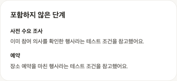

# P1 큰 틀 잡기 — BE와 FE 연결 안내

> 2026-10-25 기준. AI 공개 함수는 구현하고 실제 모델로 확인했습니다. 제품 DB, HTTP, FE 연결과 공동 계약 합의는 남아 있습니다.
>
> 협업 이슈: [#179](https://github.com/kakaotechcampus-4/ktc4-kyungpook-5/issues/179). 이 문서는 전달용 최신 안내이며 GitHub 이슈 본문에 자동 반영된 문서는 아닙니다.

**읽는 순서:** 처음에는 1~3절로 전체 흐름을 봅니다. BE는 4절과 7~9절, FE는 5~6절을 중심으로 읽고, 마지막 11~12절에서 함께 결정할 내용과 연결 확인 목록을 봅니다.

## 1. 사용자가 하려는 일부터 보기

P1은 **대화로 행사 조건을 정리하고 최초 계획 초안을 만드는 화면**입니다.

```text
P1 큰 틀 잡기
  “MT를 가고 싶어. 인원은 대략 50명으로 잡자”
     → 현재 행사 조건 정리
  “작년 참가비는 얼마였어?”
     → 과거 기록과 출처 확인
  “현재 조건으로 초안을 만들어줘” 또는 「다음: 흐름 만들기」
     → 최초 초안 생성 성공
     → P2 흐름 만들기로 이동

P2 흐름 만들기
  불필요한 단계 제외, 복원, 순서 변경, 수정 후 AI 검토
```

P1에서 단계 삭제나 순서 변경 요구를 따로 기억해 최초 생성에 적용하지 않습니다. 단계 편집은 P2의 범위입니다. 초안 생성 성공도 운영 시작이나 공지 게시를 뜻하지 않습니다.

[Figma v12 P1](https://www.figma.com/design/DAIeI2ETmdQ5vjrPSZJ196/?node-id=1130-1933) / [P2 협업 이슈 #177](https://github.com/kakaotechcampus-4/ktc4-kyungpook-5/issues/177)

## 2. 한 번의 대화를 세 팀이 어떻게 처리하나요?

현재 참가비가 25,000원이고 사용자가 “날짜는 아직 모르겠어. 인원은 대략 50명으로 잡자”라고 입력했다고 가정합니다.

| 순서 | 담당 | 하는 일 |
| --- | --- | --- |
| 1 | FE | 입력을 BE에 전송하고 응답 대기 표시 |
| 2 | BE | 권한 확인 후 현재 조건과 이전 Agent 상태 조회 |
| 3 | BE → AI | `PlanningChatRequest`를 만들어 `chat_planning()` 호출 |
| 4 | AI | 발화 해석 → 조건 변경 Tool → 값 검증 → 답변 작성 |
| 5 | AI → BE | 화면용 `view`와 다음 대화를 위한 `next_state` 반환 |
| 6 | BE | 다른 요청이 먼저 변경하지 않았는지 확인하고 결과 저장 |
| 7 | FE | “50명 잠정”, “날짜 보류”와 AI 답변 표시 |

BE는 AI 내부 Graph나 Tool을 직접 호출할 필요가 없습니다. FE는 Python 모듈을 직접 부르지 않고 BE의 제품 API를 사용합니다.

## 3. 반환값 두 개만 먼저 이해하면 됩니다

| 이름 | 쉽게 말하면 | 처리 |
| --- | --- | --- |
| `view` | 이번 결과를 화면에 보여주기 위한 정보 | BE가 제품 응답으로 변환해 FE에 전달 |
| `next_state` | 다음 대화를 이어가기 위한 Agent의 기록 | BE가 JSON으로 보관했다가 다음 요청에 전달 |

왜 상태가 필요할까요?

```text
사용자: “참가비 3만 원이면 어때? 아직 바꾸지는 마”
AI: 상담만 진행 → 현재 참가비는 25,000원 유지
BE: 답변과 next_state 저장

다음 요청에서 저장 상태 복원
사용자: “일단 그렇게 잡자”
AI: 앞선 3만 원 상담을 읽고 조건 변경 Tool 실행
결과: 참가비 30,000원 잠정 반영
```

텍스트 한 문장만 보내면 “그렇게”가 무엇인지 잃을 수 있습니다. `next_state`에는 대화, Tool 호출과 결과, 생성 권유 등이 들어갑니다. FE가 관리할 데이터는 아닙니다.

## 4. BE가 호출하는 실제 Python 코드

아래는 공개 API를 사용하는 **async 함수 예시**입니다. 저장은 JSON 문자열의 메모리 왕복으로 대신합니다. 제품 DB 저장과 권한 확인은 7절처럼 BE가 연결해야 합니다. `be/.env`가 설정된 개발 환경에서 호출하면 실제 모델을 사용합니다.

```python
from app.ai import (
    PlanningChatRequest, PlanningUserMessage, PlanningDraft, PlanningConditions,
    chat_planning, parse_resume_state,
)

async def example():
    # 예시용 ID와 기준일이다. 제품에서는 BE가 권한/소속을 확인한 값으로 만든다.
    request = PlanningChatRequest(
        request_id="request-1", club_id="club-1", event_id="event-1",
        conversation_id="conversation-1", base_revision=0,
        draft=PlanningDraft(conditions=PlanningConditions(
            event_type="MT", fee_per_person=25000,
        )),
        resume_state=None,  # 최초 요청에만 이전 상태가 없다.
        reference_date="2026-10-25", timezone="Asia/Seoul",
        message=PlanningUserMessage(
            id="message-1",
            content="날짜는 아직 모르겠어. 인원은 대략 50명으로 잡자.",
        ),
    )
    first = await chat_planning(request)  # 검색 없는 예시

    # 실제 서비스에서는 같은 결과의 조건/답변/상태를 함께 저장한다.
    saved_draft_json = first.view.draft.model_dump_json()
    saved_state_json = first.next_state.model_dump_json()

    # 다음 요청에서 저장했던 조건과 상태를 함께 복원한다.
    second_request = PlanningChatRequest(
        request_id="request-2", club_id="club-1", event_id="event-1",
        conversation_id="conversation-1", base_revision=1,
        draft=PlanningDraft.model_validate_json(saved_draft_json),
        resume_state=parse_resume_state(saved_state_json),
        reference_date="2026-10-25", timezone="Asia/Seoul",
        message=PlanningUserMessage(id="message-2", content="참가비는 무료로 하자"),
    )
    second = await chat_planning(second_request)
    return second
```

`base_revision=1`은 예시의 저장이 한 번 성공했다는 가정입니다. 실제 버전은 BE가 관리하며 AI가 증가시키지 않습니다. `reference_date`도 제품에서는 사용자 시간대의 현재 날짜를 전달합니다.

### 입력 필드의 의미

| 필드 | BE가 넣는 값 | 주의점 |
| --- | --- | --- |
| `request_id` | 이번 작업의 고유 ID | 동일 요청 재전송을 구분. 같은 ID로 다른 입력을 보내지 않기 |
| `message.id` | 이번 사용자 메시지 ID | 이미 상태 이력에 있는 메시지를 다시 넣지 않기 |
| 행사/대화/동아리 ID | 권한 확인된 소속 | FE가 보낸 값을 검증 없이 신뢰하지 않기 |
| `base_revision` | 조회한 상태 버전 | 저장 직전에 최신 버전과 비교 |
| `draft` | 현재 조건과 잠정/근거/보류 정보 | Event 컬럼 값만 복원하면 메타정보가 빠짐 |
| `resume_state` | 직전 결과의 저장 상태 | 중간부터 null로 보내거나 내부 내용을 편집하지 않기 |
| `reference_date`, `timezone` | 날짜 해석 기준 | “다음 달” 등의 기준이 됨 |

## 5. FE는 어떤 값으로 화면을 갱신하나요?

실제 확인한 첫 턴 응답의 **일부 필드만 발췌**하면 다음과 같습니다. 전체 JSON은 [검증 결과](evaluation-results/planning-public-2026-10-25.json)에 있습니다. 최종 HTTP의 필드명은 BE와 FE가 정합니다.

```json
{
  "view": {
    "draft": {
      "conditions": {
        "event_type": "MT",
        "headcount": 50,
        "fee_per_person": 25000,
        "start_date": null,
        "end_date": null
      },
      "condition_meta": {
        "headcount": {
          "status": "tentative",
          "evidence": {
            "message_id": "user-1",
            "quote": "일단 인원은 대략 50명으로 잡자."
          }
        }
      },
      "deferred_topics": ["dates"]
    },
    "generation_readiness": {"can_generate": true, "reasons": []},
    "generation_result": null
  }
}
```

| 화면 | 사용할 값 | 예시 |
| --- | --- | --- |
| AI 말풍선 | `view.reply` | 반환된 답변을 표시 |
| 조건 카드 | `view.draft.conditions` | 50명, 참가비 25,000원 |
| 잠정 표시 | `condition_meta[field].status` | tentative이면 “잠정” |
| 미정 표시 | 조건 값 null | 날짜 미정 |
| 무료 표시 | 참가비 0 | 무료. null과 다름 |
| 나중에 정할 내용 | `deferred_topics` | dates를 “날짜 보류”로 표시 |
| 다음 버튼 기준 | `generation_readiness` | 생성 가능 여부와 차단 이유 |
| 과거 기록 | `record_lookup` | 현재 조건과 분리해 출처 표시 |
| P2 진입 | `generation_result.status` | 이번 결과가 generated인 경우 |

**답변의 숫자로 조건 카드를 바꾸지 않습니다.** 상담에서 “3만 원이면…”이라고 말해도 구조화된 참가비가 25,000원이면 그대로입니다. `changed_fields`는 변경 알림용이며, 값이 같아도 잠정/보류가 바뀔 수 있으므로 draft 전체로 갱신합니다.

`specified`도 행사 최종 승인을 뜻하지 않습니다. 생성 가능 여부도 AI가 먼저 권유했다는 뜻이 아닙니다. 날짜와 인원이 미정이어도 초안을 만들 수 있습니다.

## 6. 채팅 수락과 버튼은 어떻게 다른가요?

```text
채팅: “초안을 만들까요?” → “응, 만들어줘”
  → chat_planning → Agent가 수락 해석 → 생성 Tool ┐
                                                   ├→ 공통 생성 Graph
버튼: 「다음: 흐름 만들기」                           │
  → generate_planning_preview ─────────────────────┘
```

버튼은 별도 요청입니다. “만들어줘”라는 가짜 사용자 말풍선을 추가하지 않습니다.

```python
from app.ai import PlanningPreviewRequest, generate_planning_preview

# snapshot은 BE가 같은 시점에 조회한 최신 조건/상태/버전이다.
# 아래 snapshot 변수와 조회 함수는 BE에서 준비하는 예시다.
request = PlanningPreviewRequest(
    request_id="click-1", club_id=authorized_club_id, event_id=event_id,
    conversation_id=conversation_id, base_revision=snapshot.revision,
    draft=snapshot.draft, resume_state=snapshot.resume_state,
    reference_date=local_today, timezone="Asia/Seoul",
)
result = await generate_planning_preview(request)

if result.view.generation_result.status == "generated":
    preview = result.view.generation_result.preview
    # BE가 저장 결과를 확정한 뒤 FE가 preview.steps로 P2를 구성한다.
```

생성 결과는 세 가지입니다.

| 상태 | 뜻 | 화면 처리 |
| --- | --- | --- |
| `generated` | 이번 초안 생성 성공 | 저장 후 P2에 초안 표시 |
| `needs_clarification` | 행사 유형 또는 반영 못 한 변경 등을 확인해야 함 | 이유 표시, 사용자 확인 |
| `failed` | 이번 초안 생성 실패 | 조건 유지, 실패 안내와 재시도 |

생성을 요청하지 않은 대화에서는 `generation_result`가 null입니다. 이전 성공 초안이 남아 있어도 이번 failed를 generated처럼 처리하지 않습니다.

`use_current_conditions`는 기본 false입니다. 반영 못 한 조건 변경이 있을 때 사용자가 **기존 값으로 생성하겠다고 따로 확인한 경우**에만 true를 사용합니다. 모든 버튼 요청에서 true로 설정하면 안 됩니다.

P2 단계 수와 순서는 `preview.steps`를 기준으로 합니다. 실제 검증에서 답변은 10개 항목으로 요약했지만 구조화 초안은 13단계였습니다. 초안의 임시 ID는 BE의 저장된 Plan/Step/Action ID가 아닙니다. P2 저장 매핑은 #177에서 맞춥니다.

### 포함하지 않은 단계도 이름과 이유를 제공합니다 (#198)

```json
{
  "code": "DEMAND_SURVEY",
  "name": "사전 수요 조사",
  "reason": "이미 참여 의사를 확인한 행사여서 제외했어요."
}
```

이 항목은 `preview.excluded_steps`의 예시입니다. AI 코드가 고정 카탈로그에서 name을 붙이고, LLM이 작성한 code와 reason은 유지합니다. BE는 제품 응답에 이름과 이유를 매핑하고 FE는 두 값을 표시하면 됩니다. FE에서 제외 단계 이름을 찾기 위한 별도 코드 변환표를 만들 필요는 없습니다. 코드 식별자와 실제 저장 매핑은 별도로 유지합니다.

기존 저장 JSON에 name이 없어도 공개 요청이나 `parse_resume_state()`가 이름을 보완합니다. 형식 버전 1과 이전 초안 ID, 조건, 대화 이력을 유지합니다. 명시된 이름이 틀렸다면 오류로 처리하며 상태를 임의로 초기화하지 않습니다. 실제 제품 응답 매핑과 연결 확인은 #187 범위입니다.

아래는 AI 독립 테스트 UI에서 고정 모델 응답을 실제 생성 Graph에 통과시킨 화면입니다. 제품 FE 화면이나 모델 판단 품질의 검증 결과가 아닙니다. 테스트 화면은 참고용이며 제품 표현은 FE에서 정하면 됩니다. [검증 원본](ui-tests/excluded-step-names-198.json).



### 생성 대기 화면과 화면 복귀 (#179)

- 버튼 클릭은 생성 요청이므로 바로 생성 대기 화면을 표시합니다.
- 채팅은 Agent가 생성 Tool을 고를 때까지 FE가 중간 시작 시점을 알 수 없습니다. 첫 연결은 대화 처리 중 표시 후 최종 응답의 생성 결과로 이동합니다.
- 「대화로 돌아가기」는 화면 복귀입니다. 서버 작업 취소를 보장하지 않으며 늦은 결과로 사용자를 갑자기 P2로 이동시키지 않습니다. 늦게 완료된 결과 보관과 다시 열기 정책은 BE 협의 대상입니다.
- 경과 시간은 표시할 수 있지만 “보통 20초”는 사용하지 않습니다. “계획을 만들고 있어요. 잠시 걸릴 수 있어요.”로 안내하고 반복 측정은 #196에서 진행합니다.

이 내용은 제품 연결 기준이며 테스트 UI가 모든 동작을 이미 제공한다는 뜻은 아닙니다. 제품 반영은 #187에서 확인합니다.

## 7. BE 저장에서 중요한 세 가지

### 조건과 상태를 함께 저장합니다

```text
AI 결과를 받음
  → 저장 직전 base_revision이 여전히 최신인지 확인
  → 조건 + 메타정보 + 답변 + next_state + 요청 결과를 함께 저장
  → BE revision 증가
  → FE 응답
```

예를 들어 Event에는 50명을 저장했는데 Agent 상태에는 30명이 남으면 다음 요청에서 불일치가 납니다. 저장 위치를 정하되 같은 처리 결과를 함께 반영해야 합니다. 모델 응답을 기다리는 동안 DB 행 잠금을 길게 잡는 구조는 피하는 안을 제안합니다.

### 같은 요청을 두 번 실행하지 않도록 관리합니다

```text
요청 A가 저장까지 성공 → 네트워크가 끊겨 FE가 응답을 못 받음
  → FE가 A 재전송
  → BE가 저장된 A의 응답 반환
```

처리 중인 요청의 중복도 관리해야 합니다. AI의 생성 성공 재사용 기능만으로 전체 채팅 중복 방지가 해결되지는 않습니다. 요청 ID와 입력 내용의 대응, pending/완료/실패 정책은 BE에서 정합니다.

### 재접속은 저장한 화면과 상태를 읽습니다

새로고침 때문에 AI를 다시 호출하지 않습니다. BE는 저장된 말풍선/조건/화면 결과를 반환하고, 다음 메시지가 들어오면 Agent 상태도 복원합니다. 기존 `Message` 텍스트만으로 Tool 이력이 모두 복원된다고 가정하지 않습니다.

현재 내부 history 한도는 **Tool 메시지 포함 60개**입니다. 60번의 사용자 대화를 뜻하지 않습니다. 초과 시 명시적 오류를 내며 자동 요약은 없습니다. #179에서 한도 임박 시 “대화가 길어지고 있어요. 현재 정한 내용을 확인해 주세요.”로 안내하기로 했습니다. AI 응답의 `view.history_usage`는 현재 이력 수와 최대값, 한도 임박 여부를 제공합니다(#194). 제품 필드 형태는 BE와 합의 전이며 상세 예시는 공개 계약 14절을 따릅니다. 압축 설계는 #195의 후속 범위입니다.

## 8. 실패해도 모든 것을 되돌리는 것은 아닙니다

| 상황 | 무엇을 받나 | BE/FE 처리 |
| --- | --- | --- |
| 인원 변경 성공 후 생성만 실패 | 새 draft와 generation_result.failed | 새 조건과 next_state 저장. 생성만 실패 안내 |
| 검색 실패 | record_lookup.failed | 현재 조건 유지. “자료 없음”과 구분 |
| 전체 AI 호출 실패 | AI 오류 예외 | 이전 조건/상태 보존. 요청 실패 기록 |
| 저장 JSON 손상/다른 행사/조건 불일치 | 상태 또는 입력 검증 오류 | 자동 초기화하지 않고 저장/변환 확인 |
| 저장 직전 다른 요청이 먼저 변경 | BE의 revision 충돌 | 오래된 AI 결과로 덮어쓰지 않기 |

`parse_resume_state()`는 `PlanningStateError`를 낼 수 있습니다. 요청 타입 검증에서는 Pydantic `ValidationError`로 감싸질 수 있습니다. 공급자 예외 원문을 FE에 그대로 보내지 않고 안전한 문구로 변환합니다. 구체 HTTP 코드와 재시도 UI는 합의 대상입니다.

## 9. 검색 기능을 연결하려면

```python
result = await chat_planning(request, records=record_search_port)
```

`record_search_port`는 BE가 구현하는 기존 `RecordSearchPort`입니다. AI는 질문을 해석하고 임베딩/검색/답변을 연결합니다. BE는 주어진 동아리 범위의 청크와 출처를 조회합니다. 미주입 시 검색 Tool을 제공하지 않습니다.

현재 계획 행사 ID로 검색 범위를 제한하면 과거 행사를 찾지 못할 수 있습니다. 동아리 접근 범위를 검증하되 현재 행사와 과거 검색 대상을 구분해야 합니다.

과거 참가비가 45,000원이라는 검색 결과만으로 현재 25,000원을 바꾸지 않습니다. 사용자가 채택하면 조건 Tool로 반영합니다. 버튼 생성은 새 검색을 하지 않고 저장된 최신 검색 근거를 사용합니다.

## 10. 지금 어디까지 확인했나요?

| 항목 | 현재 상태 |
| --- | --- |
| 공개 채팅과 버튼 함수 | 구현됨 |
| JSON 상태 저장/복원 | 구현 및 테스트됨 |
| 실제 모델의 상담 → 짧은 수락 → 생성 | 합성 대화 한 건에서 확인 |
| 실제 BE 검색 port, 권한, DB, HTTP | 제품 연결 검증 필요 |
| 제품 FE | FE팀 구현 필요 |
| P2 단계 편집/영향 검토 | 별도 범위 |

실제 모델은 gpt-5.6-luna로 공개 채팅 5회와 버튼 1회를 실행했습니다. 채팅 생성은 26.287초, 버튼 생성은 16.522초였습니다. 평균 성능이나 전체 성공률을 의미하지 않습니다. 자발적 권유 평가는 하지 않았고, 검색 port는 주입하지 않았습니다.

[평가 기록](evaluation.md) / [공개 계약 상세](p1-public-contract.md) / [실제 모델 재현 스크립트](../../scripts/check_planning_public.py)

## 먼저 보는 실제 테스트 화면

2026-10-24에 실제 모델로 확인한 **AI 전용 테스트 앱**입니다. 제품 FE 화면이나 최신 디자인의 확정본은 아닙니다.

아래 화면에서는 현재 참가비 25,000원을 유지하면서 과거 기록의 45,000원을 출처와 함께 보여줍니다. 검색했다고 현재 조건이 바뀌지 않는 점을 볼 수 있습니다.


<details>
<summary>추가 화면: 조건 대화와 「다음: 흐름 만들기」 버튼</summary>

40명, 참가비 25,000원, 날짜와 장소 미정으로 대화한 화면입니다. 좁은 화면에서는 조건 카드가 채팅 아래에 배치됩니다.


사진 속 Markdown 기호 노출과 예산 언급은 당시 모델 답변의 관찰 결과입니다. 해당 문구나 표현을 제품의 필수 동작으로 구현하라는 뜻은 아닙니다.

</details>

사진은 각 PR의 커밋을 고정한 주소이므로 브랜치가 정리돼도 같은 버전의 자료를 참조할 수 있습니다.

## 11. 팀별로 무엇을 결정하면 되나요?

| 담당 | 구현/확인할 것 | 함께 정할 것 |
| --- | --- | --- |
| AI | 공개 함수/상태 변환 유지, 재현된 문제 수정 | 긴 대화 정책, 상태 동기화 지원 |
| BE | 권한, 실제 검색 port, 요청 순서, 저장, HTTP | Agent 상태 저장 위치, 메타 저장, revision/중복 요청 정책 |
| FE | 채팅과 조건 카드, 출처, 생성 대기/결과/재시도 | HTTP 필드명, 미정/잠정 표시, 실패 및 재접속 UI |

연결 전에 우선 확인할 차이는 다음과 같습니다.

- AI `headcount`와 BE `expected_headcount`의 매핑
- #179에서 정한 제목 처리: BE가 행사 생성 시 기본 제목 저장, 사용자 지정 시 교체. FE는 저장 제목 표시, AI draft와 상태는 함께 동기화
- AI location 한 개와 옛 FE 명세의 locationCandidates 배열의 차이
- condition_meta/deferred_topics와 전체 Agent 상태의 저장 위치
- 기존 message/collected/readyToGenerate 응답을 새 view에 맞추는 범위
- P1 직접 조건 편집이 있다면 저장 상태와 함께 동기화하는 방법

실제 HTTP 경로와 DB 변경은 이 문서만으로 확정하지 않습니다. 테스트 전용 `/__planning-test/agent/*` 경로를 제품 API로 사용하지 않습니다. AI 테스트 UI는 `be/app/ai/tests/ui/planning/`에 있으며 제품 `fe/`의 구현이 아닙니다.

## 12. 같이 확인할 연결 시나리오

- [ ] 날짜 미정과 50명 잠정을 한 메시지로 반영하고 카드에 표시한다.
- [ ] 3만 원 상담에서는 기존 값 유지, 저장/복원 후 짧은 수락에서만 변경한다.
- [ ] 무료 0원과 미정 null을 구분한다.
- [ ] 검색의 과거 금액과 현재 조건을 구분하고 출처를 표시한다.
- [ ] 채팅 수락과 버튼 모두 생성 성공 후 P2로 이동한다.
- [ ] 생성 실패 시 조건과 이전 성공 초안을 잃지 않는다.
- [ ] 같은 요청 재전송, 동시 요청, 재접속을 실제 저장소에서 확인한다.

문제가 생기면 아래 형식으로 #179에 남겨 주세요. AI 실행 문제인지 저장/변환/화면 문제인지 함께 확인할 수 있습니다.

```text
브랜치 또는 커밋:
사용자 입력과 직전 조건:
기대했던 결과:
실제 반환된 view와 화면의 차이:
요청 ID와 상태 버전:
안전한 오류 코드:
```

인증값과 불필요한 개인정보는 제외합니다. 상태 전체가 필요하다면 합성 입력으로 재현해 공유합니다.

코드를 찾을 때는 [contracts.py](../../contracts.py)(데이터) → [facade.py](../../facade.py)(공개 함수) → [public_workflow.py](../../features/planning/public_workflow.py)(실행 연결) 순서로 보면 됩니다.
