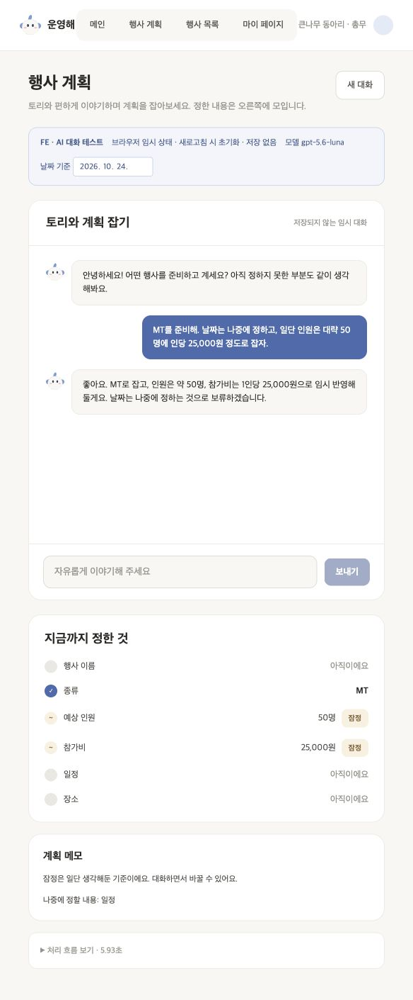

# 3단계 — AI 전용 행사계획 테스트 UI

2026-10-24 · #168, #174 · AI-PLAN-01·02·03. 2단계(#167)의 `run_planning_agent_turn()`을 기존 Figma P1 기반 테스트 화면에 연결했다. 저장·공개 API·P2·검색 Tool은 후속 범위다.

> 테스트 UI는 `be/app/ai/tests/ui/planning/`의 독립 앱이다. 제품 `fe/`의 라우트·타입·컴포넌트·설정에는 연결하지 않는다. FE팀에는 화면과 상태·계약을 참고 자료로 전달하고 실제 제품 구현은 맡긴다.

> 현재 화면에는 [4단계 검색 Tool·샘플 준비·참고 자료 표시](step-04-record-tool.md)도 연결돼 있다. 아래 검증은 3단계 당시의 기록이다.
> 최신 화면에는 [5-3 채팅/버튼 생성과 읽기 전용 P2](step-05-generation.md)도 연결했다. 실제 결과·남은 모델 품질 제한은 [평가 기록](evaluation.md)을 확인한다.

## 사용 예시와 흐름

“MT이고 참가비는 25,000원” → 카드에 MT·25,000원 → “3만 원이면 어때?” → 상담, 카드 유지 → “일단 그렇게 잡자” → Tool 실행 → 카드에 30,000원과 잠정 표시.

```text
PlanningPlaygroundPage의 임시 draft/history + 이번 발화
  → POST /__planning-test/agent/turn
  → PlanningAgentTurnInput → run_planning_agent_turn
  → agent → 필요한 경우 tools → agent
  → reply + draft + history + executions
  → 채팅은 reply, 조건 카드는 draft로 갱신
```

채팅 본문에서 숫자를 추출해 카드를 바꾸지 않는다. 상담 답변에 3만 원이 등장해도 실제 반환 draft가 25,000원이면 그대로 표시한다.

## 테스트 전용 계약

- 요청: `draft`, `current_message`, `history`, `reference_date`, `timezone`.
- 응답: `{result: PlanningAgentTurnResult, elapsed_ms}`.
- `history`는 AI가 반환한 메시지 목록을 테스트 UI가 그대로 다시 전달하는 불투명 데이터다. 화면에 표시하는 사용자/AI 말풍선과 별도로 보관하며 Tool 메시지를 삭제하거나 재작성하지 않는다.
- `draft.conditions`의 값과 `condition_meta`의 잠정 여부, `deferred_topics`를 함께 채택한다. 잠정값도 표시하되 잠정임을 밝힌다. 무료(0원)와 미정(null)을 구분한다.
- 성공 응답만 다음 턴의 기준으로 사용한다. 실패 시 기존 draft/history를 유지하며 같은 요청을 재시도할 수 있다.
- 서버는 대화 세션을 저장하지 않는다. 새 대화/새로고침은 테스트 UI 메모리를 초기화한다. DB 저장 완료나 행사 최종 승인으로 표시하지 않는다.

기존 `/__planning-test/turn`, `/records`는 legacy 검증용으로 보존하지만 새 화면에서는 호출하지 않는다. health에 `agent_version`을 포함해 새 API가 없는 오래된 서버를 구분한다.

## 화면과 확인 기준

테스트 앱 안의 PlanChat/PlanFacts를 활용한다. 초기에는 FE 화면 조각을 참고한 복사본이며 이후 AI 테스트용으로 독립 관리한다. 잠정 항목에는 잠정 표시, 보류 주제에는 사람이 이해할 이름을 보여준다. 기존 4/6 필수 조건·legacy 생성 가능 정책으로 새 대화를 제한하지 않는다. 위 화면 기준은 3단계 당시의 범위다. 현재 검색·생성 연결 여부는 위 최신 단계 안내를 따른다.

전송 중 입력/초기화를 잠그고 상태를 안내한다. 모델/API 오류는 안전한 문구로 표시한다. 실패한 요청을 재시도할 때 사용자 말풍선은 한 번만 남긴다. 이력 60개 제한은 임의로 잘라 보내지 않고 새 대화를 안내한다.

## 실행과 검증

프로젝트 루트의 터미널 두 개에서 실행한다.

```sh
cd be
.venv/bin/python -m app.ai.scripts.planning_playground
```

```sh
cd be/app/ai/tests/ui/planning
npm ci
npm run dev
```

[테스트 UI](http://127.0.0.1:5174/)에서 새 대화를 시작한다. 현재 서버가 이미 실행 중이면 코드 반영을 위해 AI 서버를 재시작한다. `be/.env`의 모델 설정을 사용하며 테스트 브라우저에는 키를 넣지 않는다. `npm ci`와 실행은 테스트 폴더 안에서만 수행하며 제품 `fe/` 설치가 필요 없다.

실제 브라우저에서 상담→수락, 잠정 인원·참가비→날짜 보류, 설명 요청, 무료→미정, 오류/재시도, 초기화를 확인한다. API 없는 테스트로 서버의 전달·오류 비노출을 확인하고 독립 테스트 앱의 `npm run build`·`npm run lint`를 실행한다.

## FE팀에 전달하는 참고 자료

이 테스트 UI는 제품 구현 요청을 구체화하기 위한 예시다. 코드 복사를 요구하거나 공개 API 계약이 확정됐다고 보지 않는다.

| 테스트에서 확인할 표시 | FE/BE에 전달할 내용 |
| --- | --- |
| 현재 조건 카드 | 명시값·잠정값·미정(null)·무료(0원) 구분, 보류 주제 표시 |
| 과거 기록 카드 | 현재 조건과 참고값 분리, 문서명·원문 위치·미조회/실패/자료 차이 표시 |
| 로딩·오류 | 중복 전송 방지, 실패 전 상태 보존, 재시도 시 요청 식별 방식 |
| 생성 결과 | 채팅 요청과 버튼 클릭 경로 구분, 최신 조건/이전 초안 구분, 미정 일정·가정·확인할 내용 표시 |
| 실제 서비스 연동 | 세션 보관·공개 DTO·권한·저장/수정/운영 시작은 각 담당 팀과 합의 |

## BE·FE 합의할 내용

- 공개 API에 사용할 초안·잠정/보류·대화 이력 계약과 버전.
- 실제 서비스에서 이력을 FE가 그대로 전달할지 BE가 세션으로 관리할지.
- 요청 식별·동시 요청·늦은 응답 처리, 저장·승인 책임.
- P2 진입 가능 판단과 검색 출처 UI는 후속 단계에서 합의.

이 문서의 API는 로컬 테스트 전용이며 공개 BE 계약을 이미 확정한 것이 아니다.

## 실제 확인 결과

2026-10-24, gpt-5.6-luna / planning-agent-v1. 프롬프트는 2단계와 같게 두고 연결을 확인했다.

| 확인 경계 | 근거 |
| --- | --- |
| 화면 → API | 실제 브라우저에서 전송, 서버 로그의 `POST /__planning-test/agent/turn 200` 확인 |
| API → Agent | 전용 엔드포인트는 `run_planning_agent_turn` 호출. 신규 API 테스트 4개에서 legacy 미호출·초안/이력 전달·오류 비노출·잘못된 이력 거절 확인 |
| Agent → 카드 | 25,000원 설정 → 3만 원 상담 시 값 유지 → 수락 시 30,000원·잠정 표시 |
| 여러 조건·보류 | 오타 섞인 원래 발화에서 50명·25,000원 잠정, 일정 보류 표시. 설명 요청에는 상태를 설명 |
| 무료·미정 | 무료는 `무료 (0원)`, CLEAR 후에는 `아직이에요` 표시 |
| 연결 실패·재시도 | 서버 중지 중 45명 요청 → 기존 50명 유지. 서버 재시작 후 재시도 → 45명 반영, 해당 사용자 말풍선 1개 |
| 초기화 | 새 대화와 새로고침으로 말풍선·초안·보류·이력이 초기화됨 |
| 빌드·회귀 | FE 빌드·변경 5개 파일 lint, AI 전체 627개 통과. 운영 번들에 테스트 API/문구가 포함되지 않음을 확인 |

[브라우저 실제 대화 8턴 기록](ui-tests/agent-p1-2026-10-24.json)은 UI에서 반환된 초안과 대화·Tool 이력을 선별해 보관한 것이다. SDK 메타정보·인증값을 포함하지 않는다. 초기화 확인용과 최종 예시 표시용 대화는 이 8턴과 별도로 실행했다. 이 기록을 정답 평가나 일반 정확도로 해석하지 않는다.



기본 브라우저 폭에서는 카드가 채팅 아래로 배치되고 큰 화면에서는 옆으로 배치된다. 채팅 본문은 현재 일반 텍스트여서 모델이 만든 Markdown 기호가 그대로 보일 수 있다. 설명 답변에 `applied` 같은 내부 코드가 노출된 표현도 있어 답변 문체 보완 과제로 남겼다. 검색 Tool·계획 생성은 아직 연결하지 않았다.
