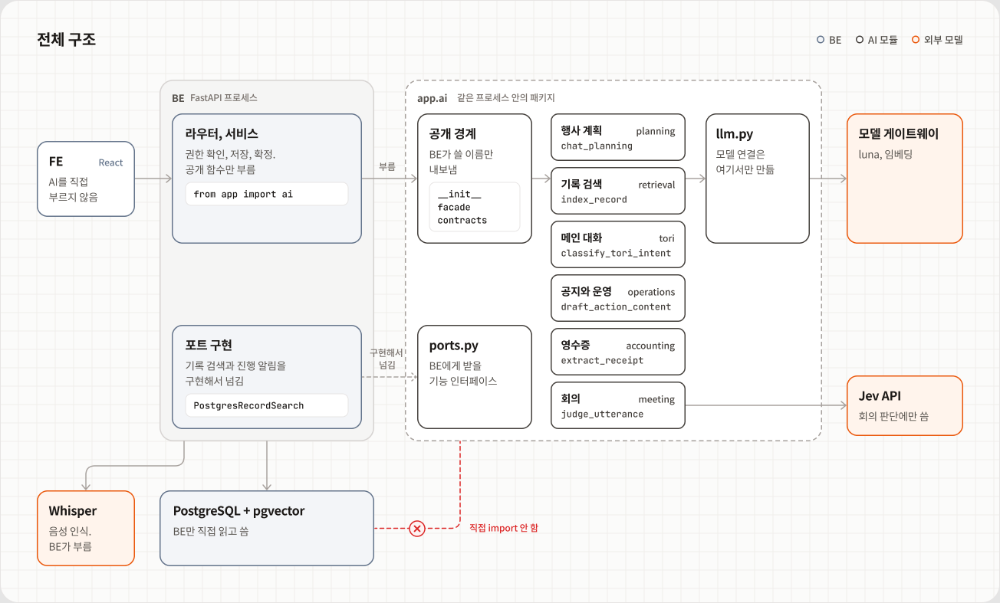
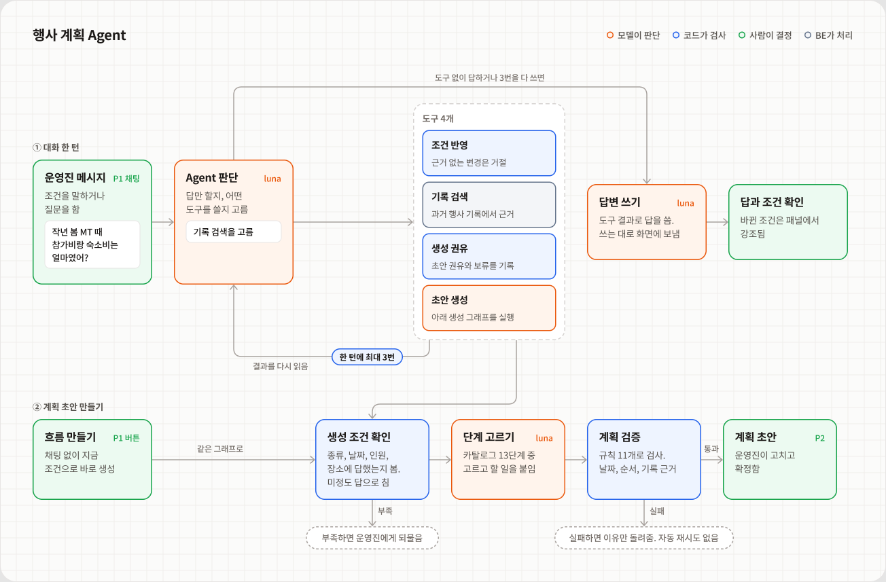
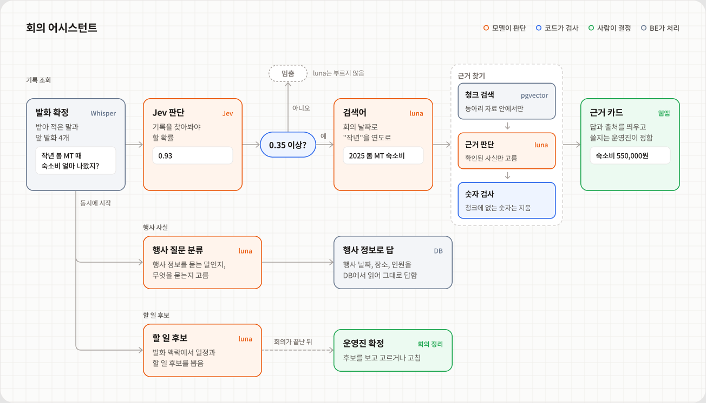

# 운영해 AI 기술 문서

> 작성 중인 문서입니다. 화면과 기능 소개는 [AI README](../README.md)에 있습니다.
> 이 문서는 토리가 **무엇을 스스로 판단하는지**, 그 판단을 **어떻게 구현하고 검사하는지**, **어떤 근거로 그렇게 정했는지**를 설명합니다.

<!--
작성 규칙 (다음 세션용 메모, 완성 후 삭제)
- 아래 ## 와 ### 제목은 README가 링크로 가리키므로 바꾸지 않는다. 바꾸면 README 링크도 함께 고친다.
- 중간점과 em dash 문자를 쓰지 않는다. AI 티 나는 표현을 피한다.
- 형식 참고: FE 기술 문서 fe/docs/technical-overview.md (PR #399)
- 숫자에는 조건(합성 대본인지, 몇 번 쟀는지)을 짧게 붙인다. 근거는 docs/*-evaluation.md
-->

## 1. 한눈에 보기

AI는 별도 서버가 아니라 BE 프로세스 안의 `be/app/ai` 패키지입니다. BE 서비스가 `from app import ai`로 공개 함수를 부르고, AI는 BE의 DB나 서비스 코드를 import하지 않습니다. 기록 검색이나 진행 알림처럼 BE 기능이 필요하면 BE가 `ports.py`의 인터페이스를 구현해서 넘겨 줍니다.

<p align="center"></p>

### 언제 불리나

| 화면 | 이럴 때 | AI 함수 |
| --- | --- | --- |
| P1 행사 계획 | 메시지를 보내거나 「흐름 만들기」를 누를 때 | `chat_planning`, `generate_planning_preview` |
| P2 계획 검토 | 고친 계획의 검토를 요청할 때 | `review_plan_edit` |
| 회의 | 발화 하나가 받아 적힐 때마다 | `judge_utterance` 외 2개 (함께 시작) |
| 회의 정리 | 회의가 끝난 뒤 | `generate_meeting_review` |
| 자료함 | 파일을 올리거나 검색할 때 | `index_record`, `search_related_records` |
| 메인 화면 | 토리에게 말을 걸 때 | `classify_tori_intent` 외 2개 |
| 행사 운영 | 현재 단계가 바뀔 때, 상황을 물을 때 | `draft_action_content`, `respond_operational_situation` |
| 회계 | 영수증을 올릴 때 | `extract_receipt` |

부르는 BE 서비스와 공개 이름 전체는 [3절](#3-구조)에 있습니다.

### 그림 읽는 법

4절의 흐름 그림은 색이 **누가 정하는지**를 뜻합니다.

| 색 | 뜻 | 예 |
| --- | --- | --- |
| 🟧 주황 | 모델이 판단 | Jev 확률, 도구 선택, 검색어, 본문 작성 |
| 🟦 파랑 | 코드가 검사 | 0.35 기준, 출처 연결, 숫자 대조, 계획 검증 |
| 🟩 초록 | 사람이 결정 | 근거 카드 확인, 초안 확정, 공지 승인 |
| ⬜ 회색 | BE가 처리 | 음성 인식, 청크 검색, 저장 |

점선 알약은 흐름이 멈추거나 사람에게 돌아가는 지점이고, 파란 작은 표시(「한 턴에 최대 3번」, 「한 번만」)는 반복 횟수의 상한입니다. 위의 전체 구조 그림만 예외로, 색이 위치(BE, AI 모듈, 외부 모델)를 뜻합니다.

## 2. 토리가 스스로 하는 일

토리는 운영진이 버튼을 누르지 않아도 판단을 시작합니다. 판단마다 순서는 같습니다. **토리가 고르고, 코드가 다시 검사하고, 확정은 사람에게 넘깁니다.**

| 기능 | 움직이는 때 | 토리가 고르는 것 | 코드가 막는 것 | 사람에게 넘기는 곳 |
| --- | --- | --- | --- | --- |
| 행사 계획 대화 | P1 메시지마다 | 쓸 도구와 순서. 조건을 확정으로 볼지 잠정으로 볼지. 초안을 권할 때 | 근거 문구가 이번 메시지에 없으면 조건 변경을 거절. 한 턴에 도구 3번까지 | 초안 생성 수락 |
| 계획 초안 | 생성을 요청할 때 | 13단계 중 넣을 단계와 뺄 이유, 단계별 일정과 할 일 | 종류, 날짜, 인원, 장소에 답했는지 먼저 확인. 규칙 11개로 검증하고 실패하면 저장하지 않음 | P2에서 고치고 확정 |
| 회의 | 발화 하나마다 | 기록을 찾아볼 말인지(확률). 앞 발화와 회의 날짜로 푼 검색어 | 0.35 미만이면 멈춤. 판단 단계 10초 제한. 청크에 없는 숫자는 지움 | 카드를 쓸지, 할 일 후보를 확정할지 |
| 기록 검색 | 계획, 회의, 메인에서 필요할 때 | 검색어. 확인한 사실과 못 찾은 것 | 자료 번호를 실제 출처로 바꾸고, 찾지 않은 번호면 오류. 자료 속 지시는 따르지 않음 | |
| 공지 초안 | 현재 단계가 바뀔 때 | 공지 본문. 모르는 값을 `[ ]`로 비울 곳 | 요일은 코드가 계산. 날짜, 요일, 금액, 시각을 입력과 대조하고 다시 쓰기는 한 번 | 승인, 앱 밖에서 게시 |
| 메인 대화 | 질문마다 | 질문 의도. 모호하면 되물음 | 출력 형식 | 실제 처리는 해당 화면에서 |

아래는 로컬 앱에서 실제로 남은 판단 기록입니다(2026-11-10, 테스트 동아리 자료). 한 번 실행한 기록입니다.

### 행사 계획 대화: 두 턴에서 고른 도구

**첫 턴: 조건을 말함**

```text
운영진  이번 가을에 운영진 MT 가려고 해. 30명 정도로 11월 28일부터 1박 2일, 장소는 가평으로 생각 중이야.
토리    update_event_conditions  조건 5개 반영 → applied
        update_generation_offer  초안 권유 → applied
        답변  "좋아요! 가평에서 11월 28~29일, 30명 정도의 운영진 MT로 정리해둘게요. (...) 계획 초안을 만들어볼까요?"
```

토리는 조건 다섯 개를 한 번에 반영하면서, 말투를 보고 확정과 잠정을 나눴습니다. 근거로 든 문구는 코드가 이번 메시지에 실제로 있는지 확인한 뒤에야 반영됩니다.

| 항목 | 값 | 토리가 고른 상태 | 근거로 든 문구 |
| --- | --- | --- | --- |
| 행사 종류 | MT | 확정 | 운영진 MT |
| 시작일, 종료일 | 2026-11-28, 2026-11-29 | 확정 | 11월 28일부터 1박 2일 |
| 예상 인원 | 30명 | 잠정 | 30명 정도 |
| 장소 | 가평 | 잠정 | 장소는 가평으로 생각 중이야 |

조건이 다 모이자 초안을 바로 만들지 않고 권유만 남겼습니다(`update_generation_offer`, 이유: "행사 유형, 일정, 예상 인원, 장소가 확인되어 MT 계획 초안을 제안합니다."). 초안은 운영진이 수락하거나 「흐름 만들기」를 눌러야 만들어집니다.

**둘째 턴: 지난 기록을 물음**

```text
운영진  작년 봄 MT 때 참가비랑 숙소비는 얼마였어?
토리    search_past_events → available (사실 4개, 확인하지 못한 것 2개)
        답변
```

토리가 검색 도구에 넣은 질문입니다. "작년 봄"을 "2025년 봄"으로 풀고, 금액이 1인 기준인지도 확인해 달라고 덧붙였습니다.

> 작년 봄(2025년 봄)에 진행한 동아리 MT의 참가비와 숙소비가 각각 얼마였는지, 관련 행사 기록의 실제 문서명과 위치를 확인해줘. 참가비가 1인 기준인지, 숙소비가 전체 또는 1인 기준인지도 함께 확인하고, 기록이 없거나 서로 다르면 구분해 알려줘.

| 검색 결과 | 출처 |
| --- | --- |
| 참가비 1인 45,000원 | 2025 봄 MT 결과보고.pdf, 1쪽 「1. 행사 개요」 |
| 숙소비 550,000원 | 2025 봄 MT 결과보고.pdf, 2쪽 「2. 예산」 |
| 참가비 수입 1,440,000원 | 2025 상반기 장부.csv, 2~8행 |
| 숙소 예약금 지출 550,000원 | 2025 상반기 장부.csv, 2~8행 |
| 확인하지 못한 것 | 숙소비가 전체 기준인지 1인 기준인지, 550,000원이 최종 숙소비인지 예약금인지 |

토리의 답은 사실마다 출처를 붙였고, 확인하지 못한 두 가지를 지어내지 않고 그대로 밝혔습니다.

> 다만 숙소비가 전체 금액인지 1인 금액인지, 최종 숙소비인지 예약금인지는 기록만으로 확인되지 않아요.

### 회의: 발화 6개에 내린 판단

회의 발화 테스트 기록입니다. Jev가 낸 확률이 0.35 이상일 때만 검색어를 만들고 기록을 찾습니다.

| 들은 말 | Jev 확률 | 결과 | 판단 단계 시간 |
| --- | --- | --- | --- |
| 자 이번 가을 MT 예산 얘기부터 할게요. | 0.07 | 띄우지 않음 | 0.90초 |
| 작년 봄 MT 때 숙소비 얼마 나왔지? | 0.93 | 검색어 「2025 봄 MT 숙소비」 → 숙소비 550,000원, 숙소 예약금 550,000원 | 2.85초 |
| 민수야 | 0.21 | 띄우지 않음 | 0.54초 |
| 버스 예약했어. | 0.19 | 띄우지 않음 | 0.51초 |
| 회측에 참가비 상한이 정해져 있었지요. | 0.41 | 검색어 「회칙 참가비 상한」 → 회칙 제13조, 1박 2일 행사 참가비 1인 50,000원 이하 | 3.01초 |
| 그럼 참가비는 사만 오천원으로 하죠. | 0.40 | 검색어 「참가비 상한」 → 2025 봄 MT 참가비 45,000원, 상한 50,000원 | 2.67초 |

- **판단 단계 시간**은 Jev 판단과 검색어 만들기를 합친 시간입니다. 예를 들어 0.93인 발화는 Jev 0.60초, 검색어 2.25초였습니다. 그 뒤 기록 검색(0.91초)과 근거 판단(2.27초)이 이어집니다.
- **잘못 들은 말을 고친 검색어**: 음성 인식이 "회칙"을 "회측"으로 받아 적었지만, 검색어는 「회칙 참가비 상한」으로 고쳐졌습니다.
- **기준 근처의 판단**: 마지막 발화는 질문이 아니라 결정인데 확률이 0.40이라 조회했습니다. 0.35 근처에서는 이런 판단이 흔들릴 수 있습니다([7절](#7-한계와-다음-일)).
- 같은 발화마다 행사 사실 조회와 할 일 후보 추출도 함께 시작했습니다(각각 약 2초). 이 둘은 판단 단계 시간에 들어가지 않습니다.

## 3. 구조

### 공개 경계

BE는 `app.ai`가 내보낸 이름만 씁니다. 내보낼 이름은 `__init__.py`의 `__all__`에 하나씩 적습니다.

| 파일 | 맡는 것 |
| --- | --- |
| `__init__.py` | BE가 쓸 이름만 다시 내보냄. 여기 없는 이름은 BE가 쓰지 않음 |
| `facade.py` | 공개 함수의 실행 진입점. 기능 폴더의 내부 함수를 이어 붙임 |
| `contracts.py` | BE와 주고받는 데이터. Pydantic 모델이라 들어올 때와 나갈 때 모두 검사됨 |
| `ports.py` | BE가 구현해서 넘겨 줄 기능의 인터페이스(`RecordSearchPort`, `PlanningProgressPort`) |
| `errors.py` | BE에 올리는 오류 타입 |

AI는 BE의 서비스, ORM, DB를 import하지 않습니다. 예외는 도메인 코드값(`app.core.enums`) 하나입니다. 같은 값을 두 곳에 두지 않기 위해서입니다.

### 부르는 BE 코드

| BE 코드 | 부르는 함수 |
| --- | --- |
| `services/planning_service.py` | `chat_planning`, `generate_planning_preview` |
| `services/plan_review_service.py` | `review_plan_edit` |
| `services/context_service.py` → `meeting_ai_service`, `meeting_event_service` | `judge_utterance`, `extract_task_suggestions`, `classify_meeting_event_facts`, `answer_meeting_event_facts` |
| `services/meeting_review_service.py` | `generate_meeting_review` |
| `services/record_service.py` | `index_record` |
| `services/record_discovery_service.py` | `search_related_records` |
| `routers/tori.py` | `classify_tori_intent`, `build_tori_record_query`, `answer_tori_records` |
| `services/action_draft_service.py` | `draft_action_content` |
| `services/operation_cases.py` | `respond_operational_situation` |
| `services/accounting_service.py` | `extract_receipt` |

모델을 기다리는 동안 DB 잠금을 쥐지 않습니다. BE는 AI를 부르기 전에 먼저 커밋하고, 결과가 오면 다시 잠근 뒤 저장 조건을 확인합니다. 공지 초안의 순서는 이렇습니다.

```text
단계 완료 요청 → 단계 완료, 커밋
  → 현재 단계의 공지를 "작성 중"으로 표시, 커밋
  → 뒤에서 초안 작업 시작, 요청에는 바로 응답
뒤에서  행사, 단계, 공지 읽기 → draft_action_content (잠금 없음)
  → 잠금 → 그사이 운영진이 고치지 않았는지 확인 → 저장 또는 실패로 표시
```

### 대화 상태 이어가기

AI는 대화 상태를 들고 있지 않습니다. 행사 계획 대화는 턴이 끝날 때마다 다음 턴에 필요한 상태를 JSON(`resume_state`)으로 돌려주고, BE가 저장했다가 다음 메시지와 함께 다시 넘깁니다. AI 쪽에는 DB도 체크포인트도 없습니다.

- 상태 JSON에는 `schema_version`이 있습니다. `parse_resume_state`는 지원하지 않는 버전과 손상된 JSON을 구분해 `PlanningStateError`를 내고, 임의로 초기화하지 않습니다.
- 대화 이력은 최대 60개 메시지입니다(`MAX_PLANNING_HISTORY`). 넘으면 몰래 잘라 보내지 않고 입력 검사에서 알립니다.

### 진행 신호

행사 계획은 답이 나오기까지 여러 단계를 거쳐서, 기다리는 동안 무엇을 하는지 보여 줍니다. BE가 `PlanningProgressPort`를 구현해 넘기면 AI가 작업에 맞춰 부르고, BE는 이를 SSE로 FE에 보냅니다.

| 메서드 | 언제 | 화면 |
| --- | --- | --- |
| `progress` | 조건 반영, 기록 검색, 초안 작성의 시작과 끝 | "예상 인원 반영했어요" 같은 진행 줄 |
| `reply_delta` | 답변 글자가 도착할 때 | 답변이 쓰이는 대로 보임 |
| `reply_reset` | 답변 뒤에 도구 호출이 나와 앞 글을 버려야 할 때 | 임시 답변을 지움 |

포트를 넘기지 않으면 진행 알림 없이 결과만 돌려줍니다. 회의는 같은 방식으로 `MeetingProgressPort`를 씁니다.

### 오류 처리

AI는 실패를 빈 결과로 돌려주지 않고 예외로 알립니다. BE는 예외 타입을 보고 다시 시도를 안내할지, 서버 오류로 처리할지 정합니다. 기준은 "같은 요청을 다시 보내면 성공할 수 있는가"입니다.

```text
AIError
├── AIConfigError            설정 문제. 다시 시도해도 안 됨
├── AIEmptyRecordError       색인할 내용이 없는 기록
└── AIRetryableError         다시 시도하면 될 수 있음
    ├── AITimeoutError
    └── AIInvalidResponseError    형식이나 검증을 통과하지 못한 응답
        └── AIOutputLimitError
```

- 공지 초안을 다시 써도 검사에 걸리면 `AIInvalidResponseError`를 냅니다. BE는 그 공지를 실패로 표시하고 「다시 받기」를 열어 둡니다.
- 회의 판단의 오류에는 실패하기 전까지의 판단 기록(`trace`)이 담깁니다. 실패한 판단도 기록에 남기기 위해서입니다.
- 예상하지 못한 예외는 감싸지 않고 그대로 올립니다. 자세한 표는 [errors.md](errors.md)에 있습니다.

### 모델 연결은 llm.py에서만

채팅 모델과 임베딩 모델은 `llm.py`에서만 만듭니다. 모델 호출 오류를 위의 AI 오류 타입으로 바꾸는 일도 여기서 해서, 기능 코드는 모델 SDK의 예외를 직접 다루지 않습니다. 기능마다 다른 설정(추론 깊이, 출력 한도)은 `build_chat_model`에 인자로 넘깁니다.

Jev만 예외입니다. OpenAI 호환 API가 아니어서 `features/meeting/jev.py`가 직접 부릅니다.

## 4. 기능별 구현

### 4.1 행사 계획 Agent

<p align="center"></p>

- **판단**: luna가 메시지마다 쓸 도구와 순서를 고르고, 조건을 확정으로 볼지 잠정으로 볼지, 초안을 언제 권할지 정합니다. 초안을 만들 때는 13단계 중 넣을 단계와 할 일을 고릅니다.
- **검사**: 조건 변경은 근거 문구가 이번 메시지에 있어야 반영됩니다. 도구는 한 턴에 3번까지입니다. 초안은 생성 조건을 먼저 확인하고, 만든 뒤 규칙 11개로 검증합니다.
- **넘김**: 초안 생성은 운영진이 권유를 받아들이거나 「흐름 만들기」를 눌러야 시작합니다. 만든 초안은 P2에서 운영진이 고치고 확정합니다.

**대화 한 턴**은 LangGraph의 두 노드가 번갈아 도는 구조입니다. `agent` 노드가 모델을 부르고, 응답에 도구 요청이 있으면 `tools` 노드가 실행한 뒤 결과를 다시 `agent`로 넘깁니다. 도구 요청 없이 답하면 턴이 끝납니다. 한 응답에 도구를 여러 개 요청할 수 있고, `tools` 노드가 앞 도구의 결과를 다음 도구의 입력 상태로 써서 차례로 실행합니다.

| 도구 | 하는 일 | 코드가 막는 것 |
| --- | --- | --- |
| `update_event_conditions` | 조건을 바꾸거나 비우고, 확정 또는 잠정으로 표시. 주제를 보류하거나 다시 꺼냄 | 근거 문구가 이번 메시지에 없으면 거절. 날짜 관계가 맞지 않으면 원래 조건 유지 |
| `search_past_events` | 과거 기록에서 근거를 찾음([4.3](#43-기록-검색)) | 조건을 바꾸지 않음 |
| `update_generation_offer` | 초안 권유를 남기거나 운영진이 미루면 보류 | 보류한 조건 그대로 다시 권하거나, 지금 조건으로 만든 초안이 이미 있으면 거절 |
| `generate_event_plan` | 아래 생성 그래프를 실행 | 요청이나 수락 문구가 이번 메시지에 없으면 되물음. 받아들인 권유가 지금 것이 아니거나 그 뒤 조건이 바뀌었어도 되물음 |

도구를 3번 쓰면 다음 모델 호출에서 도구를 끄고 "실제로 끝낸 것과 남은 것을 답하라"는 안내를 붙입니다. 그래도 도구를 요청하거나 빈 답을 내면 오류로 처리합니다.

**계획 초안 만들기**는 대화의 도구와 P1 「흐름 만들기」 버튼이 같은 경로로 들어옵니다.

1. **생성 조건 확인**: 행사 종류가 있고 날짜, 인원, 장소에 답했는지 봅니다. "미정"이라고 답한 것도 답으로 칩니다. 부족하면 "행사 일정이 어떻게 되나요? 아직 미정이라고 답해도 괜찮아요." 같은 질문을 돌려줍니다.
2. **`compose_plan`**: luna(추론 깊이 low)가 13단계 카탈로그에서 단계를 고르고, 단계마다 일정과 할 일을 붙입니다. 빼는 단계에는 이유를 답니다. 단계 이름과 허용된 할 일 종류는 카탈로그가 정하고, 모델은 단계 코드만 고릅니다.
3. **`validate_plan`**: 아래 규칙 11개로 검사합니다. 실패하면 자동으로 다시 만들지 않고, 이유를 돌려주며 이전 초안을 그대로 둡니다.

| 묶음 | 규칙 |
| --- | --- |
| 단계 | 포함과 제외가 카탈로그 13단계와 정확히 맞는지, 준비, 모집, 진행 순서인지 |
| 날짜 | 마감이 시작보다 빠르지 않은지, 행사 날짜가 미정이면 단계 날짜도 비웠는지, 행사 전 단계가 시작 뒤로, 행사 뒤 단계가 종료 전으로 잡히지 않았는지, 당일 단계가 행사 날짜와 같은지 |
| 할 일 | 단계에서 허용한 할 일 종류인지, 기한이 단계 기간 안인지 |
| 근거 | 계획이 가리킨 기록 근거가 실제로 넘긴 것인지 |

**고친 뒤 검토**는 P2에서 운영진이 계획을 고친 다음 요청할 때 돕니다(`review_plan_edit`).

| 순서 | 누가 | 하는 일 |
| --- | --- | --- |
| 1 | BE | 고치기 전과 뒤를 비교해 바뀐 단계, 일정, 할 일을 계산 |
| 2 | luna | 바뀐 내용을 보고 걱정되는 점을 0~4개 찾음 |
| 3 | 코드 | 검토가 입력에 없는 단계를 가리키면 오류로 막음 |
| 4 | 운영진 | 검토를 보고 반영할지 정함 |

| 위치 | 내용 |
| --- | --- |
| `features/planning/agent/graph.py` | `agent`와 `tools` 노드 연결, 한 턴 실행 |
| `features/planning/agent/nodes.py` | 모델 호출, 도구 실행, `MAX_TOOL_CALLS = 3`, `PARALLEL_TOOL_CALLS` |
| `features/planning/agent/tools.py` | 조건 변경 도구와 근거 확인 |
| `features/planning/generation/offers.py` | 초안 권유와 보류 |
| `features/planning/generation/readiness.py` | 생성 조건 확인 |
| `features/planning/generation/graph.py` | `compose_plan` → `validate_plan` |
| `features/planning/generation/catalog.py` | 13단계 카탈로그 |
| `features/planning/generation/validation.py` | 검증 규칙 11개 |
| `features/planning/review/review.py` | 고친 뒤 검토 |
| `features/planning/state_codec.py` | 대화 상태 JSON 변환 |

### 4.2 회의 판단

<p align="center"></p>

- **판단**: Jev가 기록을 찾아봐야 할 말인지 확률로 냅니다. 0.35 이상이면 luna가 앞 발화와 회의 날짜로 검색어를 씁니다.
- **검사**: 0.35 미만이면 luna를 부르지 않고 멈춥니다. 판단 단계는 10초를 넘기면 끊습니다. 근거에서 청크에 없는 숫자와 연도는 지웁니다.
- **넘김**: 근거 카드를 쓸지는 운영진이 정합니다. 할 일 후보는 회의가 끝난 뒤 회의 정리에서 운영진이 고르기 전까지 할 일이 되지 않습니다.

**입력**은 받아 적은 발화 하나와 그 앞 발화 4개(`MEETING_CONTEXT_UTTERANCES`), 회의 날짜입니다. 앞 발화가 있어야 "그때"나 "그거"가 무엇인지 알 수 있고, 회의 날짜가 있어야 "작년"을 연도로 바꿀 수 있습니다.

**판단을 두 모델로 나눈 이유**: Jev는 문장 없이 확률만 돌려주는 판단 전용 API라 빠르고, 기준값으로 자를 수 있습니다. 검색어처럼 글을 써야 하는 일만 luna에 맡깁니다. 조회하지 않을 말(대부분의 발화)에는 luna를 아예 부르지 않습니다. 이렇게 바꾼 과정은 [5절](#5-숫자로-내린-결정)에 있습니다.

**결과는 세 가지 중 하나입니다.** 결과 타입이 종류마다 있어야 할 값을 강제해서, 섞인 결과는 만들어지지 않습니다.

| 종류 | 뜻 | 반드시 있는 것 |
| --- | --- | --- |
| `NO_LOOKUP` | 찾아볼 말이 아님 | 확률 |
| `ANSWER` | 찾았음 | 답과 출처 하나 이상 |
| `NOT_FOUND` | 찾아봤지만 기록에 없음 | 무엇을 물었는지(검색어). 답과 출처는 없어야 함 |

처리에 실패하면 이 셋이 아니라 오류로 올라옵니다. 그래서 "기록에 없음"과 "처리하지 못함"이 화면에서 섞이지 않습니다.

**시간 처리**
- 판단 단계(Jev와 검색어)는 10초 제한입니다(`JUDGE_TIMEOUT_SECONDS`). 빨리 끊으려는 값이 아니라 무한히 기다리지 않으려는 값입니다. 넘기면 조용히 버리지 않고 `AITimeoutError`로 알립니다.
- 대화가 다음 안건으로 넘어갔어도 찾은 근거는 카드로 띄웁니다.
- BE는 회의 하나에서 AI 처리를 동시에 4개까지 돌리고, 나머지는 들어온 순서대로 기다리게 합니다. 받아 적기는 막지 않습니다.

**판단 기록**: 발화마다 단계별 기록(`trace`)을 남깁니다. 단계 이름, 걸린 시간, Jev 확률, 검색어, 찾은 청크 수, 프롬프트 버전이 들어갑니다. 2절의 회의 표가 이 기록에서 나왔습니다.

| 위치 | 내용 |
| --- | --- |
| `features/meeting/nodes.py` | 판단 흐름, `JUDGE_TIMEOUT_SECONDS = 10.0` |
| `features/meeting/context.py` | `JEV_THRESHOLD = 0.35`, 앞 발화 4개, 판단 입력 만들기 |
| `features/meeting/jev.py` | Jev API 호출 |
| `features/meeting/lookup.py` | 기록 찾기와 숫자 검사, 카드 문구 |
| `features/meeting/event_intent.py`, `event_facts.py` | 행사 사실 질문 분류와 답 |
| `features/meeting/task_extraction.py` | 할 일 후보 추출 |
| `services/context_service.py` (BE) | 세 갈래를 함께 시작하고 판단 기록 저장 |

### 4.3 기록 검색

<!-- 청킹 규칙(문서: 쪽과 조항, 장부: 행 1,000자), 임베딩 1536차원, 검색어 정리, 근거 판단, 출처 번호를 코드가 바꿈, 기록 속 지시문 차단, 숫자 검사(#383) -->

### 4.4 공지와 발송 초안

<!-- 신호 A(단계가 현재 단계가 됨), draft_action_content, 요일을 코드가 계산, find_draft_violations, 한 번만 다시 쓰기, [ ] 자리표시 -->

### 4.5 메인 대화

<!-- 의도 분류(record_search, task_list, briefing 등), 답은 DB 값으로, 모호하면 되묻기, redirect 화면 안내 -->

## 5. 숫자로 내린 결정

<!--
README에는 Jev 하나만 남겼다. 여기에는 전체를 「문제, 원인, 고른 방안, 결과, 한계」 순서로
- Jev 전체(미리 정한 기준 3개, 받아들인 1건, 남은 위험)
- 계획 생성 추론 깊이 low: 생성 호출 p50 15.4초 → 11.1초 (#264)
- 생성 출력에서 취소 단계 코드 막음: 채팅 생성 검증 통과 25/30 → 30/30 (#276)
- 기록 재검색 끔: 틀린 사실 12.3 → 6.7, 질문당 1.9초 단축 (#72)
- 검색어 정리: Hit@1 0.41 → 0.58 (#72)
- 회의 검색어 앞 발화 4개: 대상 포함 35~40% → 100%
- 대화 입력 캐시(#269), 한 응답에 도구 여러 개(#265, #274), 날짜 보류 17/30 → 0/30(#205)
-->

## 6. 재는 방법과 평가 세트

<!-- 한 번에 하나만 바꿈, 번갈아 재서 순서 효과 제거(#111), 홀드아웃은 한 번만, 평가 세트 위치(tests/fixtures/eval), 측정 스크립트(scripts/) -->

## 7. 한계와 다음 일

<!-- 행사 Agent 상시 대기 미구현, 0.35 근처 확률 흔들림, 긴 대화 압축 없음(#195), 다시 쓰기 경로 실제 모델 미확인 등 -->
