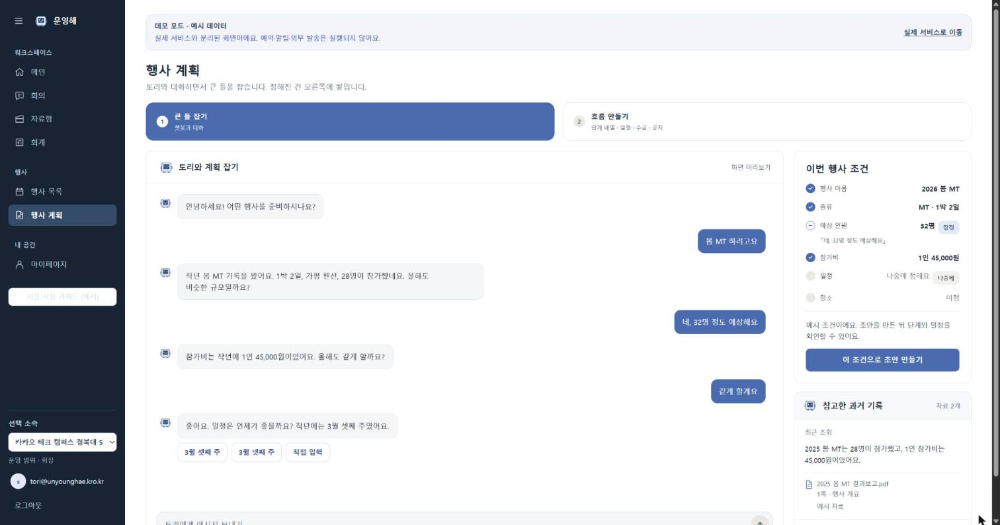
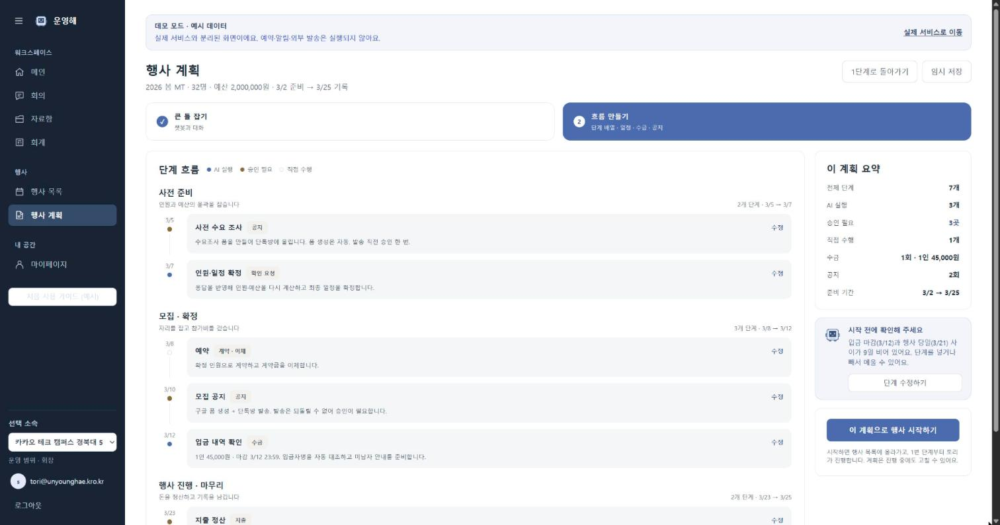
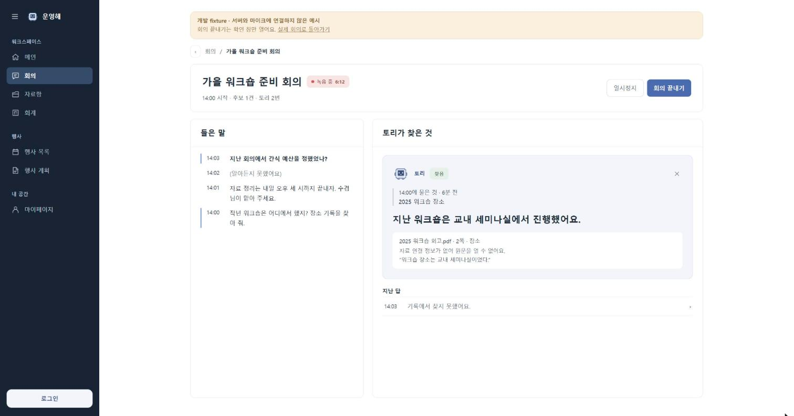
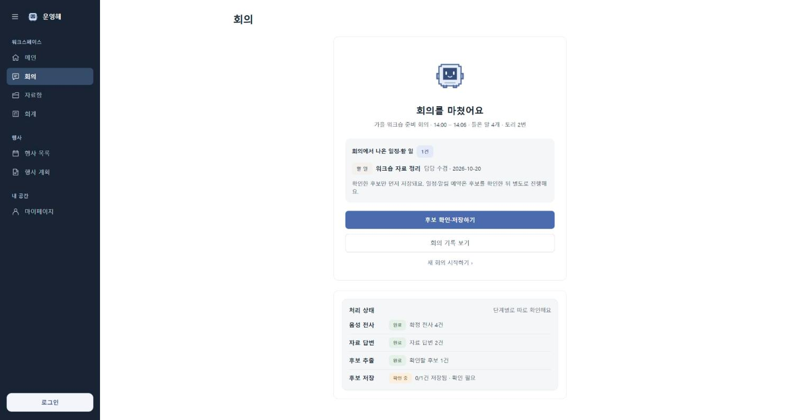
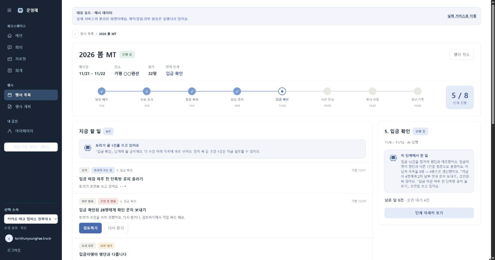
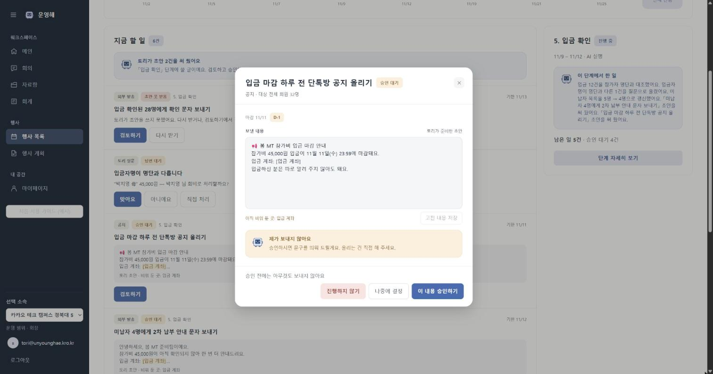
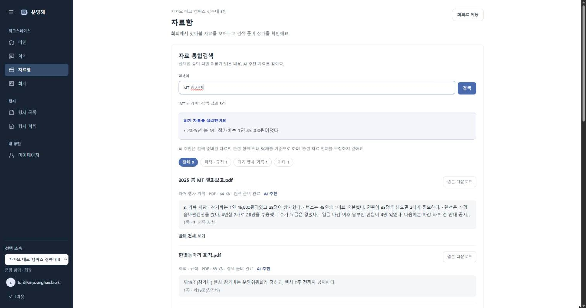
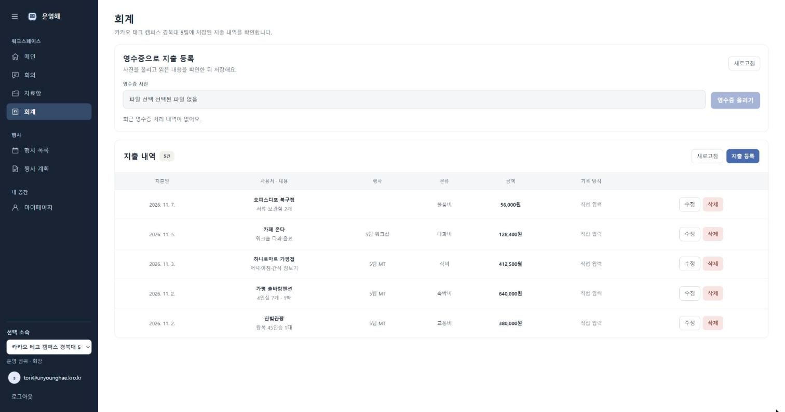
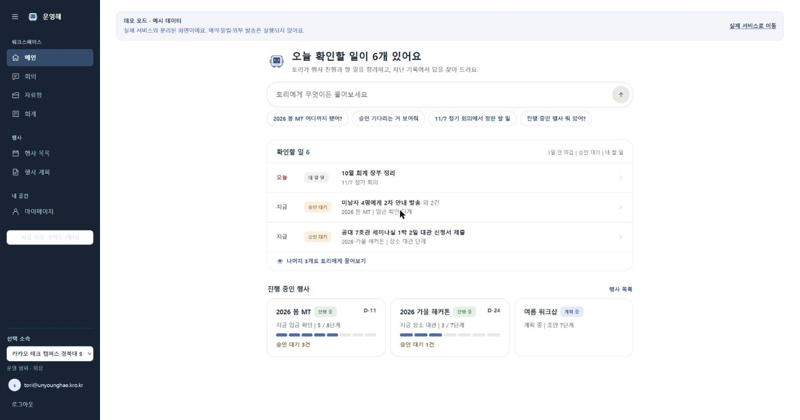
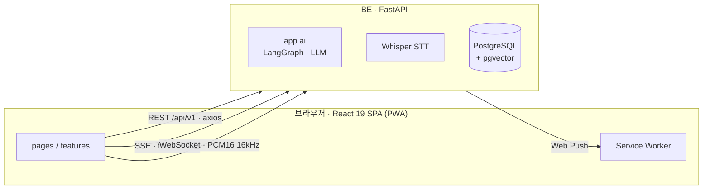

<div align="center">

# 운영해 · Frontend

### 🎓 동아리 운영진을 위한 AI 행사 보조 서비스, 운영해

> **"토리는 제안하고, 운영진이 확정합니다."**
> 행사 계획부터 회의 기록, 공지 초안, 정산까지 — AI가 먼저 써 두고 사람이 확인합니다.

[](https://unyounghae.kro.kr)
[](https://unyounghae.kro.kr)

카카오 테크 캠퍼스 4기 · 경북대 5팀 · 2026.09 ~ 2026.11

</div>

---

### 💡 왜 운영해인가?

동아리 운영진은 행사 하나를 치르는 동안 계획을 짜고, 회의를 하고, 공지를 쓰고, 영수증을 모읍니다.
흩어진 그 일들을 한곳에 모으되, **결정은 사람이 하도록** 만들었습니다.

| 핵심 가치 | 무엇이 다른가 |
| --- | --- |
| **제안과 확정의 분리** | 토리가 쓴 공지·이체 초안은 승인해도 앱이 보내지 않습니다. 운영진이 밖에서 게시·이체한 뒤 완료를 표시합니다 |
| **근거 없는 말을 하지 않음** | 과거 기록에서 찾은 답에는 출처와 원문 위치를 붙입니다. 「기록에 없음」과 「찾지 못함」을 구분합니다 |
| **실패를 덮지 않음** | API가 실패하면 예시 데이터로 대체하지 않습니다. 못 한 일과 다시 할 수 있는 일을 보여 줍니다 |

---

## 목차

<table>
<tr>
<td width="50%" valign="top">

### 📋 프로젝트 정보

- [주요 기능](#주요-기능)
- [화면 구성](#화면-구성)
- [아키텍처](#아키텍처)
- [기술 스택](#기술-스택)
- [디렉터리 구조](#디렉터리-구조)

</td>
<td width="50%" valign="top">

### 🤝 개발 가이드

- [시작하기](#시작하기)
- [명령어](#명령어)
- [개발 규칙](#개발-규칙)
- [API 규약](#api-규약)
- [배포](#배포)
- [팀원](#팀원)

</td>
</tr>
</table>

---

## 주요 기능

### 1. 행사 계획 — 대화로 조건을 모으고 초안을 생성

> **대화에서 조건 6칸을 자동으로 채움**
> 행사 이름·종류·예상 인원·참가비·일정·장소를 말에서 뽑아 반영하고, 바뀐 칸을 1.5초 강조합니다
>
> **확정·잠정·미정을 구분**
> 잠정이면 근거가 된 발화를 인용하고, 과거 기록을 참고했으면 파일과 위치를 함께 보입니다
>
> **13개 단계 카탈로그에서 계획 초안 생성**
> 넣은 단계는 일정·행동까지, 뺀 단계는 이유를 남깁니다

<table>
<tr>
<td width="50%" align="center"><b>🖥 조건 대화 (P1)</b></td>
<td width="50%" align="center"><b>🖥 계획 검토 (P2)</b></td>
</tr>
<tr>
<td width="50%"></td>
<td width="50%"></td>
</tr>
</table>

<br/>

### 2. 회의 — 말하는 동안 토리가 과거 기록에서 답을 찾음

> **실시간 전사와 근거 검색**
> 마이크 음성을 PCM16 16kHz로 100ms씩 보내면, 서버가 구간을 나눠 받아쓰고 답을 찾습니다
>
> **찾을 필요가 없는 말에는 개입하지 않음**
> 발화마다 기록을 찾아봐야 하는 말인지 먼저 판단합니다
>
> **회의 후 자동 정리**
> 화자를 나누고 이름을 확인하면 회의록과 일정·할 일 후보를 정리합니다

<table>
<tr>
<td width="50%" align="center"><b>🖥 회의 중 (들은 말 · 토리가 찾은 것)</b></td>
<td width="50%" align="center"><b>🖥 회의 후 (후보 확인·예약)</b></td>
</tr>
<tr>
<td width="50%"></td>
<td width="50%"></td>
</tr>
</table>

<br/>

### 3. 행사 운영 — 공지·발송 초안을 검토하고 승인

> **다음 단계가 시작되면 본문 초안을 미리 작성**
> 운영진이 채울 곳은 `[ ]` 빈칸으로 남겨 둡니다
>
> **승인해도 앱이 보내지 않음**
> 운영진이 복사해 게시·이체한 뒤 「게시했습니다」로 완료를 표시합니다
>
> **그사이 바뀌었으면 막음**
> 화면이 본 버전을 함께 보내, 다른 사람이 먼저 처리했으면 다시 불러와 확인하게 합니다

<table>
<tr>
<td width="50%" align="center"><b>🖥 행사 상세 (지금 할 일)</b></td>
<td width="50%" align="center"><b>🖥 초안 검토·승인</b></td>
</tr>
<tr>
<td width="50%"></td>
<td width="50%"></td>
</tr>
</table>

<br/>

### 4. 자료함과 회계 — 올린 자료가 답의 근거가 됨

> **업로드한 자료를 파싱하고 검색용으로 색인**
> 「처리 대기 → 내용 읽는 중 → 파싱 완료 → 검색 준비 완료」를 구분해 보입니다
>
> **영수증 사진으로 지출 초안 생성**
> 「확정 전에는 지출에 반영되지 않아요」 — 확인 체크 후에만 장부에 들어갑니다
>
> **송금 행동은 장부에 자동 기록**
> 행사에 묶인 자동 기록이라 연결 행사를 바꿀 수 없습니다

<table>
<tr>
<td width="50%" align="center"><b>🖥 자료함 (처리 상태 · 검색)</b></td>
<td width="50%" align="center"><b>🖥 회계 (영수증 가져오기)</b></td>
</tr>
<tr>
<td width="50%"></td>
<td width="50%"></td>
</tr>
</table>

<br/>

### 5. 메인 브리핑과 알림 — 앱을 닫아도 놓치지 않게

> **확인할 일을 서버가 모아서 보여 줌**
> 3일 안에 마감되는 단계, 승인을 기다리는 행동, 내게 배정된 할 일
>
> **토리에게 묻고 카드로 답 받기**
> 질문 의도를 분류한 뒤 DB에서 읽은 값으로 답합니다. 모호하면 되묻습니다
>
> **확정한 시각에 기기 알림(Web Push)**
> 알림을 누르면 해당 할 일 상세가 열립니다



---

## 화면 구성

| 경로 | 화면 | 하는 일 |
| --- | --- | --- |
| `/` | 소개 | 서비스 소개. 로그인 상태면 메인으로, 아니면 로그인으로 안내 |
| `/dashboard` | 메인 | 토리 브리핑(확인할 일, 진행·계획 중인 행사), 토리에게 묻고 카드로 답 받기 |
| `/planning` | 행사 계획 P1·P2 | 조건 정하기 → 계획 초안 생성 → 단계·행동 검토·수정 → 운영 시작 |
| `/events`, `/events/:id`, `/events/:id/cancel` | 행사 목록·상세·취소 | 진행 단계와 지금 할 일, 공지·발송 초안 검토·승인, 상황 대응, 취소 뒷정리 |
| `/meetings`, `/meetings/:id` | 회의 | 녹음 중 전사와 토리 답 → 종료 후 화자 확인, 후보 저장·알림 예약 |
| `/records` | 자료함 | 회칙·장부·결과보고(PDF·CSV·XLSX) 업로드, 처리 상태 확인, 검색 |
| `/accounting` | 회계 | 영수증 사진으로 지출 등록, 장부 입력·수정, 지출에 행사 연결 |
| `/mypage` | 마이페이지 | 내 정보, 동아리원 명단·초대, 동아리 정보 수정 |
| `/login`, `/signup`, `/clubs/new`, `/clubs/join` | 인증·동아리 | 회원가입, 이메일·카카오 로그인, 동아리 만들기, 초대 코드로 참여 |
| `/onboarding` | 체험 | 실제 API 없이 예시 계정으로 회의 → 후보 저장 흐름 체험 |

---

## 아키텍처

FE는 BE만 호출합니다. AI(`be/app/ai`)는 BE 프로세스 안의 모듈이라 FE가 직접 부르지 않습니다.



통신 방식을 기능마다 다르게 고른 이유입니다.

| 기능 | 통신 방식 | 왜 이 방식인가 |
| --- | --- | --- |
| 행사 계획 대화·생성 | **SSE** (POST 응답 스트림) | 조건을 반영하고 기록을 찾는 과정을 기다리는 동안 보여 주려고 |
| 회의 음성 | **WebSocket** (JSON 메타 + binary) | 100ms 단위 음성을 끊김 없이 보내고 서버 확인(ack)을 받으려고 |
| 회의 전사·답·후보 | **REST 폴링 2.5초** + WS 신호로 즉시 재조회 | 화면은 서버에 저장된 상태만 그립니다. WS 메시지를 그대로 그리지 않습니다 |
| 자료·영수증·초안 처리 상태 | **REST 폴링** (처리 중일 때만) | 서버 비동기 작업이 끝나면 폴링을 멈춥니다 |
| 예약 알림 | **Web Push + Service Worker** | 앱을 닫아도 기기 알림으로 받습니다 |

> 구조·기능별 구현·기술 결정의 자세한 내용은 [**FE 기술 문서**](docs/technical-overview.md)에 있습니다.

---

## 기술 스택

| 분류 | 기술 | 고른 이유 |
| --- | --- | --- |
| **언어 · 프레임워크** |   | 로그인 뒤 쓰는 대시보드형 앱이라 SSR·SEO가 필요 없음 |
| **빌드** |  | 빠른 개발 서버, 정적 파일 빌드 |
| **스타일** |  | 디자인 토큰을 `styles/index.css`의 `@theme`에 모음 |
| **서버 상태** |  | 캐시·재조회·폴링을 한 방식으로 처리 |
| **전역 상태** |  | 세션·소속, 녹음 중 잠금, 토스트만 전역에. 화면 상태는 `useState` |
| **라우팅** |  | 레이아웃을 중첩 라우트로 공유, 녹음 중 이동을 `useBlocker`로 차단 |
| **HTTP** |  + `fetch` | 일반 요청은 axios, 조금씩 읽어야 하는 SSE는 fetch |
| **API 타입** |  | BE OpenAPI에서 타입을 생성해 요청·응답을 맞춤 |
| **음성** |  `AudioWorklet` | 브라우저에서 PCM16 16kHz로 변환해 전송 |
| **알림** |  | PWA 설치, 기기 알림 |
| **코드 품질** |    | 별도 테스트 프레임워크 없이 Node 내장 러너로 단위 테스트 172개 |
| **배포** |    | 멀티 스테이지 빌드, `/api/*` 프록시, HTTPS 자동 발급 |

---

## 디렉터리 구조

**Feature-based 구조** — 화면은 조립만 하고, 도메인 지식은 `features/`에, 공용은 `shared/`에 둡니다.

```text
src/
├── app/            라우터, 전역 Provider, 레이아웃(상단바·사이드 메뉴)
├── pages/          화면 하나당 파일 하나
├── features/       도메인별 코드
│   ├── planning/       행사 계획 P1·P2 (SSE 스트림, 생성 요청 복구)
│   ├── meetings/       회의 (audio/: 마이크 → PCM → WebSocket)
│   ├── events/         행사 목록·상세, 행동 초안·승인·실행, 운영 상황 대응
│   ├── dashboard/      메인 브리핑, 토리 대화(카드 답)
│   ├── records/        자료 업로드·검색
│   ├── accounting/     영수증 가져오기, 장부
│   ├── notifications/  Push 구독, 알림 설정
│   ├── auth/ clubs/ mypage/ onboarding/ home/
│   └── <domain>/{types,api,hooks}.ts + components/
├── shared/
│   ├── api/        client.ts(HTTP 유일 통로), sse.ts, schema.d.ts(생성), models.ts
│   ├── auth/       세션·토큰·소속 전역 상태(Zustand)
│   ├── pwa/        Service Worker 등록
│   ├── ui/         Button, Card, Modal, Toast, StateScreen, Tori …
│   └── lib/        labels(enum→문구), format, toast, dialog …
└── styles/index.css   디자인 토큰 + 전역 스타일

public/
├── sw.js                    Push 표시·클릭 처리
├── meeting-pcm-worklet.js   마이크 입력을 mono로 모으는 AudioWorklet
├── rnnoise/                 노이즈 억제 wasm(현재 화면에서는 꺼 둠)
└── manifest.webmanifest
```

데이터는 항상 한 방향으로 흐릅니다.

```text
pages/<Screen>Page.tsx              화면 조립
  └─ features/<domain>/components/  화면 조각
       └─ features/<domain>/hooks.ts   TanStack Query 훅 (캐시 키, 폴링, 재조회)
            └─ features/<domain>/api.ts   엔드포인트 함수
                 └─ shared/api/client.ts  axios 인스턴스 (인증, 봉투 해제, 오류 통일)
```

---

## 시작하기

Node 22를 씁니다(CI·배포 이미지와 같은 버전).

```bash
cd fe
npm ci
cp .env.example .env
npm run dev   # http://localhost:5173
```

| 환경변수 | 용도 |
| --- | --- |
| `VITE_API_BASE_URL` | BE origin(예: `http://localhost:8000`). `/api/v1`은 빼고 적습니다. Vite 프록시는 없습니다 |
| `VITE_KAKAO_REST_API_KEY` | 카카오 로그인용 REST API 키. 리디렉션 URI는 `<FE origin>/auth/kakao/callback`이고, 카카오·BE에 등록한 값과 같아야 합니다 |

> [!NOTE]
> - BE CORS는 기본으로 `http://localhost:5173`·`http://127.0.0.1:5173`만 허용합니다. 다른 주소로 띄우면 BE의 `CORS_ORIGINS`에 추가합니다.
> - 마이크와 Service Worker는 **localhost나 HTTPS에서만** 동작합니다.
> - 저장소 루트에서 `docker compose up`으로 PostgreSQL·BE·FE를 함께 띄울 수도 있습니다. DB 마이그레이션 등 BE 준비는 [`be/README.md`](../be/README.md)를 봅니다.

### 서버 없이 화면만 보기

| 방법 | 내용 |
| --- | --- |
| `?demo` | `/dashboard`, `/planning`, `/events`, `/mypage`에서 예시 데이터로 화면을 봅니다 |
| `/meetings?fixture=1` | 개발 서버에서만 회의 예시 화면(`&ended=1`이면 종료 화면). 저장·음성·예약은 하지 않습니다 |
| `/onboarding` | 예시 계정 체험. 인증·자료·회의 API와 마이크·Push 권한을 쓰지 않습니다 |
| `/dev/ui` | 공용 UI 컴포넌트 모아 보기 |

---

## 명령어

```bash
npm run dev              # 개발 서버
npm run build            # 타입 검사(tsc -b) + 빌드
npm run lint             # ESLint
node --test tests/*.test.mjs src/shared/api/sse.test.mjs   # 단위 테스트 172개 (node:test)
npm run gen:api-types    # BE OpenAPI → src/shared/api/schema.d.ts
```

<details>
<summary><b>그 밖의 명령어와 주의사항</b></summary>

<br/>

- `gen:api-types`의 기본 source는 `http://localhost:8000/openapi.json`입니다.
  다른 곳에서 받으려면 `npm run gen:api-types -- <경로나 주소>`나 `OPENAPI_SOURCE=<주소> npm run gen:api-types`를 씁니다.
- `schema.d.ts`는 **생성 파일**이라 손으로 고치지 않습니다.
- 회의 음성 변환 테스트:
  `node --experimental-transform-types --test src/features/meetings/audio/pcm.test.mjs`
- `tests/e2e/`는 Playwright로 화면을 돌려 보는 스크립트 6개입니다.
  `npm install --no-save playwright`가 필요하고, 개발 서버·가짜 API·합성 DB 중 무엇이 필요한지는 파일 머리말에 있습니다.

</details>

---

## 개발 규칙

1. **`pages/`는 조립만 합니다.** 로직이 생기면 `features/`로 옮깁니다.
2. **컴포넌트는 `fetch`·axios를 직접 부르지 않습니다.** `features/<domain>/hooks.ts` → `api.ts` → `shared/api/client.ts` 순서로 거칩니다.
3. **`features/`끼리 import하지 않습니다.** 함께 쓸 것은 `shared/`로 올립니다.
4. **서버의 enum은 `shared/lib/labels.ts`에서 문구로 바꿉니다.** 오류는 서버 `message`를 그대로 띄우지 않고 `code`로 문구를 고릅니다.
5. **실패를 빈 결과나 예시 데이터로 덮지 않습니다.** 처리하지 못한 사실과 다시 할 수 있는 일을 보여 줍니다.


### API 규약

- Base path `/api/v1`, 응답은 `{ data, meta }` 봉투, 오류는 `{ error: { code, message } }`
- 인증은 `Authorization: Bearer <accessToken>`. 401이 오면 `client.ts`가 refresh를 **한 번만** 시도합니다.
- 화면에서 본 버전을 `expectedVersion`·`baseRevision`으로 함께 보냅니다.
  그사이 바뀌었으면 서버가 409로 거절하고, 화면은 다시 불러와 확인하게 합니다.
- 계획 대화·생성 요청에는 `Idempotency-Key`를 붙입니다.
  연결이 끊겨도 같은 요청을 다시 보내지 않고 결과만 조회합니다.

---

## 배포

`develop`을 향한 PR과 `develop` push마다 GitHub Actions(`.github/workflows/deploy.yml`)가 `npm ci → lint → build`로 검증합니다.
`develop` push일 때만 이어서 `Dockerfile.prod`로 이미지를 만들어 배포합니다.

이미지는 Vite 빌드 결과를 Caddy로 서빙하고, `/api/*`는 API 컨테이너로 넘기며,
그 밖의 경로는 `index.html`로 돌려 SPA 라우팅을 처리합니다.
EC2 반영 절차는 [`deploy/README.md`](../deploy/README.md)를 봅니다.

---

## 팀원

<table align="center">
<tr>
<td align="center" width="33%">
<a href="https://github.com/junhyung-dev">
<br/>
<sub><b>junhyung-dev</b></sub>
</a>
</td>
<td align="center" width="33%">
<a href="https://github.com/yoon-0409">
<br/>
<sub><b>yoon-0409</b></sub>
</a>
</td>
<td align="center" width="33%">
<a href="https://github.com/suder0213">
<br/>
<sub><b>suder0213</b></sub>
</a>
</td>
</tr>
<tr>
<td align="center" width="33%">
<a href="https://github.com/kixmeo">
<br/>
<sub><b>kixmeo</b></sub>
</a>
</td>
<td align="center" width="33%">
<a href="https://github.com/Kimtaekhyun">
<br/>
<sub><b>Kimtaekhyun</b></sub>
</a>
</td>
<td align="center" width="33%">
<a href="https://github.com/Widadada">
<br/>
<sub><b>Widadada</b></sub>
</a>
</td>
</tr>
</table>

---

## 더 읽을 문서

| 문서 | 내용 |
| --- | --- |
| [FE 기술 문서](docs/technical-overview.md) | 구조, 기능별 구현, 토리가 자동으로 하는 일, 핵심 기술 결정 |
| [BE API Reference](../be/docs/api-reference.md) | 도메인별 엔드포인트·권한·공통 규칙 |
| [배포 절차](../deploy/README.md) | EC2 배포와 운영자 확인 사항 |
