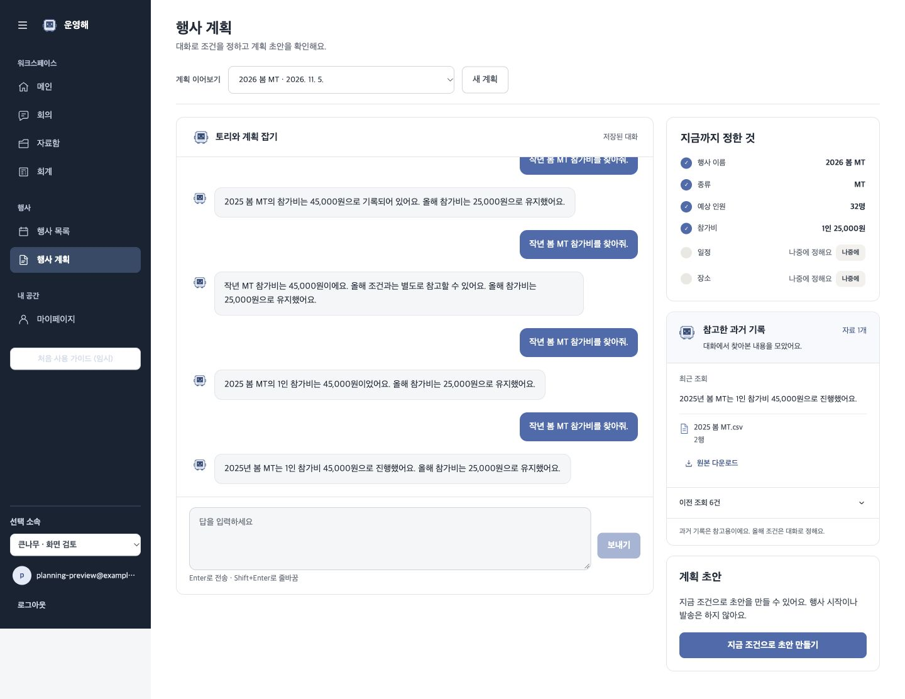
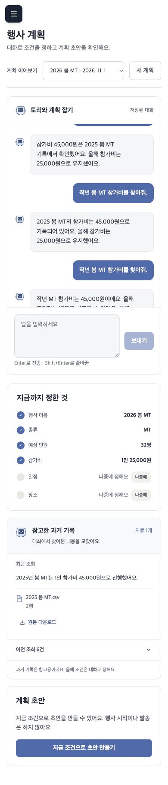
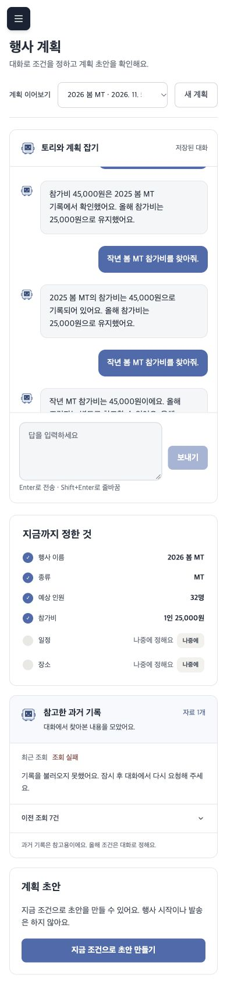
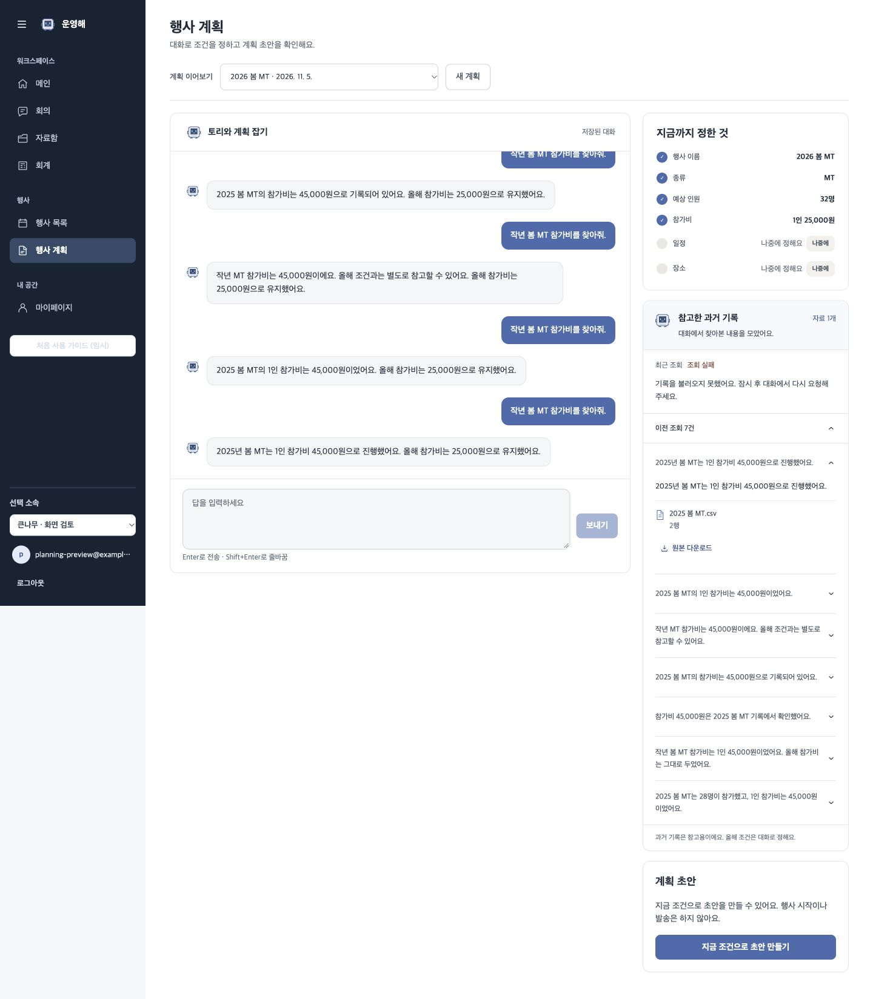

# 행사계획 참고 기록 · 화면 검증

2026-11-05, 최신 develop에 이번 참고 카드 변경을 통합한 제품 FE/BE의 실제 렌더다.
합성 CSV와 고정 모델·임베딩 응답을 사용했다. 제품 HTTP·pgvector·저장·스트리밍·복원 경로를 사용하며 실제 모델 품질이나 운영 배포 검증은 아니다.

## 확인한 흐름

1. 올해 조건을 32명·1인 25,000원으로 저장한다.
2. 과거 참가비 45,000원을 7번 조회한다. 현재 조건은 유지되고 출처 문서 수는 중복 없이 1개다.
3. 최근 결과에서 파일명·2행 위치·인증 원본 다운로드 버튼을 확인한다.
4. 다음 검색을 실패시키면 최근 조회에 실패를 알리고 이전 성공 조회 7건을 보관한다. 채팅의 작업 줄에도 조회 실패가 남는다.
5. 이전 조회 5건 뒤 ‘2건 더 보기’를 누르고 개별 조회를 펼쳐 출처를 확인한다.
6. 새로고침하면 실패 상태와 이전 조회 7건이 GET에서 복원된다. AI를 다시 호출하지 않는다.

현재 조건은 과거 조회·실패 뒤에도 32명·1인 25,000원이다. 실제 기록 ID와 권한 검증 파일 API를 사용하며 원본 다운로드 성공은 앞선 연결 검증에서 별도로 확인했다.

## 화면

- [데스크톱 1440px](desktop.jpg): 최근 성공 조회와 접힌 이전 목록.
- [모바일 390px](mobile.jpg): 채팅 → 현재 조건 → 참고 기록 → 초안 생성 순서.
- [모바일 조회 실패](failed-mobile.jpg): 최신 실패와 이전 성공을 구분.
- [이전 조회 펼침](archive.jpg): 이전 기록을 더 불러오고 개별 출처를 연 상태.

모바일

최신 실패와 이전 조회

## 적용·검사

대상 DB 설정을 확인하고 `be/`에서 `uv run alembic upgrade head`를 실행한다. 이번 작업은 사용자·운영 DB를 변경하지 않았고 임시 검증 DB만 사용했다.

- 조회 DTO·실제 검색/복원/마이그레이션 12개, 기존 계획 통합 18개: 30 passed.
- FE 계획 테스트: 30 passed.
- FE build 및 계획 파일 eslint 통과.
- 최신 두 Alembic head를 선행 revision으로 연결해 `20261105_planning_history` 단일 head 확인.
